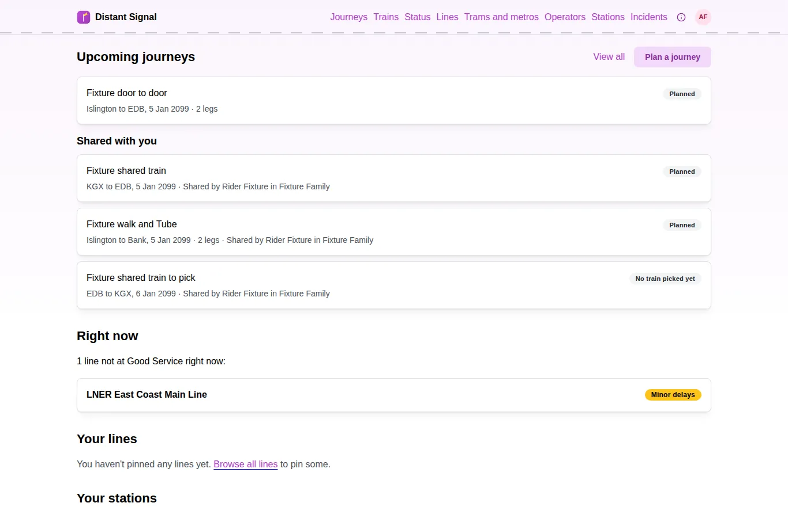
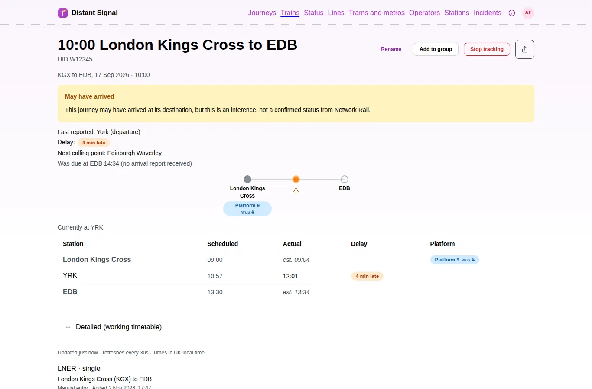
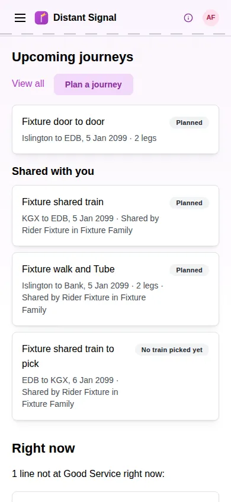
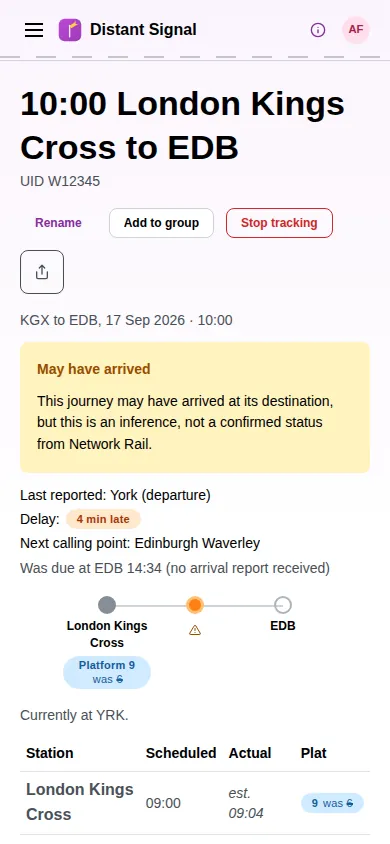
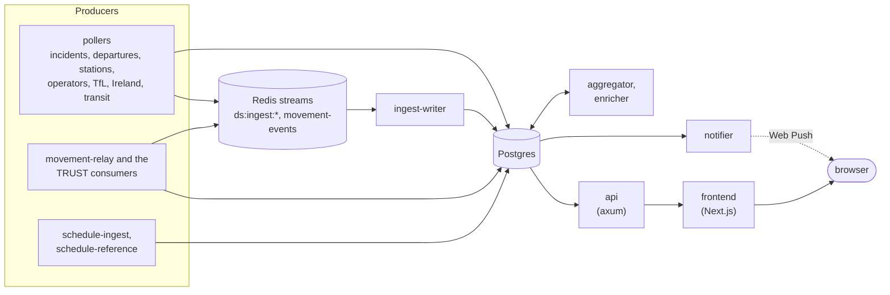

# Distant Signal

Distant Signal is a personal UK rail companion. It shows the status of every
line, tracks your trains and journeys as they run, plans trips and helps
with Delay Repay claims.

**Use it at [ds.cursed.solutions](https://ds.cursed.solutions/).**

<table>
  <tr>
    <th>Home</th>
    <th>A train</th>
  </tr>
  <tr>
    <td>
      <picture>
        <source media="(prefers-color-scheme: dark)" srcset="docs/screenshots/home-dark-1366.webp">
        
      </picture>
    </td>
    <td>
      <picture>
        <source media="(prefers-color-scheme: dark)" srcset="docs/screenshots/train-dark-1366.webp">
        
      </picture>
    </td>
  </tr>
  <tr>
    <td align="center">
      <picture>
        <source media="(prefers-color-scheme: dark)" srcset="docs/screenshots/home-dark-390.webp">
        
      </picture>
    </td>
    <td align="center">
      <picture>
        <source media="(prefers-color-scheme: dark)" srcset="docs/screenshots/train-dark-390.webp">
        
      </picture>
    </td>
  </tr>
</table>

The screenshots come from the e2e test fixtures, not real users' data (see
[Screenshots](#screenshots)).

## Features

- **Line status** for National Rail, TfL and the island of Ireland, in the
  style of TfL's Unified API. Disruption on a shared stretch of track shows
  on every line that uses it, and nowhere else.
- **Train tracking** from live movement data: each calling point's
  scheduled, expected and actual times, platforms, cancellations and the
  reason for a delay.
- **Journeys** of one or more legs, by train, tram, Tube, bus or on foot,
  with progress as you travel and Web Push notifications when something
  changes.
- **Trip planning** over the timetable, including Metrolink trams.
- **Stations and departure boards**, with nearby stations.
- **Groups**, to share trains and journeys with the people you travel with.
- **Tickets and Delay Repay estimates**, from the recorded times of the
  trains you took, and a record of how reliable your journeys have been.
- **A public API**, with delegated access for connected apps.

## Architecture

Distant Signal is a set of small Rust services around one Postgres
database, with a Next.js frontend. Producers write to Postgres directly or
to Redis streams, which `ingest-writer` applies. The `api` serves the
frontend and the public API. The workers derive line status, enrich
incident text and send notifications.

[`DESIGN.md`](DESIGN.md) has the full design: the data sources, the domain
model and the reasoning behind each choice.

### How line status works

Every line comes from the curated catalogue in [`lines/`](lines/), one TOML
file per passenger route ([`lines/SCHEMA.md`](lines/SCHEMA.md) has the
format). Each station on a line belongs to a named segment. A segment name
that appears on several lines is a shared trunk: an incident there shows on
every line that uses it. An incident on a segment unique to one line shows
only there. That distinction, for operators with parallel routes over
shared track such as SWR, Southeastern and Northern, is the project's
original core.

The matcher grades each incident-to-line match, from an exclusive segment
(most confident) down to an operator-only match, which is capped at Minor
Delays and dropped when a more precise match exists. Severities follow
TfL's scale, with two National Rail additions; `DESIGN.md` §5 has the
details.

## Repositories

The project is moving from this single repository into several, one at a
time. Repositories marked *planned* don't exist yet; until then their code
lives here.

| Repository | Role |
|---|---|
| [`distant-signal`](https://github.com/Distant-Signal/distant-signal) (this one) | The frontend and the project's front page. Today it also holds every service, the charts and the line catalogue. It owns all issues. |
| `ds-core` (planned) | The shared crates, the database schema and migrations, grants, the stream envelope and the line catalogue. |
| `ds-api` (planned) | The api, the trip planner and the timetable services. |
| `ds-ingest` (planned) | The train movement and timetable feeds and `ingest-writer`. |
| `ds-pollers` (planned) | The pollers. |
| `ds-workers` (planned) | `aggregator`, `enricher` and `notifier`. |
| `ds-deploy` (planned) | The Helm charts and the deploy tooling. |
| `ci` (planned) | Shared workflows, actions and the Renovate preset. |
| [`.github`](https://github.com/Distant-Signal/.github) | The organisation profile, the security policy, the contributing guide and the issue forms. |
| DS-MCP (hosted elsewhere) | An MCP server for Distant Signal. It consumes the public API. |

## Getting started

The repository holds a Rust workspace (`crates/`), the Next.js frontend
(`frontend/`), the Helm charts (`charts/`), the line catalogue (`lines/`)
and Python tooling (`scripts/`, managed with
[uv](https://docs.astral.sh/uv/)).

- **The whole stack, locally.** `docker-compose.yml` runs Postgres, Redis
  and every service. Copy `local.env.example` (optimised builds) or
  `dev.env.example` (debug builds and frontend hot reload) and run
  `docker compose --env-file local.env up --build`. The header of
  `docker-compose.yml` explains both modes. The feed URLs in the examples
  are placeholders, so a local stack has no live data until you add your
  own Rail Data Marketplace credentials or load `scripts/dev-seed.sql`.
- **Only the frontend.** In `frontend/`, `npm ci` then `npm run dev`, with
  `API_BASE_URL` pointing at a running api.
- **Deploying.** [`charts/distant-signal/README.md`](charts/distant-signal/README.md)
  documents the Helm chart.

The dev stack: Rust (axum, sqlx, tokio), Postgres 18, Valkey (Redis)
streams, Kafka for the TRUST feed, Next.js with Mantine, Playwright for the
e2e and visual tests, Helm, and Python tooling run with uv.
[`CLAUDE.md`](CLAUDE.md) lists the exact build, lint and test commands, and
[`CONTRIBUTING.md`](CONTRIBUTING.md) the tooling and checks.

### Screenshots

The screenshots above are taken from a local stack seeded with
`frontend/e2e/fixtures/seed.sql`, the e2e fixtures, logged in as the
fixture user. Chromium runs in the pinned Playwright container, as for the
visual tests (`scripts/visual-tests.py`), with the browser's clock fixed to
the fixtures' service date. They never show real users' data. They are
WebP files in `docs/screenshots/`, separate from the visual regression
baselines in `frontend/e2e/visual-baselines/`, which must stay byte-exact.

## Contributing

Bug reports, ideas and pull requests are welcome. Read the organisation's
[contributing guide](https://github.com/Distant-Signal/.github/blob/main/CONTRIBUTING.md)
and this repository's [`CONTRIBUTING.md`](CONTRIBUTING.md) first. All
issues live here, whatever area they concern, labelled `area:frontend`,
`area:api`, `area:core`, `area:ingest`, `area:pollers`, `area:workers` or
`area:deploy`.

## Security

Please report vulnerabilities privately, through
[GitHub's private vulnerability reporting](https://github.com/Distant-Signal/distant-signal/security/advisories/new),
never in a public issue. The
[security policy](https://github.com/Distant-Signal/.github/blob/main/SECURITY.md)
says what it covers and what to expect.

## Licence

AGPL-3.0-or-later: the GNU Affero General Public License, version 3 or (at
your option) any later version. The full text is in `LICENSE`. Every Cargo
crate, `frontend/package.json`, `pyproject.toml`, both charts and every
image carry the same licence.

Because the site is used over a network, AGPL §13 applies: every page's
footer links this repository, and the api's `/public/version` (`/api/version`
on the site) lists each running image with the commit it was built from.

`lines/` is part of this repository and under the same licence. Some files
in `reference-data/` are derived from upstream data under its own terms;
`reference-data/README.md` lists each file's source and terms.
