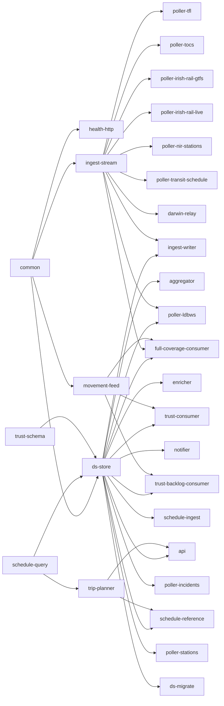
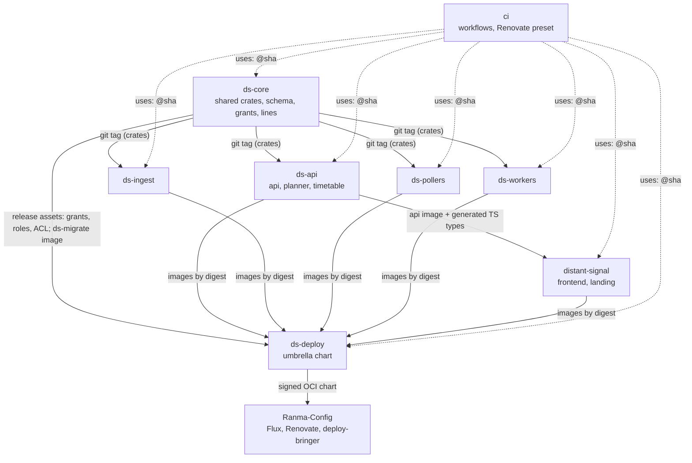

# Splitting the monorepo into the Distant-Signal organisation

Status: **the repo split is complete** (phases 1 to 9, 2026-11-02 to
2026-11-04). Phase 1 transferred the repository to
`Distant-Signal/distant-signal` and rewrote its history (§9, "Phase 1
record"); phases 4 (`ds-core`), 5 (`ds-deploy`), 6 (`ds-pollers`), 7
(`ds-ingest`), 8 (`ds-workers`) and 9 (`ds-api`) extracted the rest, with
records in §9. This repository now holds the frontend, the docs and the
dev stack. Only phase 10, the cleanup, remains: about 90 days after phase
9, so from early February 2027.
Task DS-261. Written 2026-11-02 against `main` at `01f5a7f2`. Revised
the same day after two decisions by the user:

- split thematically now, not on triggers;
- license every DS repository under AGPL-3.0-or-later.

Revised again the same day: the user accepted every recommendation in the
first list of open questions, and asked for a git history rewrite as part
of the migration (§5.11). The user then decided every rewrite question,
including a mainline squash. All of these are recorded in §10.1. The
history figures in §5.11 were measured against `main` at `cc44d13c`.

This spec moves Distant Signal (DS) from the single
`FasterSpeeding/Distant-Signal` repository into the GitHub organisation
[Distant-Signal](https://github.com/Distant-Signal), and splits it into
thematic repositories. It also re-evaluates the shared CI and utility code
that DS uses or could share.

**The plan in one paragraph.** Transfer the repository to
`Distant-Signal/distant-signal`. It keeps its stars, issues, PRs and
old-URL redirects, and it stays the landing repository and the frontend's
home. License everything AGPL-3.0-or-later before the transfer. In the same
frozen window as the transfer, rewrite the history once (§5.11):
- squash each mainline step into one commit, about 1,650 commits from
  5,365, each with the exact tree `main` had;
- use one author identity;
- remove Claude attribution;
- freeze the original history in a private archive.

Then cut
seams inside the monorepo and extract the shared libraries first, as
`ds-core`. After that, extract one repository at a time, each with
`git filter-repo` history:

- `ds-deploy`: the umbrella chart;
- `ds-pollers`;
- `ds-ingest`;
- `ds-workers`;
- `ds-api`: the api, the trip planner and the timetable pipeline.

Shared tooling goes to `Distant-Signal/ci`.

How the pieces fit:

- Shared crates are git dependencies pinned to `ds-core` tags.
- Schema, migrations, the checksum lock, Postgres grants and the Redis ACL
  belong to `ds-core` and ship as release assets.
- The frontend gets generated API types from the api image it pins for e2e.
- Images go to the stable path `ghcr.io/distant-signal/images/<service>`
  whichever repository builds them. `ds-deploy` pins their digests through
  Renovate, so the OCI chart URL Ranma-Config watches never changes again
  after phase 1.
- Every repository stays public, which is what keeps CI free.

Nothing on Forgejo moves (§8.2).

**Risk.** The coupling data in §2 was the case *against* splitting. The plan
treats it as the list of seams to engineer:

- 38% of changes since 2026-10-01 crossed code areas;
- 39 to 43% of api and frontend changes were joint;
- 78% of schema changes also touched the api.

Each of these gets a mechanism in §5: a version pin, an ordering check, or a
vendored artifact. Without those mechanisms the split would be fragile.

## 1. Inventory

### 1.1 Crates

There are 31 workspace members (`Cargo.toml`) with 469,618 lines of Rust.
"Commits" counts non-merge commits since the repository began (2026-07-05)
that touched the crate. "Image" means `containers.yml` builds an image for it.

| Crate | Theme | LOC | Workspace deps | Image | Commits |
|---|---|---:|---|---|---:|
| `common` | shared lib | 35,619 | none | | 255 |
| `health-http` | shared lib | 282 | common | | 5 |
| `trust-schema` | shared lib | 2,030 | none | | 23 |
| `schedule-query` | shared lib | 11,268 | none | | 75 |
| `ingest-stream` | ingest contract | 5,683 | common | | 31 |
| `movement-feed` | ingest lib | 3,831 | common, health-http | | 30 |
| `ds-store` | schema + SQL | 48,220 | common, schedule-query, trust-schema | | 114 (+61 migrations) |
| `ds-migrate` | schema | 583 | common, ds-store | ships in the api image | 8 |
| `trip-planner` | planner lib | 15,560 | schedule-query | | 60 |
| `api` | api | 184,020 | common, ds-store, schedule-query, trip-planner, trust-schema | api | 1,071 |
| `aggregator` | worker | 19,180 | common, ds-store, health-http | aggregator | 285 |
| `enricher` | worker | 36,396 | common, ds-store, health-http | enricher | 116 |
| `notifier` | worker | 18,043 | common, ds-store, health-http | notifier | 100 |
| `ingest-writer` | ingest | 9,540 | common, ds-store, health-http, ingest-stream | ingest-writer | 63 |
| `movement-relay` | ingest (Kafka) | 3,744 | common, health-http, trust-schema | movement-relay | 33 |
| `darwin-relay` | ingest | 1,685 | common, health-http, ingest-stream | darwin-relay | 2 |
| `trust-consumer` | ingest | 8,565 | common, ds-store, health-http, movement-feed, trust-schema | trust-consumer | 97 |
| `trust-backlog-consumer` | ingest | 4,506 | same as trust-consumer | trust-backlog-consumer | 56 |
| `full-coverage-consumer` | ingest | 9,573 | common, ds-store, health-http, ingest-stream, movement-feed, schedule-query, trust-schema | full-coverage-consumer | 93 |
| `schedule-ingest` | schedule | 15,361 | common, ds-store, health-http | schedule-ingest | 48 |
| `schedule-reference` | schedule | 10,728 | common, ds-store, health-http, schedule-query, trip-planner | schedule-reference | 107 |
| `poller-transit-schedule` | schedule (transit) | 7,825 | common, health-http, ingest-stream | yes | 16 |
| `poller-incidents` | poller (Postgres) | 1,589 | common, ds-store, health-http | yes | 35 |
| `poller-stations` | poller (Postgres) | 1,069 | common, ds-store, health-http | yes | 31 |
| `poller-ldbws` | poller (stream) | 5,469 | common, ds-store, health-http, ingest-stream | yes | 45 |
| `poller-tfl` | poller (stream) | 2,823 | common, health-http, ingest-stream | yes | 49 |
| `poller-tocs` | poller (stream) | 449 | common, health-http, ingest-stream | yes | 25 |
| `poller-irish-rail-gtfs` | poller (stream) | 1,260 | common, health-http, ingest-stream | yes | 18 |
| `poller-irish-rail-live` | poller (stream) | 903 | common, health-http, ingest-stream | yes | 15 |
| `poller-nir-stations` | poller (stream) | 855 | common, health-http, ingest-stream | yes | 15 |
| `line-catalogue-validator` | tool | 2,959 | common | none (CI and manual) | 21 |

The fan-in is what matters:

- `common`: 27 dependents, every crate except `schedule-query`, `trip-planner`
  and `trust-schema`.
- `health-http`: 21 dependents.
- `ds-store`: 14 dependents, each with Postgres access.
- `ingest-stream`: 10 dependents, the stream producers plus `ingest-writer`.
- `schedule-query`: 5 dependents (`ds-store`, `api`, `trip-planner`,
  `schedule-reference`, `full-coverage-consumer`).
- `trip-planner`: 2 dependents, `api` and `schedule-reference`. The planner is
  not api-private: schedule-reference precomputes with it.



### 1.2 Everything else in the repository

| Area | What | Size |
|---|---|---|
| `frontend/` | Next.js app router and Mantine 9. It has a hand-written API client (`lib/api.ts`, 1,500 lines, no generated types), vitest, and the Playwright e2e and visual suites (172 baseline images). | 156k lines of TS/TSX |
| `charts/distant-signal` | One chart for the whole stack: 57 templates, `values.yaml` 7,044 lines, `_helpers.tpl` 3,576 lines. It holds `files/db-grants.yaml` (625 lines), the rendered `files/postgres-grants.sql` (1,371 lines), the Redis ACL template and the PrometheusRule. | 409 commits |
| `charts/ds-ingest-bucket` | A Crossplane chart (GCS bucket, IAM, audit). It is published as its own OCI artifact, and Ranma-Config's Renovate rule for it is disabled. | 6 commits |
| `lines/` | The curated line catalogue, 247 TOML files. The aggregator and api images copy it in, and `common::matcher` reads it. | 302 commits |
| `reference-data/` | CSVs and TSVs. `common`, `api` and `poller-transit-schedule` embed them with `include_str!`. The trust-consumer image copies the whole directory in. | |
| `docker/` | 21 Rust Dockerfiles generated by `scripts/gen-rust-dockerfiles.py`. Each one copies the whole workspace (`COPY . .`) with cargo-chef. | |
| `scripts/` | 31 typed Python scripts (below) and `scripts/tests`. | 186 commits |
| `.github/workflows` | `ci.yml` (4,057 lines, 17 jobs), `containers.yml` (895 lines, a 22-image matrix plus the chart push), `dependency-scan.yml`, `prune-buildcache.yml`, `validate-line-catalogue.yml`. | 247 commits |
| `docs/` | 306 Markdown files: runbooks, the API changelog, specs, and the dated `docs/superpowers` history. | |
| Root | `renovate.json5`, `deny.toml`, `pyproject.toml`/`uv.lock`, compose files, `authentik-blueprints/`. | |

The scripts fall into groups by what they touch:

- **Chart checks** (`check-*-chart.py`, 9 scripts, about 6,200 lines) and
  `chart-values-doc.py`. All of them know the DS chart's values paths.
- **Database:** `gen-db-grants.py`, `test-postgres-roles.py`,
  `observe-role-usage.py`, `check-migration-order.py`, `db-tests.py`, and
  `render-redis-acl.py` (for Redis).
- **Generic lint and CI:** `lint-scripts.py`, `lint-containers.py`,
  `paths-changed.py` and `check-bench-gates.py`. None of them names DS.
- **Code generation:** `gen-rust-dockerfiles.py` and
  `generate-pass-through.py`.
- **Frontend:** `check-copy.py`, `visual-tests.py` and the
  `tfl-arrivals-stub.py` e2e stub.
- **One-off analysis and backfills:** `fc-windowed-analysis.py`,
  `measure-transit-trip-planning.py`, `backfill-*.py`, and the `*.sql` and
  `test-*.sh` remediations.

### 1.3 Cross-cutting couplings

These are what any split has to cut.

1. **Schema and migrations.** There are 223 sqlx migrations in
   `crates/ds-store/migrations`, forward-only and immutable once merged. The
   checksum lock is `crates/api/tests/migration_checksums.lock`, 225 lines.
   It sits in the **api** crate, not `ds-store`, which is one reason 78% of
   store changes also touch the api. The lock and index-locking tests
   (`migration_checksums.rs`, `migration_index_locking.rs`) are api tests.
   `check-migration-order.py` compares migrations against `origin/main`.
2. **The schema gate.** `ds-store/src/schema.rs` makes every DB service wait
   for two things: the newest migration embedded in its build, and every
   privilege its role is given. `crates/ds-store/build.rs` reads
   `../../charts/distant-signal/files/db-grants.yaml` **at compile time**.
   The schema crate depends on a file inside the chart.
3. **DB roles and grants.** `db-grants.yaml` classifies every table, view,
   sequence and function. It gives 13 service roles (`api`, `aggregator`,
   `enricher`, `notifier`, `writer`, `schedule_reference`, `stations`,
   `incidents`, `schedule_ingest`, `trust_backlog`, `trust_consumer`,
   `full_coverage_ro`, `ldbws_ro`), 2 groups and 4 other roles their
   privileges. `gen-db-grants.py render` writes `postgres-grants.sql`, which
   the chart's roles Job runs. `gen-db-grants.py check` runs in CI against a
   freshly migrated database. Since July, 56% of grants changes came with a
   migration and 56% with an api change.
4. **Chart files read by crate tests.** Ten Rust files read chart files
   directly: the Redis ACL template (`common/tests/redis_acl.rs`), chart
   values (`ingest-stream/tests/chart_values.rs`), and the api's rate-limit
   and config defaults (`api/src/data/config.rs`, `api/src/rate_limit.rs`),
   among others.
5. **Shared DB test harness.** `ds-store`'s `test-support` feature is used by
   api, notifier, trust-consumer and trust-backlog-consumer. CI builds one
   cargo-nextest archive (`rust-db-build`). Three jobs then run every
   `#[ignore]` DB test from it: as the superuser, as the app role, and as
   each service's own role. `db-tests.py` lists the passes, which cover ten
   crates.
6. **Golden and differential data.** `ingest-stream/tests/golden.rs` and its
   fixtures pin the v1 envelope wire format "between producers and the
   writer, which ship separately". This boundary is already designed for
   independent releases. `trip-planner/tests/differential.rs` checks CSA
   against RAPTOR, inside one crate. Other fixtures live in
   `schedule-query`, `schedule-ingest`, `darwin-relay`,
   `poller-transit-schedule` and `common`, plus `enricher/eval/dataset.jsonl`.
   All of them are crate-local.
7. **The api and frontend contract.** The Rust types are serde with
   camelCase. The TypeScript side is hand-mirrored in `frontend/lib/api.ts`,
   with no generated schema. Changes are recorded in `docs/api-changelog.md`,
   which DS-MCP also reads; its client cites entries by date. CI's
   `frontend-e2e` job builds the api **from source** and runs it against
   `frontend/e2e/fixtures/seed.sql`, which depends on the current migrations.
8. **The chart and the images.** `containers.yml` builds all 22 images on
   every push to `main`. `push-helm-chart` then pins every digest into
   `values.yaml` through a hard-coded `SERVICE_TO_PATH` map. It packages the
   chart as `0.4.1+build.<run>.sha.<short>`, pushes it to
   `oci://ghcr.io/fasterspeeding/charts`, and signs it with cosign keyless,
   with three retries. The chart is the only versioned release unit: an image
   is never deployed except through a chart build. `global.imageRegistry`
   keeps the **last two path segments** of every image repository, so the
   path shape `<registry>/<namespace>/distant-signal/<svc>` is load-bearing.
9. **Data baked into images.** `lines/` goes into the api and aggregator
   images, and `reference-data/` into trust-consumer. `include_str!` CSVs
   are embedded in common, api and poller-transit-schedule.
10. **Owner-specific strings.** 225 occurrences of `FasterSpeeding` in 51
    files. The ones that matter at runtime:
    - `common::user_agent::PROJECT_URL`, sent to every upstream data provider;
    - the alert `runbook_url`s in the PrometheusRule and its tests;
    - `IMAGE_BASE` and the chart destination in `containers.yml`;
    - `prune-buildcache.yml`'s package name;
    - every `image.repository` default in `values.yaml`.

## 2. Evidence (risk context)

These numbers argued against splitting. With the split decided, they are
the list of seams the designs in §5 must handle.

### 2.1 What changes together

"Changes" are first-parent commits on `main`: merged PRs and direct commits,
with each merge diffed against its first parent. Paths are grouped into ten
areas:

- **api**: `api` plus `docs/api-changelog.md`;
- **frontend**;
- **chart**: both charts;
- **ci**: `.github`, `scripts`, `docker`;
- **store**: `ds-store`, `ds-migrate`, migrations;
- **common**: `common`, `health-http`, `line-catalogue-validator`, `lines/`;
- **ingest**: the relays, consumers, `ingest-*`, `movement-feed`,
  `trust-schema`;
- **schedule**: `schedule-*`, `trip-planner`;
- **pollers**;
- **workers**: aggregator, enricher, notifier.

| Window | Changes | Touch 2+ areas | Touch 2+ code areas (ci and chart excluded) |
|---|---:|---:|---:|
| All history (2026-07-05 on) | 1,388 | 589 (42%) | 450 (32%) |
| Since 2026-10-01 | 512 | 265 (52%) | 196 (38%) |

Coupling is rising, not falling, as the project matures.

The strongest pairs since 2026-10-01 are below. A percentage is the share of
the first area's changes that also touched the second, then the other way
round.

| Pair | Changes | Share |
|---|---:|---|
| chart + ci | 98 | 63% / 65% |
| api + frontend | 89 | 39% / 43% |
| api + chart | 78 | 34% / 50% |
| api + store | 76 | 33% / **78%** |
| chart + store | 54 | 35% / 56% |
| chart + ingest | 47 | 30% / 60% |
| api + ingest | 46 | 20% / 59% |
| api + common | 45 | 20% / 67% |
| common + ingest | 41 | 61% / 53% |
| api + schedule | 42 | 19% / 70% |

At commit level since 2026-01-01 (4,115 non-merge commits), the clearest
clusters are these:

- aggregator with `lines/`: 52% of aggregator commits;
- api changelog with api: 74%;
- migrations with api: 80%;
- `trust-backlog-consumer` with `trust-consumer`: 61%;
- `full-coverage-consumer` with the other two TRUST consumers: 32 to 35%;
- `scripts/` with the chart: 55%.

The island-of-Ireland and TfL pollers are the quietest code: 15 to 49
commits each, mostly alongside `common` or `ingest-stream`.

### 2.2 CI

These figures come from the last 20 successful `ci.yml` runs on `main`.

- **Wall time:** minimum 10.3 minutes, median 14.1, maximum 72 (queueing).
- **Job time per run:** 66 job-minutes in run 41408892594. The largest jobs
  are Playwright (13.6), cargo build and test (11.2), frontend (9.9),
  scripts-lint (6.1), and the three DB passes (5.6, 4.3 and 5.4) off a
  3.6-minute archive build.
- **Containers:** median 8 minutes, maximum 19 (`containers.yml`).
- **Volume:** in the week to 2026-11-02, each of CI, Containers and the
  dependency scan ran about 166 times. CI alone is about 11,000 job-minutes
  a week.

The repository is **public**, so these minutes cost nothing on
GitHub-hosted runners. The organisation is on the Free plan. A **private**
repository there gets 2,000 minutes a month, which DS's CI would use up in
about a day and a half. **Every repository in the organisation has to stay
public, or the CI bill changes the whole calculation.**

### 2.3 Repository facts

- 5,360 commits since 2026-07-05 and a 194 MiB pack.
- 142 PRs and 6 issues (4 open), 1 star, no forks.
- No branch protection or rulesets, no repository secrets or variables, and
  no environments. The workflows use only `GITHUB_TOKEN` and OIDC.
  `validate-line-catalogue.yml` is `workflow_dispatch` only. Its
  `schedule:` and its `RDM_API_KEY`/`RDM_TOCS_BASE_URL` env lines are
  commented out, and it has never run, so there is nothing to migrate.
- No `LICENSE` and no `SECURITY.md`. Homepage `https://ds.cursed.solutions/`.
  No description, no topics.
- Authors since 2026-10-01: FasterSpeeding (1,857 commits, under the
  address §5.11.1 replaces) and `mine-bringer-renovate[bot]` (25). The
  whole-history identity counts are in §5.11.1.

## 3. Target layout

### 3.1 Repositories

All repositories are public and licensed AGPL-3.0-or-later.

| Repository | Contents | Images it builds | Why this boundary |
|---|---|---|---|
| `distant-signal` (landing; the transferred repository) | `frontend/`, the landing README, `CONTRIBUTING.md`, the dev-stack compose file (pulls every image), `docs/superpowers` (historical record), `docs/specs`, `check-copy.py`, `visual-tests.py`, `tfl-arrivals-stub.py`; as built, also `release-order.py` (the frontend's image labels), `sync-core.py` with `core-version`, `check-sftp-entrypoint.py` and `sync-api-types.py` | frontend | Highest change rate (1,263 commits). It is what users see. It keeps the history, stars and redirects. |
| `ds-core` | `common`, `ds-runtime` (the domain-free half of `common`, §5.8), `health-http`, `trust-schema`, `schedule-query`, `ingest-stream`, `ds-store` with migrations and the checksum lock, `ds-migrate`, `line-catalogue-validator`, a new `ds-lines` crate that embeds `lines/`, core `reference-data/`, `db-grants.yaml`, the Redis ACL source, and the DB scripts (`gen-db-grants.py`, `render-redis-acl.py`, `test-postgres-roles.py`, `observe-role-usage.py`, `check-migration-order.py`, `check-crate-deps.py`) | ds-migrate | Everything with fan-in: `common` has 27 dependents, `ds-store` 14 and `ingest-stream` 10. It is the one owner of the schema, grants, stream envelope and line catalogue. |
| `ds-api` | `api`, `trip-planner`, `schedule-ingest`, `schedule-reference`, `docs/api-changelog.md`, the api-only `reference-data` CSVs (station groups, TOC codes, operator names and groups, fixed-link operators); as built, also `docs/specs/personal-api-tokens.md`, `docs/personal-data-retention.md`, the other api docs and the remediation scripts (`remediate-*.sql` and their `test-remediate-*.sh`) | api, schedule-ingest, schedule-reference | Since July, `trip-planner` changed with api in 38% of its commits, `schedule-reference` in 42% and `schedule-query` in 43%. `schedule-reference` links `trip-planner`. The two schedule crates share a pod and a PVC. Keeping planner and timetable with the api keeps those changes in one repository. |
| `ds-ingest` | `ingest-writer`, `movement-relay`, `darwin-relay`, `trust-consumer`, `trust-backlog-consumer`, `full-coverage-consumer`, `movement-feed` (only these consumers use it), `stanox-crs.csv` | 6 | The three TRUST consumers change together (32 to 61%). It holds the Kafka and stream runtime and the ingest runbooks. |
| `ds-pollers` | the 8 `poller-*` crates, `poller-transit-schedule`, the transit `reference-data` | 9 | The quietest code (15 to 49 commits each). Six of the nine talk to the rest only through the golden-pinned `ingest-stream` envelope. |
| `ds-workers` | `aggregator`, `enricher` (with `eval/`), `notifier` | 3 | Separate `ds-store` consumers at a moderate change rate. Aggregator's churn on `lines/` moves to `ds-core` bumps (§5.2). |
| `ds-deploy` | `charts/distant-signal`, `charts/ds-ingest-bucket`, `scripts/alert-rules-tests`, `check-*-chart.py`, `chart-values-doc.py`, `check-alert-payloads.py`, `docs/alerts.md` and the deploy runbooks | none (charts) | The deploy unit. It pins every image by digest and is the only thing Ranma-Config watches. Chart and CI changes went together 63% of the time, so the chart takes its CI with it. |
| `ci` | reusable workflows, composite actions, the Renovate preset, generic scripts (§8.3) | none | Shared by the 7 code repositories. |
| `.github` | `profile/README.md`, default `SECURITY.md`, `CONTRIBUTING.md`, issue forms | none | Organisation presentation and defaults. |

That makes 7 code repositories plus `ci` and `.github`, against 31 crates and
22 images. `ds-ingest-bucket` goes into `ds-deploy` rather than its own
repository. It is a chart, already versioned and pushed on its own, and one
deploy repository is simpler than two.

Under §2.1's grouping, the rejected per-service split (about 30
repositories) would have made nearly every pollers, workers and ingest change
a core bump plus a service change, with no gain in deploy independence. One
chart stays the deploy unit (§5.4).

### 3.2 Dependencies between repositories



The rules:

- No service repository depends on another service repository. The one
  exception is the frontend pinning the api image, for e2e tests and types.
- Only `ds-core` publishes Rust code.
- Only `ds-deploy` publishes something Ranma-Config consumes.

## 4. The landing repository

### 4.1 Which repository

The landing repository is **`Distant-Signal/distant-signal`, the transferred
`FasterSpeeding/Distant-Signal`**. It keeps the frontend, which is the user's
default. As services are extracted it ends up as the frontend plus the
project front page.

| Candidate | For | Against |
|---|---|---|
| **The transferred repository, keeping the frontend (chosen)** | The history (squashed per mainline step, §5.11), the star, the 142 PRs and the issues stay. Every old link redirects: Ranma-Config, the deploy records, Renovate PR bodies, DS-MCP comments, old alert annotations. | Its history is the whole monorepo's, which is useful: `contract:` migration headers cite its commits, resolved through the migration ledger (§5.11.8, §5.11.9). |
| A new frontend repository | A clean start. | Loses the stars, issues and PR history, and the old links would point at an archived repository. |
| A thin meta or docs repository | A front page independent of code churn. | Nothing to build, so the README drifts. It adds a hop. The `.github` profile already plays this role at the organisation level. |
| `ds-core` | The technical centre. | Not what visitors come for. Its README is for crate consumers. |

### 4.2 What it carries

- **README as the front page.** Today's 158-line README is a developer
  overview. Restructure it in this order:
  1. what DS is, in two sentences;
  2. a link to https://ds.cursed.solutions/;
  3. four screenshots: home and train page at 390 px and 1366 px, light and
     dark;
  4. a feature list;
  5. an architecture overview, a Mermaid diagram of producers to Postgres or
     Redis streams to ingest-writer, api and frontend, notifier;
  6. the repository index (§3.1);
  7. links to "Run it locally" and "Contributing".

  Generate the screenshots from the seeded e2e stack inside the pinned
  Playwright container (the `visual-tests.py` route) into
  `docs/screenshots/`, so they are reproducible and never show real user
  data. Don't reuse `frontend/e2e/visual-baselines/`: those are test
  baselines and must stay byte-exact.
- **Repository index.** Every organisation repository and its role. Add a
  row for DS-MCP saying that it is hosted elsewhere and consumes the public
  API, without linking a tailnet URL.
- **Contributing and dev setup across repositories.** `CONTRIBUTING.md`
  covers the following.
  - **Full stack locally.** The landing repository's `docker-compose.yml`
    pulls every image from `ghcr.io/distant-signal/images/*`, using the
    digests pinned in `ds-deploy`'s `values.yaml`. A small script,
    `scripts/dev-stack.py`, writes them into `.env`. Setting
    `DS_<SERVICE>_SRC=../ds-ingest` builds that service from a local
    checkout instead.
  - **Working across repositories.** For example, changing `ds-core` and
    a service together, through a local Cargo `[patch]` (§5.2).
  - The per-repository toolchain commands from today's `CLAUDE.md`. Each
    repository gets its own `CLAUDE.md`, with the shared conventions in
    `ci/docs/conventions.md`.
- **Issue tracker home.** The landing repository owns *all* issues,
  cross-cutting and per area, with area labels: `area:frontend`, `area:api`,
  `area:core`, `area:ingest`, `area:pollers`, `area:workers`, `area:deploy`.
  The other repositories disable Issues and point here through the
  `.github` issue-form config. The worklog/Vikunja cards stay the working
  tracker. GitHub Issues are for external reports and anything that needs a
  public link.
- **Security policy and licence.** `SECURITY.md` lives in `.github`, so it
  is the default for every repository. It uses GitHub private vulnerability
  reporting and covers the site, the API (including delegated access) and
  the images. The AGPL-3.0-or-later `LICENSE` is in §6.

### 4.3 Organisation-level presentation

- **`Distant-Signal/.github/profile/README.md`:** three lines on what DS is,
  the site link, one screenshot and the repository index. Keep it short and
  point to the landing README.
- **Pinned repositories:** `distant-signal` first, then `ds-api` and
  `ds-core`.
- **Description:** "A personal UK rail companion: line status, train and
  journey tracking, trip planning and Delay Repay support." Homepage: the
  site. Topics: `rail`, `uk`, `trains`, `transport`, `rust`, `nextjs`,
  `helm`, `postgres`, `agpl`. Each other repository gets a one-line
  description and the shared topics.
- **Organisation avatar:** the app icon (`frontend/public/icon-512.png`).

### 4.4 Transfer, not archive

Transfer the existing repository and extract the services out of it. Don't
archive it and start fresh.

A GitHub transfer keeps issues, PRs, stars, watchers, releases and wiki. It
redirects old web and git URLs until somebody creates a repository at the
old name, so never create one. A rename on transfer
(`Distant-Signal` to `distant-signal`) is also redirected.

Archiving would break existing links and duplicate the name in search, and
every extract would need a fresh history.

The transfer keeps the repository; it does not keep the SHAs. The history
rewrite (§5.11) runs in the same frozen window and force-pushes `main`
once, after squashing it to one commit per mainline step. Old PR pages keep showing the original commits, because GitHub
manages `refs/pull/*` and they can't be rewritten. The original history
stays complete in the private archive (§5.11.7).

Treat redirects as a convenience only. Update explicitly in phase 1:

- the Flux verification regex;
- Renovate's `sourceUrl`;
- the task-bringer repository list;
- the User-Agent URL.

## 5. Designs

### 5.1 Schema, migrations, grants and the Redis ACL: owned by `ds-core`

**What `ds-core` owns:**

- `crates/ds-store/migrations/`, which stays forward-only and immutable;
- the checksum lock and its tests, moved from `crates/api/tests` to
  `crates/ds-store/tests`: `migration_checksums.lock`,
  `migration_checksums.rs` and `migration_index_locking.rs`;
- `check-migration-order.py`;
- `ds-migrate`, with **its own image** (`images/ds-migrate`). Today it ships
  inside the api image. The chart's migrate hook Job and the schema-owner
  backfills switch to it.

**Grants and ACL source.** `db-grants.yaml` moves to
`crates/ds-store/db-grants.yaml`, so `build.rs` reads a file inside its own
crate rather than the chart. The Redis ACL template (`redis-users.acl.tpl`)
moves to `ds-core/access/`, and `render-redis-acl.py` and `gen-db-grants.py`
move with it. `common/tests/redis_acl.rs` keeps checking that the Redis
commands the code issues are in the ACL, now against a file in the same
repository.

**Release assets.** Every `ds-core` tag `vX.Y.Z` publishes:

- the crates, at the git tag (§5.2);
- `images/ds-migrate:vX.Y.Z`;
- GitHub release assets: `db-grants.yaml`, `postgres-grants.sql`,
  `postgres-roles.sql`, `postgres-roles-setup.sh` (the roles Job's
  entrypoint, which ds-core's role tests run), `redis-users.acl.tpl` and
  `render-redis-acl.py` (the chart's phase 0 check renders with it) and the
  line catalogue validator's `site-credits.json` (which sources
  `/attribution` must credit; the web app's tests read the vendored copy), each
  with a Sigstore bundle from `cosign sign-blob` under
  `.github/workflows/release.yml@refs/tags/vX.Y.Z`, and `SHA256SUMS`.

**Vendoring into the chart.** `ds-deploy` keeps a file `core-version`.
Renovate bumps it through a `github-releases` custom manager. In the same PR,
`ds-deploy/scripts/sync-core.py` downloads the assets, verifies them and
writes them into `charts/distant-signal/files/`. The same PR also bumps
`migrate.image` to the matching `ds-migrate` digest. CI fails when the
vendored files differ from the release.

**Version labels.** Every service image carries
`org.distant-signal.core-version=<tag>`, read from its `Cargo.lock`. The
schema gate already makes a service wait (not ready) until the database has
its `REQUIRED_MIGRATION` and its role holds the grants baked in from
`db-grants.yaml`.

**Ordering checks in `ds-deploy` CI:**

1. **Expand.** For every image pinned in `values.yaml`, its `core-version`
   must be at most the pinned `ds-migrate` version. A service can't
   reach prod expecting a migration or grant that the chart wouldn't run.
   The check reads labels with `crane config` over the public registry.
2. **Contract.** A destructive migration's header gains a version:
   `-- contract: <what> (code stopped using it in <commit>; safe after core vA.B.C)`.
   `ds-core`'s release workflow reads `ds-deploy`'s `main` `values.yaml`.
   It refuses the tag while any pinned image has a `core-version` older than
   `vA.B.C`. That is today's "ships a release after the code stopped using
   it" rule, made mechanical.

**DB tests in other repositories** (decided at phase 4). A repository
with `#[ignore]` DB tests uses `ci`'s reusable `rust-db-tests.yml`, which
starts Postgres and Valkey and runs the repository's passes from its own
`db-tests.toml` (today's `db-tests.py` passes, split by crate). The schema
and roles come from the ds-core commit its `Cargo.lock` pins:
`scripts/core-checkout.py` clones that tag and checks the commit, the
passes run that checkout's migrations (`sqlx migrate run`), and the role
passes run that checkout's own `scripts/test-postgres-roles.py`, which
applies the release's `access/postgres-roles.sql` and
`postgres-grants.sql`. Nothing in `ci` changes, and no repository keeps a
copy of ds-core's DB scripts.

**Requesting a grant.** A service that needs a new grant opens a `ds-core`
PR changing `db-grants.yaml`, alongside the migration if there is one, then
bumps core. The schema gate keeps it unready until the roles Job has run.

### 5.2 How shared crates are consumed: git tags

**Decision: git dependencies on the public `ds-core` repository, pinned by
tag.**

```toml
# each consumer's workspace Cargo.toml
[workspace.dependencies]
common    = { git = "https://github.com/Distant-Signal/ds-core", tag = "v0.4.0" }
ds-store  = { git = "https://github.com/Distant-Signal/ds-core", tag = "v0.4.0" }
# ... one line per core crate, all on the same tag
```

`Cargo.lock` records the exact commit. In `deny.toml`, `allow-git` gets
exactly `https://github.com/Distant-Signal/ds-core`. `unknown-git = "deny"`
stays.

**Why not a registry:**

- **crates.io** would publish 10+ workspace-internal crates as a public API
  with semver promises and permanent versions. Names like `common` aren't
  available.
- **The Forgejo Cargo registry** can't be reached from GitHub-hosted runners
  (§8.1).
- **A hosted private registry** adds cost, a token secret in every
  repository, and a single point of failure.

Git tags need no infrastructure. The repository is public, so cargo fetches
over HTTPS without auth.

**Version-bump workflow:**

1. **Change in `ds-core`.** PRs merge to `main` as today. Releases are
   deliberate: `workflow_dispatch` on `release.yml` with `bump: patch|minor`.
   It runs `scripts/release.py`, which:
   - bumps `workspace.package.version`;
   - prepends `CHANGELOG.md` from the merged PR titles since the last tag,
     flagging migrations, grants and ACL changes and contract migrations;
   - tags `vX.Y.Z`;
   - builds and signs `ds-migrate`;
   - attaches the access assets.
2. **Versioning.** While on `0.x`, a breaking Rust API change or a contract
   migration is a minor bump. Anything else is a patch. Every migration is
   at least a patch release, so the schema version is the core version.
3. **Consumers.** Renovate (the `ci` preset) groups all `ds-core` crates
   into one PR per repository, `renovate/ds-core`. That PR updates every
   `tag =` line and `Cargo.lock`. The git dependencies use Renovate's cargo
   manager. Confirm tag tracking with `renovate --platform=local
   --dry-run=extract`. If it doesn't work, a regex custom manager on
   `tag = "v..."` with the `git-tags` datasource does. The PR's CI is the
   compatibility test, and it automerges when green. *As built:* Renovate
   is installed but has not run yet, so until it does these bumps are hand
   PRs.
4. **Developing across repositories.** Use a local, uncommitted patch:
   `cargo --config 'patch."https://github.com/Distant-Signal/ds-core".common.path="../ds-core/crates/common"' test`.
   Open the `ds-core` PR, release, then open the consumer PR on the new
   tag. *As built:* the planned helper, `ci/scripts/core-patch.py`, was not
   written (decision D6, §10.2), so the `--config` lines are passed by
   hand (each service README shows one). And `.cargo/config.toml` is not
   git-ignored: it is tracked, holding the `DS_PROJECT_URL` default, and
   each service repository and `ds-core` carries a copy.

### 5.3 Generated API types and cross-repo api and frontend changes

**Types.** Derive TypeScript from the api's serde types with `ts-rs`. It
honours `#[serde(rename_all = "camelCase")]`, `Option` and enums.

- `ds-api` CI regenerates `api-types/api.ts` and fails if the committed copy
  is stale.
- The api image bakes the file in at `/usr/share/distant-signal/api-types.ts`.
- The image's tag (`build.<run>-<sha>`) is the types' version.

**Consumption by the frontend.** No npm registry is needed. GitHub's npm
registry requires a token even for public packages, and npmjs would need an
organisation and a secret.

- The frontend keeps one pin, `frontend/api-image.txt`, holding
  `ghcr.io/distant-signal/images/api:<tag>@sha256:...`. Renovate bumps it.
- The api image carries the types and the personal-token API's OpenAPI
  document (`/usr/share/distant-signal/api-types.ts` and
  `openapi-v1.json`). `scripts/sync-api-types.py` copies both out of that
  exact image, checking the tag, manifest and layer digests against the
  pin, into `frontend/lib/api-types.ts` and `openapi-v1.json`, and CI
  checks the copies match and that the OpenAPI copy has no breaking
  change. `sync-api-types.py pin --latest` is the hand bump.
- `lib/api.ts` keeps its fetch helpers but imports every request and
  response type. The hand-mirrored interfaces go.
- e2e runs the same pinned image, migrated with the `ds-migrate` version
  from the image's `core-version` label, and then `seed.sql`.
- DS-MCP can fetch the same files from the public image (service
  repositories make no releases).

**The process for a change across api and frontend.** This applies to the
39 to 43% of changes that touched both (§2.1).

1. **The `ds-api` PR** adds the field or route. It must be additive: a new
   optional field, or a new route. It includes regenerated types and a
   `docs/api-changelog.md` entry. Merge it, and the api image is published.
2. **Renovate** opens the frontend's api-pin PR with the new types. The
   developer pushes the frontend change onto that PR, or onto a branch built
   on it. e2e runs against the new api image. Merge it, and the frontend
   image is published with `org.distant-signal.api-build=<api tag>`.
3. **`ds-deploy`'s ordering check:** the frontend image's `api-build` must
   be at most the pinned api image's build. A chart can't ship a frontend
   that expects an api it doesn't deploy. Normally both bumps land in the
   same grouped image PR (§5.4), so they deploy together.
4. **Removing or renaming a field** is a later `ds-api` PR, made only after
   the deployed frontend no longer reads it. DS-MCP is checked through the
   changelog, as today.
5. **A change that must switch on at once** ships dark behind an
   off-by-default chart value. Both halves deploy, then one `ds-deploy`
   values change turns it on.

### 5.4 Chart and deploy: one umbrella chart, per-service images

**Decision: one umbrella chart in `ds-deploy`; images versioned per
service.** Per-service charts would mean:

- 22 HelmReleases and `version.yaml` files in Ranma-Config;
- 22 Renovate PRs per build;
- rebuilding today's ordering (migrate Job, roles Job, then workloads) out
  of Flux `dependsOn`;
- a flood of small deploy-bringer requests instead of one reviewable
  release.

**How image tags flow:**

1. **Every service repository** builds on each `main` push, through `ci`'s
   `image.yml`, and pushes `ghcr.io/distant-signal/images/<service>`.
   - Tags: `build.<run>-<short sha>` plus `sha-<short sha>`.
   - Labels: `org.opencontainers.image.source`, `.revision`, `.licenses`,
     `org.distant-signal.core-version`, and `api-build` on the frontend.
   - Each image is signed with cosign keyless and attested.

   The image path doesn't depend on the source repository. Each package is
   linked to the repository that builds it, through the package's "Manage
   Actions access" setting, so moving a service between repositories changes
   nothing in the chart. The `global.imageRegistry` rule (keep the last two
   segments) yields `images/<service>`.
2. **`ds-deploy` Renovate** tracks each `values.yaml` `image.repository` and
   `image.tag` plus `image.digest`. It uses the helm-values manager with
   regex versioning `^build\.(?<major>\d+)-[0-9a-f]+$`, so builds order by
   run number.
   - All DS images go into **one group PR**, `renovate/ds-images`, which
     automerges when green.
   - `ds-core`'s `core-version` and `ds-migrate` bumps get their own group,
     `renovate/ds-core`, which merges first, because the ordering checks
     (§5.1) block the images otherwise.
   - Security bumps are never grouped.
3. **Every `ds-deploy` `main` push** packages the chart as
   `<base>+build.<run>.sha.<short>`. It pushes to
   `oci://ghcr.io/distant-signal/charts/distant-signal`, the same URL as
   after phase 1, and signs it. The digest pinning moves from
   `containers.yml`'s `SERVICE_TO_PATH` step into the bump PRs: digests are
   committed in `values.yaml`, not injected at package time.
4. **Ranma-Config** keeps one OCIRepository and one Renovate PR per chart
   build (`renovate/distant-signal-chart`), filed deliberately to
   deploy-bringer with deploy notes, approved with the passkey.

   The notes come from the `ds-deploy` compare range. Each image bump's PR
   body lists the per-service commit ranges, which Renovate generates from
   the image's `org.opencontainers.image.source` label. Migrations, grants
   and contract flags come from the `ds-core` CHANGELOG entries in the
   range.

**Holding one service back** (today's frontend "hold" pattern) is a `ds-deploy`
PR reverting that one digest, or a Renovate `ignoreDeps` for a while.

**The chart version.** The base goes to 0.5.0 at phase 1, then to **0.6.0**
when `ds-deploy` takes over the push. That repository's run counter starts
at 1, and semver ignores build metadata, so a new base guarantees Renovate
orders the builds correctly.

**Changes in Ranma-Config:**

| Where | Phase 1 (transfer) | `ds-deploy` cutover |
|---|---|---|
| `clusters/base/apps/distant-signal/version.yaml` | `url` becomes `oci://ghcr.io/distant-signal/charts/distant-signal`, plus a new `tag`. Add the identity `Distant-Signal/distant-signal`. | `url` unchanged. Add the identity `Distant-Signal/ds-deploy`. |
| `renovate.json5` | `matchPackageNames`, `sourceUrl`, compare template | `sourceUrl` and compare template point to `ds-deploy` |
| `renovate-github.yaml` | `discoveryFilters`: the new name, and the App installed on the organisation | Add every organisation repository, or use a `Distant-Signal/*` filter |
| `task-bringer/release.yaml` | Add the new name | Add every new repository to the DS project |
| `scripts/bump-distant-signal.sh` | Chart path | Notes source |
| `ds-ingest-gcp/release.yaml` | Chart path | Identity (`ds-deploy`) |
| `deploy-prs.yaml`, deploy-bringer | None | None: both read Ranma-Config |

The `renovate-github.yaml` row is historical: phase 1 removed
`mine-bringer-renovate` for good, and the hosted Renovate app
(`renovate[bot]`) covers the organisation's repositories (§5.10).

**Don't co-file gated-resource edits.** deploy-bringer's post-deploy watch
waits for every object a change touches to become ready. `ds-ingest-gcp` is
gated: a suspended HelmRelease with no Kustomization, so it never settles,
and a change that touches it never finishes its watch (deploys djqg and
rcfr, 2 Nov 2026). File `ds-ingest-gcp/release.yaml` edits apart from the
DS chart change, and until `ds-ingest-gcp` is ungated expect to clear the
watch by hand on any deploy that does touch it.

### 5.5 CI per repository

**Every repository is public.** That is a requirement, not a preference.
Public repositories get free GitHub-hosted minutes. On the Free plan a
private repository gets 2,000 minutes a month, and today's CI is about
11,000 job-minutes a week (§2.2).

**The Free plan's 20-concurrent-job limit is shared across the
organisation.** Today's 22-leg container matrix already hits it. A `ds-core`
release triggers four consumer PRs at once. Mitigations:

- `concurrency` with `cancel-in-progress` in every workflow;
- path filters (`paths-changed.py`) on the heavy jobs;
- Renovate's `ds-core` PRs staggered with `prConcurrentLimit: 2` in the
  preset;
- container matrices limited to the services whose inputs changed. A `main`
  build still builds all of them weekly, to pick up base-image fixes.

**Per repository:**

| Repository | Jobs, all from `ci`'s reusable workflows |
|---|---|
| `ds-core` | rust-ci (fmt, clippy in both feature sets, MSRV, deny, test), rust-db-tests (superuser, app role, per-service role), migration order and grants checks, release |
| `ds-api`, `ds-ingest`, `ds-workers`, `ds-pollers` | rust-ci, rust-db-tests where there are DB tests (not for most pollers), image |
| `distant-signal` | node-ci (lint, prettier, tsc, vitest, build), e2e and visual tests against the pinned api image, check-copy, image |
| `ds-deploy` | helm lint and render assertions, the chart check scripts, alert-rules tests, values docs, the §5.1 and §5.3 ordering checks, chart push |
| `ci` | actionlint, the scripts lint, a self-test that calls its own workflows |

**Caching:**

- `Swatinem/rust-cache` is per repository, so each Rust repository compiles
  sqlx, axum and reqwest once more. Only `ds-ingest` pays for rdkafka.
- Docker layer caches stay in the registry, at
  `ghcr.io/distant-signal/images/buildcache:<service>`. They can be read
  across the organisation.
- `cargo-chef` keeps the dependency layer cached across `ds-core` bumps
  that change only path crates.

The per-PR job time drops for most repositories, because a pollers PR no
longer runs Playwright or the api's DB passes.

`ci` is consumed as `uses: Distant-Signal/ci/.github/workflows/<x>.yml@<sha> # vN`,
and Renovate bumps it. It is public, so no cross-repository access settings
are needed.

### 5.6 History preservation: `git filter-repo` per repository

The landing repository keeps the full history, rewritten once at phase 1
(§5.11). Each extracted repository is built from a fresh mirror clone of
that **rewritten** history, so it inherits the clean identity and messages.
No extraction rewrites identity or messages again:

1. **List the paths, including historical names.** For each path in the
   target set, run `git log --follow --name-only --format= -- <path>`
   (and for directories, `git log --name-status --diff-filter=R`) to collect
   old names. Examples are pre-rename crate directories and
   `charts/nr-status`. Write `paths/<repo>.txt` in `ci`, so the extraction
   is reviewable and repeatable.
2. **Run** `git filter-repo --paths-from-file paths/ds-ingest.txt`. *As
   built:* no `--path-rename` was needed in any extraction: the paths were
   already `crates/`, `docker/` and `docs/` in the monorepo.
3. **Keep authorship as rewritten.** filter-repo keeps authors and dates,
   so the maintainer's commits stay `FasterSpeeding <lucy@cursed.solutions>`
   from the phase 1 rewrite, and outside contributors' commits keep their
   own authors. Don't pass `--mailmap`, `--email-callback`,
   `--name-callback` or `--message-callback` here: the identity was
   settled once, and a second rewrite would only complicate the ledger.
   Run `check-commit-identity.py` (§5.10) over every extract's whole
   history anyway, before its first push.
4. **Append to the ledger, not the repository.** filter-repo's
   `commit-map` (landing SHA to extract SHA) goes through
   `append-extract.py` into the migration ledger (§5.11.9). That adds an
   `ext:<repo>` column and `post-rewrite` rows for landing commits made
   since phase 1. No map is committed to the extract.
5. **Add a top commit** that adds `LICENSE`, the repository's README and CI.
   *As built:* it doesn't switch path dependencies to `ds-core` tags;
   phase 4 (#186) already did that in the monorepo. It keeps the used
   `[workspace.dependencies]` lines and prunes Cargo.lock.
6. **Remove the extracted paths from the landing repository** in one commit
   that names the new repository and its first SHA. Do this only after the
   new repository's images have been deployed once (§9).

### 5.7 Issue and PR migration

- **The transfer** moves all 142 PRs and 6 issues to the landing
  repository, where they stay.
- **Open issues** that belong to an extracted area keep living in the
  landing repository with an `area:` label (§4.2). Nothing needs
  transferring, because the other repositories have Issues disabled. If a
  repository ever enables Issues, GitHub's "Transfer issue" works within the
  organisation.
- **Open PRs can't be moved.** Each extraction has a **freeze**: no open PR
  touches the paths being moved. Merge or close them first. A PR that
  can't wait is re-created in the new repository by cherry-picking it onto
  the extract, with a link back.
- **Renovate branches** in the landing repository that touch moved paths are
  closed. Renovate re-opens them in the new repository.
- **Worklog.** Commits carry `Task: DS-123` trailers in every repository.
  task-bringer's DS project lists all repositories (§5.4 table).

### 5.8 `common`: domain and runtime

Before `ds-core` is extracted, split `common` into two crates.

- **`ds-runtime`**, domain-free: `backoff`, `log_once`, `logging`,
  `metrics`, `secret`, `redis_conn`, `redis_auth`, `redis_group`, `pg`,
  `startup`, `heap`, `outbound_endpoint_guard`, `service_args`, `progress`,
  `advisory_locks`, `user_agent`, with `health-http` folded in or alongside.
- **`common`**, the domain: matcher, segments, severity, stations, TfL,
  TRUST timestamps, transit, island of Ireland, and so on.

`ds-runtime` stays in `ds-core`; nothing is published elsewhere (§10.1, decision 9).
`user_agent::PROJECT_URL` becomes the organisation URL.

**The line catalogue.** `lines/` and its validator go into `ds-core` as a
`ds-lines` crate. It embeds the TOML (`include_dir`), so a consumer's
catalogue is exactly its pinned core version. Services keep `--lines-dir`
as an override for local edits. The api and aggregator images stop copying
`lines/`.

Since July, 52% of aggregator commits touched `lines/`. Most of those were
catalogue edits followed by matcher checks. They now become a `ds-core`
release plus an automerged bump. That is the largest new friction in the
plan, and the user accepted it (§10.1, decision 8).

### 5.9 GHCR paths, signing and repository settings

**Paths:**

- **Images:** `ghcr.io/distant-signal/images/<service>`, from phase 1 on,
  for every repository.
- **Charts:** `ghcr.io/distant-signal/charts/distant-signal` and
  `.../charts/ds-ingest-bucket`.
- **Build cache:** `ghcr.io/distant-signal/images/buildcache:<service>`.
  For the first week, `cache-from` also lists the old fasterspeeding cache.
  *As built:* only the landing repository's builds list it (today the
  frontend's); the service repositories started on
  `images/buildcache:<service>`, which the monorepo had already filled.

The old `ghcr.io/fasterspeeding/...` packages stay for 90 days as the
rollback target. After that, prune all but the last deployed chart and its
images.

**Package visibility.** The cluster pulls anonymously, so every chart and
image package must be **public**; `images/buildcache` is set to
**internal**. In phase 1 the first organisation packages came out private,
because the organisation's package setting blocked public packages. The
user changed it, and new packages now default to public. Check each new
package's visibility on its first push anyway: there is **no API to change
a package's visibility**, only the package settings page, so an extraction
that creates a package has to check it by hand.

The first organisation packages were deleted and recreated in phase 1, to
drop stale contributor data carried over from before the rewrite. A
package recreated that way loses its "Manage Actions access" grants and
its visibility, so set both again.

**Signing.** The cosign subject is
`https://github.com/Distant-Signal/<repo>/.github/workflows/<file>@refs/heads/main`.
Flux verifies only the chart. Its cosign keyless verifier accepts only
**one** `matchOIDCIdentity` entry: a second entry fails verification with
"multiple identities are not supported at this time" (deploy m4ag, 2 Nov
2026, blocked chart fetches until it was collapsed). So keep a single entry
and widen its `subject` regex with an alternation **before** each cutover:

1. phase 0: `^https://github\.com/(FasterSpeeding/Distant-Signal|Distant-Signal/distant-signal)/\.github/workflows/containers\.yml@refs/heads/main$`;
2. before phase 5: add a `Distant-Signal/ds-deploy/...` branch to the
   alternation, matching that repository's chart workflow.

Drop each old branch of the alternation 90 days later. If the cluster ever
verifies images, use one organisation regex:
`^https://github\.com/Distant-Signal/[^/]+/\.github/workflows/[^/]+@refs/heads/main$`.
`ds-core`'s access assets are verified in `sync-core.py` against
`Distant-Signal/ds-core`'s `release.yml`.

**Repository settings,** applied identically to every repository.
*As built:* there is no `ci/scripts/repo-settings.py`; the settings are
`gh api` calls made at each extraction, as in phases 4 and 5, and the user,
not the agent, creates each repository and turns its Actions on:

- Issues on only in the landing repository;
- squash and merge commits allowed, as today;
- delete branch on merge;
- private vulnerability reporting on;
- the repository ruleset below.

**The ruleset is per repository.** Organisation rulesets need GitHub
Team, and the organisation is on Free. So phase 1 created a
**repository-level** ruleset, "Protect main", on `distant-signal` and on
`.github`: the `deletion` and `non_fast_forward` rules on the default
branch, with no required reviews or checks and no bypass list. Every
extracted repository gets the same ruleset when it is created (phases 4
to 9). It was created at the **end of phase 1**, right after the history
rewrite's single force-push had been verified (§5.11.5). Nothing later
needs a force-push, because extractions push to new, empty repositories
and remove paths with ordinary commits. If a second rewrite is ever
needed, disable the ruleset for that window and re-enable it.

**Organisation settings:**

- an Actions allow-list: GitHub-owned actions, the already-pinned
  third-party ones, `FasterSpeeding/Piped` and `Distant-Signal/ci`. It must
  also list every action used **inside** an allowed reusable workflow:
  allowing the workflow doesn't allow what it calls. Piped's
  `lint-actions.yml` uses `reviewdog/action-actionlint`, and its absence
  failed the run with `startup_failure` in phase 1. Recheck the list when
  a reusable workflow's pin moves;
- a read-only default `GITHUB_TOKEN`;
- packages default to public (above).

**Secrets:** none today, and no environments. `validate-line-catalogue.yml`
has only `workflow_dispatch`, with its `schedule:` and its RDM env lines
commented out, and it has never run. Nothing needs migrating. The workflow
moves to `ds-core` with its crate. Enabling it stays the TODO already
documented in the file.

### 5.10 Commit identity

From the phase 1 rewrite on, the maintainer's commits are authored
`FasterSpeeding <lucy@cursed.solutions>`, and nothing carries Claude
attribution. Outside contributors keep their own authorship (the user's
decision, §10.1 decision 26): no rule restricts who may author a commit,
only which identities are retired. GitHub links a commit to an account
through a verified address on that account, not through the repository
owner.

- **Before the rewrite,** the user adds `lucy@cursed.solutions` to the
  FasterSpeeding account and verifies it. If "Keep my email addresses
  private" and "Block command line pushes that expose my email" are on,
  the rewrite's force-push is refused, so allow this address to be public:
  it will be in every commit. Keep the two old addresses verified on the
  account, so the original commits shown on old PR pages stay linked.
- **Local config,** on every machine and agent workspace:
  `git config --global user.name FasterSpeeding` and
  `git config --global user.email lucy@cursed.solutions`.
- **Agent sessions** check that `git config user.email` is
  `lucy@cursed.solutions` before committing, and wait rather than override
  it. They add no `Co-Authored-By: Claude` trailer and no
  "Generated with Claude Code" footer to commits or PR bodies. Each
  repository's `CLAUDE.md` says so.
- **The identity check,** `scripts/check-commit-identity.py`, runs on
  every PR and every push, as the `commit-identity` job in `ci.yml` since
  phase 1; it moves to `ci`'s reusable `identity.yml` in phase 3. It
  rejects only the retired identities as author or committer: the two old
  addresses, matched by SHA-256 so the script doesn't name them, and
  `noreply@anthropic.com`. It also rejects any message line matching the
  attribution rules of §5.11.3. Every other identity passes: an outside
  contributor's commits keep their own author, Renovate's keep
  `renovate[bot]`, and GitHub stays the committer of web merges.
- **Renovate** is the hosted public Renovate app, `renovate[bot]`. It
  replaced `mine-bringer-renovate`, which was removed permanently in
  phase 1.
- **Merging PRs:** always
  `gh pr merge <n> --merge --author-email lucy@cursed.solutions`. Without
  `--author-email`, GitHub authors the merge commit with the account's
  default commit email. That happened to #153's merge, which was
  re-authored before the ruleset existed (§9, "Phase 1 record"). With the
  ruleset on, such a merge can't be force-pushed away; the push-time
  identity check fails on it instead.
- Extracts keep the rewritten authors (§5.6).

### 5.11 History rewrite

The history is rewritten once, in the phase 1 freeze, before any
extraction (§10.1, decisions 14 to 22). It does three things:

- **Squashes the mainline.** Each mainline step becomes one commit: a
  direct commit, a PR merge or a local merge. That turns 5,365 commits into
  1,650, with no merges left. Every new commit's tree is exactly the tree
  `main` had at that step.
- **Normalises your identity.** Both of your old addresses become
  `FasterSpeeding <lucy@cursed.solutions>`.
- **Strips Claude attribution** from commit messages.

The original history is frozen in a private, archived repository
(§5.11.7). The old-to-new tracking is kept **outside every repository**,
in the migration ledger on page-bringer (§5.11.9). No commit carries an
archive pointer, and no repository carries a commit map. All figures are
from `main` at `cc44d13c`.

#### 5.11.1 Identities

| Identity today | Author | Committer | After the rewrite |
|---|---:|---:|---|
| `FasterSpeeding <<old address>>` | 5,334 | 5,197 | `FasterSpeeding <lucy@cursed.solutions>` |
| `FasterSpeeding <<old address>>` (5 commits on 2026-09-03, the client-local timezone work) | 5 | 5 | `FasterSpeeding <lucy@cursed.solutions>` |
| `Claude <noreply@anthropic.com>` (one commit, `aa3ab695`, a docs fix) | 1 | 1 | `FasterSpeeding <lucy@cursed.solutions>` |
| `GitHub <noreply@github.com>` | 0 | 162 | **kept** as committer |
| `mine-bringer-renovate[bot] <…@users.noreply.github.com>` | 25 | 0 | **kept** as author |

GitHub committed 162 commits:

- 134 PR merges;
- 25 Renovate branch commits, made through GitHub's API;
- 3 other merges, from GitHub's "Update branch" button.

**How the squash keeps these identities:**

- **Committer and both dates** come from the original mainline commit
  of that step. So every PR merge's squashed commit keeps GitHub as
  committer (134 in the rehearsal), with the merge's dates.
- **The Renovate branch commits and the 3 "Update branch" merges** sit
  inside PRs. They fold into their PR's commit, and its committer is
  GitHub because the merge's was.
- **Renovate's commits are not edited.** None carries an old address, and
  the identity rules only match the three addresses above. Each Renovate
  PR's commits fold, like any PR's, into one commit that keeps the bot as
  author (20 such commits) and GitHub as committer.
- **The Claude-authored commit** `aa3ab695` is reattributed to you through
  the mailmap. Its `Co-Authored-By` trailer goes under §5.11.3.

GitHub's signatures are lost in any rewrite. The 159 signed commits become
unsigned commits whose committer is still GitHub.

#### 5.11.2 What mentions Claude in commit messages today

Scanning `git log origin/main --format=%B`: 3,609 messages contain
"claude" in any case.

| Category | Messages | Rule |
|---|---:|---|
| `Co-Authored-By: Claude … <noreply@anthropic.com>` trailers: Opus 5.5 (2,110), Sonnet 5 (1,415), Opus 5 1M (41), Opus 5 (30), Haiku 4.5 (5) | 3,600 | strip mechanically |
| `Claude-Session: https://claude.ai/code/session_…` trailers | 11 | strip mechanically |
| "🤖 Generated with [Claude Code](…)" footers | 0 in commits (109 PR bodies) | strip mechanically wherever found |
| Messages where nothing mentions Claude once the above are gone | 3,538 | none needed |
| **Messages that still mention Claude** | **71** | kept as they are (§10.1, decision 19) |

The 71 messages that still mention Claude, by what the mention is:

| Mention | Messages |
|---|---:|
| The product's `/connect-claude` route, the Claude connector and the user's Claude API key (`ClaudeKeySettings`) | 44 |
| The enricher's Anthropic/Claude LLM provider, Message Batches, `claude-default` eval profiles | 14 |
| Claude.ai and Claude Desktop as MCP clients of the API | 3 |
| Other product prose ("Claude with your own API key", Claude Message Batch alerts, the user's own Claude client) | 6 |
| `Merge pull request #3/#4 from FasterSpeeding/claude/…` (branch names) | 2 |
| `CLAUDE.md` and a `.claude/` path named in prose | 2 |

None of them is attribution. After the squash, only 25 commit messages
mention Claude, because folded commits contribute only their subjects. All
25 are product content: 15 are about the connector or the API key, and 10
about the LLM provider or MCP clients.

File names and file contents that mention Claude are product content, and
the rewrite never touches them:

- `CLAUDE.md`;
- `crates/enricher/prompts/claude-haiku-5.*`;
- `ClaudeKeySettings.tsx`;
- `docs/enricher-anthropic.md`.

#### 5.11.3 Identity and attribution rules

**Identity.** One mailmap. filter-repo applies it to authors and
committers; the match is on the address and is case-insensitive. GitHub
and the Renovate bot aren't in it, so they are never touched.

```text
FasterSpeeding <lucy@cursed.solutions> <<old address>>
FasterSpeeding <lucy@cursed.solutions> <<old address>>
FasterSpeeding <lucy@cursed.solutions> <noreply@anthropic.com>
```

**Messages.** One `--message-callback`. filter-repo passes it the raw
message as `bytes` and uses the return value:

```python
import re

drop = re.compile(
    rb"^(?:co-authored-by:[^\n]*<noreply@anthropic\.com>"
    rb"|claude-session:[ \t]*https://claude\.ai/\S*"
    rb"|(?:\xf0\x9f\xa4\x96[ \t]*)?generated with \[?claude code\]?(?:\([^)\n]*\))?[^\n]*)[ \t]*\r?$\n?",
    re.IGNORECASE | re.MULTILINE,
)
new = drop.sub(b"", message)
if new != message:
    new = re.sub(rb"[ \t]+$", b"", new, flags=re.MULTILINE)
    new = re.sub(rb"\n{3,}", b"\n\n", new).rstrip(b"\n") + b"\n"
return new
```

In words:

1. Delete a whole line that is a `Co-authored-by:` trailer with an
   `@anthropic.com` noreply address, whatever the model name.
2. Delete a whole line that is a `Claude-Session:` trailer pointing at
   `claude.ai`.
3. Delete a whole line that is a "Generated with Claude Code" footer, with
   or without the 🤖 and the link.
4. Only in a message where something was deleted, remove trailing spaces,
   collapse runs of blank lines to one, and end with exactly one newline.
   Every other message is returned byte for byte.
5. Nothing else is touched. `Task:` trailers stay.

**File contents.** No file on `main`, on any branch, or in any tag names
either old address, except this spec, which has to name them. The rewrite
passes `--replace-text` with:

```text
<old address>==><old address>
<old address>==><old address>
```

That changes this spec's blob in every commit that contains it, and
nothing else. The mailmap lives in the private archive (§5.11.7), not in
any public repository.

**Tags and releases.** There are none today: no tags and no GitHub
releases. If any exist at the rewrite, each tag is moved to the squashed
commit that its target maps to. Its tagger goes through the mailmap, and
its message goes through the message rules.

**PR titles, bodies and comments** (§10.1, decision 17). These aren't in
git, so they are edited through the API.

- No PR title mentions Claude.
- 109 of 143 PR bodies end with the "🤖 Generated with [Claude Code]"
  footer. None has a `Co-Authored-By` line or an old address.
- 2 PR comments (#29 and #33) carry the footer. Issue bodies carry none.

`strip-pr-footers.py` reads each body through `gh api`, applies rules 1 to
4, and `PATCH`es only when something changed: 111 calls. GitHub keeps a
body's edit history, which anyone who can see the PR can open, so this
cleans the page but doesn't erase the old text. The script is independent
of the git rewrite and runs in phase 0.

#### 5.11.4 Mainline squash

**Why a squash, on the numbers** (`main` at `cc44d13c`):

| Measure | Value |
|---|---:|
| Commits | 5,365 |
| Merge commits | 1,246 (23%) |
| First-parent chain | 1,679 commits (31% of history): 790 direct commits and 889 merges |
| Merged PRs | 134, all into `main`, the first on 2026-10-04 |
| Commits per PR | mean 3.3, median 2, max 22 |
| Commits that arrived through a PR | 545 (10%) |
| Local (non-PR) merges on the first-parent chain | 769, carrying 3,287 commits: mean 4.3, median 2, max 103 |
| Merges on the first-parent chain whose subject has "into" | 111: 34 merges of `main` into a branch, and 77 merges into an integration branch |

A per-PR squash would only reach the 10% of history that went through PRs,
so the squash works on mainline steps. A thematic regrouping was rejected:
its trees never existed and wouldn't build.

**1. Find the mainline.** Walk back from the tip of `main`, normally along
the first parent. The exception is a merge of `main` into a branch. Its
subject matches
`^Merge (?:(?:remote-tracking )?branch '(?:origin/)?main'|origin/main\b).* into `
(34 on today's first-parent chain). For such a merge, follow the **second**
parent.

Here is what happened in those cases. A branch merged `main` in, then
`main` fast-forwarded to the branch. The first-parent walk then wanders
into the branch's history and sees `main`'s own steps as the side branch.
Following the second parent keeps `main`'s real steps, and folds the
branch's work into the merge's step, where it landed. Walking that way
reaches 37 such merges, including 3 that the plain first-parent chain never
visits.

The other 77 "into" merges merge an agent branch into an integration
branch, such as `integ-batch2` or `integration-preview`. That integration
branch was then fast-forwarded onto `main`. Those merges are kept as
ordinary steps: each one is one agent branch's work landing. That makes
1,648 steps:

- 721 direct commits;
- 756 local merges;
- 134 PR merges, all of them, including the 14 that weren't on the plain
  first-parent chain;
- 37 repaired reverse merges.

Every repaired merge is listed in the rehearsal log for a read-through.

**2. Fold.** Each step S takes every commit reachable from S and not from
the previous step (`git rev-list ^prev S`). Every original commit lands in
exactly one step. In the rehearsal, 498 steps fold more than one work
commit, at most 59.

**3. Pinned commits.** A commit listed in `.git-blame-ignore-revs` keeps
its own commit, so blame can still skip it exactly. Today that is one
commit: the frontend Prettier reformat `1d552032`. Its step folds 4
commits:

1. the Prettier scope change;
2. a test made whitespace-tolerant;
3. the reformat;
4. the blame-ignore file itself.

The step is split into three commits, and each tree is a real original
tree:

1. the commits before the pin, whose tree is the pin's parent's tree;
2. the pin alone;
3. the rest of the step, whose tree is the step's tree.

That adds 2 commits, so the total is 1,650.

**Folding the local-merge steps further: re-examined, not done.** The
squash already removes every merge commit: a local-merge step is one
ordinary commit. The only question left was whether some of those steps
could merge into a neighbour. The rule was that every resulting tree must
still have existed on `main`, and that nothing needed for blame, bisect or
cited SHAs may be lost.

- **Steps that changed nothing:** a step whose tree equals the previous
  step's could be dropped at no cost. The rehearsal found none.
- **Integration-branch runs:** 102 steps merge one agent branch each into
  an integration branch (`integ-*`, `integration-preview`), in 38 runs.
  Folding each run into its last step would save 64 commits (1,650 to
  1,586), and every tree would still be a `main` state. But it would
  combine separate agent branches' work into batch commits. Bisect would
  then land on a batch rather than on the branch that broke something, so
  the rule fails.
- **Any other run of local merges:** each step is one branch's work
  landing, so folding it loses bisect precision in the same way.

So all 1,648 steps stay, and the count stays at 1,650. What the user
wanted, a history that reads like direct commits, comes from the messages
in step 4 instead.

**4. The message of each new commit.** No subject may contain merge
wording: no "Merge branch …", no "Merge pull request", and no subject
starting with "Merge". The rehearsal produced subjects as follows:

| Step | Message | Commits |
|---|---|---:|
| A direct commit | its own message | 721 |
| A step with one work commit | that commit's message | 348 |
| A PR merge | the PR title plus ` (#<n>)`, then a squashed body | 134 |
| A local merge whose message has a written summary (`Merge: …`, `Merge <branch>: …`) | the summary with the `Merge` prefix dropped, then a squashed body | 261 |
| A local merge with only git's default subject | the subject of the folded commit that changed the most lines, then a squashed body | 184 |

A squashed body:

```text
<title>

Squashes <n> commits:

- <subject of each folded non-merge commit, oldest first>

Task: DS-<…>                    (every distinct Task: of the folded commits)
```

There is no `PR:` trailer, because the title carries `(#n)`, and there is
no archive line. `title-overrides.tsv`, keyed by original step SHA, replaces
a title. It is needed only after one read of the 184 heuristic titles, plus
any subject that still starts with "Merge". The rehearsal found 2 of
those, both legitimate titles that happen to use the verb:

- the PR title "Merge New journey into Plan a journey (#71)";
- a commit "Merge NI and Ireland-friction research into one combined
  rail-support design spec".

Both get reworded, for example to "Fold …" and "Combine …".

Folded commits' bodies, including their attribution trailers, aren't
copied. The ledger lists exactly which original commits each new commit
folds. All 170 distinct `Task:` IDs survive; the rehearsal checked the
set.

**5. Author and dates.**

- **Author:** the most frequent mapped author among the folded work
  commits; on a tie, the most recent one. That is FasterSpeeding
  everywhere except Renovate PRs, where it is the bot.
- **Dates and committer:** the author date, the committer and the
  committer date come from the original step commit, so the new history's
  dates are those of when each step reached `main`.
- **Pinned commits** keep their own author and dates.

**6. Identity, attribution and hashes.** Then the result goes through
filter-repo with the rules of §5.11.3. filter-repo's own hash rewriting
updates commit IDs cited in the kept messages. Stage 1 first resolves each
original SHA in a message to the squashed commit that folded it.

- 66 references in the rehearsal pointed at an earlier step and were
  rewritten.
- 2 point at a commit that lands in a later step. They are left as
  original SHAs and resolve through the ledger.

**7. Old to new goes many to one, in the ledger.** 5,365 original commits
point at 1,649 rewritten ones: 1,648 steps, 3,716 folded and 1 pinned. The
extra pre-step has no original of its own. That mapping is the migration
ledger (§5.11.9), which is not committed to any repository.

**Costs we accept:**

- `git bisect` lands on a step, up to 59 commits. To go further inside it,
  bisect in the archive, finding the range through the ledger.
- Per-commit authorship and dates inside a step are lost. It was one
  person anyway, apart from the bot, and the archive keeps them.
- Extracts (§5.6) get steps whose folded subjects also describe work that
  stayed behind in another repository.

#### 5.11.5 When: phase 1, behind a freeze

The rewrite changes every SHA. Doing it at the transfer means the one URL
break and the one SHA break happen together. Ranma-Config is edited in that
window anyway, and the first organisation-built chart (0.5.0) is already
built from rewritten history. Rewriting per extraction instead would leave
the landing repository unrewritten, and would need a separate rewrite per
extract.

Order inside phase 1 (§9 has the full phase):

1. **Freeze.**
   - Merge or close every open PR, PR #149 included.
   - Pause Renovate on the repository.
   - Delete every other branch. Only `main` survives the squash. A branch
     still wanted is recreated afterwards by cherry-picking onto the new
     `main`.
   - Stop agent sessions and remove their worktrees.
   - Make sure deploy-bringer has no DS chart PR in flight.
2. **Archive** the original (§5.11.7).
3. **Transfer and rename.** Disable Actions on the repository for the
   window.
4. **Rewrite and verify** (§5.11.6).
5. **Force-push** `main` with
   `git push --force-with-lease=main:<original sha>`.
6. **Re-enable Actions.** The first commit after the rewrite is a normal
   PR. It adds:
   - the SHA references in files (§5.11.8), including
     `.git-blame-ignore-revs`;
   - the identity check step (§5.10);
   - the chart base bump to 0.5.0.

   Its build is the first organisation build. The ledger is pushed to
   its Forgejo repository in the same window (§5.11.9).
7. **Create the repository ruleset** (§5.9).
8. **Re-clone everywhere.** Don't fetch into an old clone. `git pull`
   refuses unrelated histories, and the ruleset blocks a force-push, so an
   old clone can't merge the original history back in. Keep the old clone
   renamed (`Distant-Signal.pre-rewrite`) until phase 2 ends.

#### 5.11.6 Tooling and verification

**Two stages.** The scripts live on a `tooling` branch of the private
archive, because the mailmap names the old addresses. They are typed
stdlib Python, checked with ruff and `mypy --strict`.

1. **`squash.py`** builds the new linear history in a throwaway bare
   clone, with `git commit-tree`. It covers §5.11.4 steps 1 to 5 and
   writes `stage1.jsonl`: one row per original commit with its stage-1
   commit, kind, step, PR and `Task:` IDs.
2. **`git-filter-repo`** then applies the mailmap, the message callback
   and `--replace-text` (§5.11.3). It isn't installed; run it through uv
   at a pinned version:

   ```sh
   uv tool run --from 'git-filter-repo==2.47.0' git-filter-repo \
     --mailmap ../tooling/mailmap \
     --replace-text ../tooling/replace-text.txt \
     --message-callback "$(cat ../tooling/message_callback.py)"
   ```

3. **`gen-ledger.py`** joins `stage1.jsonl` with filter-repo's
   `filter-repo/commit-map` and writes the ledger files (§5.11.9).

These three run from the archive's `tooling` branch. `gen-ledger.py` and
`append-extract.py` live in the ledger's own repository (§5.11.9). The
other scripts are `scan-messages.py`, `verify-rewrite.py` and
`strip-pr-footers.py`. Work in a bare clone of `main` only, with the
remote removed, so nothing pushes by accident.

**Rehearsals, both on throwaway local copies, never pushed, deleted
afterwards:**

- **The identity and message rules alone,** with filter-repo, over every
  branch. 5,371 commits in 20 s, 0 pruned. Trees were identical except
  the 2 commits containing this spec, with zero old addresses and zero
  attribution lines.
- **The squash prototype,** with the identity and attribution rules applied
  inline, on `main` at `cc44d13c`. It ran three times; the last run was
  with the final message rules, no archive line and the ledger output, in
  about 30 s:
  - 5,365 commits became 1,650, with zero merges: 1,648 steps plus the
    Prettier pin and its pre-step. No step was empty, so none was
    dropped;
  - subjects: 721 from direct commits, 348 from single folded commits,
    134 PR titles, 261 written summaries, and 184 largest-change subjects;
  - 2 subjects still start with "Merge", which is the override list;
  - zero subjects say "Merge branch" or "Merge pull request", and zero
    messages have an archive or `PR:` line;
  - every new commit's tree equalled its original's, and the tip trees
    were equal;
  - authors: 1,630 FasterSpeeding and 20 the Renovate bot;
  - committers: 1,516 FasterSpeeding and 134 GitHub;
  - zero old addresses and zero attribution lines;
  - 29 messages mention Claude, all of them product content: the
    connector, the LLM provider, MCP clients, `CLAUDE.md` and `.claude/`;
  - 170 of 170 `Task:` IDs kept;
  - the ledger had 5,365 rows, all landing SHAs present, and every step's
    and pin's tree equal to its original's. It was about 1.4 MB as JSON
    Lines.

**Verification checklist** (`verify-rewrite.py`, run before the push; every
item must pass). Fetch the archive's original `main` into the rewrite clone
as `refs/verify/original/main`.

1. **Shape.** The new `main` is linear, with zero merges. Its length is
   the number of mainline steps plus pins plus pre-steps: 1,650 at
   `cc44d13c`. Recompute the expected number from the original at rewrite
   time.
2. **Trees.**
   - Each step commit's tree equals its original step commit's tree.
   - Each pinned commit's tree equals the original pin's tree.
   - Each pre-step's tree equals the pin's parent's tree.
   - Allowed difference: `docs/specs/repo-split.md` with only the two
     addresses changed.
   - The tip trees are equal under that same rule.
3. **Ledger.** Every original commit appears exactly once. Every landing
   SHA exists in the new history. `step` rows are one to one with the
   mainline steps, in order.
4. **Mainline.**
   - Every one of the 134 PR merges is a step whose subject ends
     `(#n)`, and the ledger row carries the same PR.
   - No subject starts with "Merge", and no message has an `Archive:` or
     `PR:` line.
   - The repaired reverse merges match the subject rule, and each is listed
     in the log.
   - Each step's parent is the previous step.
5. **Dates.** Each step keeps its original step commit's committer date and
   author date.
6. **Identities.** `git log --format='%an <%ae>'` gives only
   `FasterSpeeding <lucy@cursed.solutions>` and the Renovate bot.
   `--format='%cn <%ce>'` gives only that identity and
   `GitHub <noreply@github.com>`. The GitHub count equals the number of
   steps whose original committer was GitHub.
7. **Old addresses: zero** in messages and in any blob, searching for
   the retired addresses (listed in the archive's `tooling` mailmap) and
   never writing them into a tracked file:
   - `git log --format=%B`, counted with a case-insensitive `grep -c` for
     each retired address;
   - `git log -G'<regex>'`, the regex being the retired addresses,
     escaped and joined with `|`.
8. **Attribution: zero** lines matching the drop pattern, and no
   `@anthropic.com` co-author from `git interpret-trailers --parse`.
9. **Provenance.**
   - The set of `Task:` IDs equals the original's.
   - Every ledger row's `step` resolves in the archive.
   - The remaining Claude mentions match `scan-messages.py`'s list. It
     should all be product content; anything else stops the run.
10. **Build.** The tip tree equals the original tip's, so CI on the first
    post-rewrite PR is the build check.

#### 5.11.7 The archive: `Distant-Signal/distant-signal-archive`

The archive is a separate repository, **private and archived** (§10.1,
decision 15). It is not a `refs/archive/*` namespace in the landing
repository.

**What it holds:**

- every original branch;
- the original `refs/pull/<n>/head` commits pushed as branches
  `pull/<n>`, since GitHub refuses pushes to `refs/pull/*`;
- the `tooling` branch;
- a `git bundle create --all` of the original mirror, attached as a
  release asset;
- a README naming the rewrite date, the final original `main` SHA, and
  the ledger's location. The ledger itself is not committed here.

Archive it (read-only) once the rewrite is verified.

**Why not `refs/archive/*` in the landing repository:** GitHub serves a
commit page for any SHA reachable from any ref. The landing repository
would go on publishing the old identities and trailers that the rewrite
exists to remove, and `git log --all` would show two histories.

**Why private:** only you resolve original SHAs, through the owner-only
ledger. Old PR pages already show the original PR commits to everyone
(§10.1, decision 20). The archive runs no CI, so being private costs
nothing.

The old addresses stay verified on the FasterSpeeding account, so the
original commits on old PR pages stay linked to it (§10.1, decision 16).

#### 5.11.8 What still names an original SHA, and how it resolves

At `cc44d13c`, tracked files cite 124 distinct original commits in 89
files, most of them in `docs/superpowers`.

- **38** cite a commit that is a step on its own, so they map to exactly
  one commit.
- **86** cite a commit that folds into a squashed step.

| Where | What happens |
|---|---|
| Commit messages | Rewritten to the squashed commit that holds the cited one (§5.11.4, step 6) |
| Tracked files: 118 of the 124 references, excluding migrations | The first post-rewrite commit replaces each with its rewritten SHA. A folded one points at its squashed commit |
| `.git-blame-ignore-revs` | The same commit points it at the pinned Prettier commit, which still holds only the reformat |
| Migrations: 6 references, including the 3 `contract:` headers (`9cb89d89`, `b944ddb0`, `e44f98f3`) | Checksum-locked, so they can't change and keep the original SHAs. They resolve through the ledger. `b944ddb0` maps to exactly one commit; `9cb89d89` maps to a step of 12 commits and `e44f98f3` to a step of 3 |
| Old PR pages | Show the original commits through `refs/pull/*` (§10.1, decision 20). Direct-to-`main` commits become unreachable in the landing repository; use the archive |
| Published chart tags, image tags and `revision` labels | Keep their original short SHAs, resolved through the ledger. Semver ignores build metadata, and the base moves to 0.5.0, so Renovate ordering is safe |
| The image-label ordering checks (§5.1, §5.3) | Compare versions and run numbers, never SHAs. They arrive in phase 3, after the rewrite |
| Ranma-Config deploy records, Renovate compare links, worklog card commit links | Old compare URLs may 404 after GitHub's GC; use the ledger, then the archive. No action needed |

**A reader with an old SHA** looks it up in the ledger's page: by
original SHA, rewritten SHA, PR number or `Task:` ID. The page shows the
rewritten commit in the landing repository, the commit in each extract,
whether the original was a step, folded or pinned, the PR, the Task IDs,
and the original commit's URL in the archive. A short paragraph in
`CONTRIBUTING.md` says this. It names the ledger as owner-only, so outside
readers know old SHAs aren't publicly resolvable apart from old PR pages.

#### 5.11.9 The migration ledger on page-bringer

The old-to-new record lives in **one private Forgejo repository,
`lucy/ds-migration-ledger`**. page-bringer serves it on the tailnet only.
It is on Forgejo, not GitHub, so it is in no DS repository: not the landing
repository, not an extract, not the archive. The archive stays on GitHub,
private.

**page-bringer, as it constrains this.**

- It is a tailnet-only static host: nginx in namespace `pages`, behind a
  Tailscale Ingress, with no public-internet path.
- Each site is a Forgejo repo, branch and path, listed in Ranma-Config's
  `clusters/mine-bringer/apps/page-bringer/sites.yaml`.
- A syncer pulls every 60 s, and private repositories are fine. Updating
  content is a push.
- Every site is served with a CSP sandbox, so the page has an opaque origin
  and `fetch()` of its own data may be blocked. The data is loaded as a
  relative `<script src="ledger.js">`, and the page uses no CDN.

**Repository layout:**

```text
lucy/ds-migration-ledger (private, Forgejo)
├── site/                  # what page-bringer serves
│   ├── index.html         # self-contained lookup page, inline CSS and JS
│   ├── ledger.js          # window.DS_LEDGER = {...}; the data as a JS global
│   ├── ledger.json        # the same data
│   └── ledger.tsv         # the same rows, flat, for grep and spreadsheets
├── tools/
│   ├── gen-ledger.py      # writes site/ledger.{tsv,json,js} from the rewrite
│   └── append-extract.py  # adds one extraction's column and pushes
└── README.md
```

**Data.** `ledger.json` is `{"meta": {...}, "columns": [...], "rows": [[...], ...]}`.
It is a column list plus row arrays rather than objects, which keeps
5,365 rows to about 1 MB. `ledger.js` is the same object assigned to
`window.DS_LEDGER`. `ledger.tsv` has a header row and the same columns:

| Column | Content |
|---|---|
| `original` | full original SHA. Empty for a commit made after the rewrite (see `append-extract.py`) |
| `landing` | full SHA in `Distant-Signal/distant-signal`: the step, pin or squash the original folded into |
| `kind` | `step`, `folded`, `pinned`, `pre-step` or `post-rewrite` |
| `step` | the original SHA of the mainline step that holds it |
| `pr` | PR number, if the step was a PR merge |
| `tasks` | the original commit's `Task:` IDs, comma-separated |
| `subject` | the original commit's subject line |
| `archive` | `Distant-Signal/distant-signal-archive@<original>`. The page links it as the GitHub commit URL, which only you can open |
| `ext:<repo>` | one column per extraction (`ext:ds-core`, `ext:ds-deploy`, …): the commit in that repository, or empty where the extract pruned it |

`meta` records the original `main` SHA, the rewritten `main` SHA, the
rewrite date, the tool versions and the list of extractions.

**`gen-ledger.py`** is typed stdlib Python, run once at phase 1:

```sh
uv run tools/gen-ledger.py \
  --stage1 ../rewrite/stage1.jsonl \
  --filter-repo-map ../rewrite/rewrite.git/filter-repo/commit-map \
  --original ../rewrite/original.git --out site/
```

It composes the stage-1 commit with filter-repo's map to get the landing
SHA. It writes the TSV, the JSON and the JS from one in-memory table, so
they can't differ. It then runs the ledger checks of §5.11.6 item 3.

**`append-extract.py`** runs once per extraction (phases 4 to 9), after the
extract's first push:

```sh
uv run tools/append-extract.py --repo ds-core \
  --filter-repo-map ../extract/ds-core.git/filter-repo/commit-map --out site/
git commit -am "Add ds-core extraction" && git push
```

- It adds the `ext:ds-core` column, mapping each `landing` SHA through the
  extract's `commit-map`.
- For landing commits made after the rewrite (normal work between phase 1
  and the extraction), it appends `post-rewrite` rows with an empty
  `original`, so every SHA an extract inherited stays findable.
- It regenerates all three data files and pushes. page-bringer picks the
  change up within 60 s.

**`index.html`.** One search box that matches a SHA prefix of at least 7
characters in any SHA column, `#123` for a PR, or `DS-123` for a Task. For
each match it shows a card with:

- the kind;
- the landing commit, linked to GitHub;
- every extract's commit;
- the PR and the Tasks;
- the subject;
- the archive link.

For a squashed landing SHA, it lists every original folded into it. All
CSS and JS are inline, and it reads `window.DS_LEDGER` only. It works with
an opaque origin, and nothing loads from outside the site.

**The `sites.yaml` entry,** a one-time Ranma-Config change in phase 0,
deployed with the passkey:

```yaml
- name: ds-migration-ledger
  repo: lucy/ds-migration-ledger
  branch: main
  path: site
  access: owner
```

Leave `isolation` at page-bringer's default. Use **`access: owner`**,
because the ledger links into a private archive that only you can open,
and nobody else needs old SHAs resolved. Widen it to `tailnet` only if
someone else ever needs to read old migration headers. An `owner` site
doesn't appear on the landing index.

## 6. Licensing: AGPL-3.0-or-later

This is decided. It applies to every DS repository: the 7 code repositories,
`ci` and `.github`. It is done in phase 0, before the transfer.

**Files and fields:**

- **`LICENSE`:** the verbatim GNU AGPL v3 text at the root of every
  repository, with the README stating "AGPL-3.0-or-later".
- **Cargo:** `license = "AGPL-3.0-or-later"` in `[workspace.package]`, and
  `license.workspace = true` in every crate's `[package]`. `publish = false`
  stays everywhere except where Cargo needs nothing more: git dependencies
  don't publish.
- **npm:** `"license": "AGPL-3.0-or-later"` in `frontend/package.json`.
  `"private": true` stays.
- **Python:** `license = "AGPL-3.0-or-later"` in `pyproject.toml`
  (PEP 639), in every repository that has one.
- **Helm.** `Chart.yaml` has no licence field. Add the annotation
  `artifacthub.io/license: AGPL-3.0-or-later` and a `LICENSE` file inside
  each chart directory, so `helm package` ships it.
- **Images:** the `org.opencontainers.image.licenses=AGPL-3.0-or-later`
  label in the `containers.yml` and `image.yml` label block.
- **SPDX headers: not per file.** Over 470k lines of Rust and 156k lines of
  TypeScript, the headers would be noise. The licence is unambiguous from
  `LICENSE` and the manifests. The exception is files designed to be copied
  out: `ci`'s workflows, composite actions and scripts get
  `# SPDX-License-Identifier: AGPL-3.0-or-later`.

**Dependency compatibility, checked:**

- **Rust.** I ran `cargo deny --locked check licenses`, with cargo-deny
  0.20.2 as in CI, on this branch: `licenses ok`. Every licence in
  `deny.toml`'s allow-list is compatible with AGPL-3.0: Apache-2.0 (with
  and without the LLVM exception), BSD-2/3-Clause, BSL-1.0,
  CDLA-Permissive-2.0, ISC, MIT, MPL-2.0 (through its secondary-licence
  clause), Unicode-3.0 and Zlib.

  I also ran a simulation on a scratch copy: workspace crates set to
  `AGPL-3.0-or-later` and `[licenses.private] ignore = false`. It fails
  only on the 31 workspace crates' own licence, `rejected: not explicitly
  allowed`. With `AGPL-3.0-or-later` added to `allow`, it passes. So add
  `"AGPL-3.0-or-later"` to `allow` and keep `private.ignore = true`. That
  makes the own-licence policy explicit and harmless.
- **npm production dependencies,** from `frontend/package-lock.json`:
  - MIT 195, Apache-2.0 21, ISC 21;
  - LGPL-3.0-or-later 14 (sharp's libvips binaries);
  - BSD-2/3-Clause, BlueOak-1.0.0, MIT-0, 0BSD, CC0-1.0, Unlicense;
  - MPL-2.0 OR Apache-2.0;
  - CC-BY-4.0 (browser-support data).

  All of these are compatible. There is no npm licence gate today, so add
  `check-npm-licences.py` to `ci`, with this allow-list, and run it in node-ci.
- **Python** tools are lint-only and never distributed.
- **Base images** (Debian, Node, Postgres, Valkey) are aggregation, not
  derivative works.

**AGPL §13 (network use).** Users interact with DS over the network, so the
site must offer them the corresponding source of what is deployed.

- Add a "Source code" link to the frontend footer and the about page. It
  points to the landing repository's index.
- Add a `/public/version` api route, served publicly at
  `/api/version`, listing each running image's
  `org.opencontainers.image.source` and `revision`. The chart passes the
  pinned digests' labels in as env.

Then every user can reach the exact commits.

**Data is separate from code.** `lines/` (DS-authored) is covered by the
AGPL. `reference-data/` includes upstream-derived data: add a
`reference-data/README.md` stating each file's source and terms. The user
treats the current RDM use as permitted.

## 7. What else depends on the DS repository

- **DS-MCP** (Forgejo, `lucy/Distant-Signal-MCP`) depends only on the
  deployed API and on `docs/api-changelog.md` by name. Its comments cite the
  file path. After the move, the old GitHub links redirect. Generated API
  types (§5.3) would let it pin a package instead of reading Rust structs.
- **Ranma-Config** depends on the chart, the images and the identity (§5.4).
- **The bedrock-openai-proxy test fixture** in Ranma-Config names the
  repository as a string. Update it when convenient.

## 8. Shared CI and utilities

### 8.1 What DS actually uses today

These were grepped across workflows, `Cargo.toml`, `deny.toml`, Dockerfiles,
`renovate.json5`, `pyproject.toml`/`uv.lock`, `package.json`, the chart and
the scripts.

- **GitHub, neutral:** `FasterSpeeding/Piped`. DS uses its reusable
  `lint-actions.yml` (pinned by SHA) and its Renovate base preset
  (`github>FasterSpeeding/Piped//config/renovate.json5`). Piped is also used
  by Aurora-Fauxy and by the Forgejo repositories' Renovate configs.
- **Marketplace actions,** all SHA-pinned.
- **Forgejo (`git-bringer`): nothing at build or CI time.**
  - `deny.toml` allows crates.io only (`allow-git = []`, and "the guide's
    Forgejo registry entry is dropped").
  - There is no `local>lucy/renovate-config` preset. DS-MCP, ci-workflows,
    helm-common and postgres-pgbackrest use it; DS doesn't.
  - There is no helm-common dependency. helm-common was *extracted from*
    the DS chart, but the DS chart doesn't consume it.
  - DS doesn't use `lucy/ci-workflows`, which was also extracted from DS's
    workflows.
- **Runtime only:** `lucy/postgres-pgbackrest`. The chart's
  `postgresql.pgbackrest.image.repository` has no default; the deployer
  (Ranma-Config) sets it. The chart and `renovate.json5` mention it only in
  comments.

GitHub-hosted runners **cannot reach** `git-bringer.fox-prometheus.ts.net`,
which is on the tailnet. helm-common's README says so under "GitHub-built
consumers". Forgejo's composite actions also need the in-cluster URL
(`http://forgejo-http.forgejo.svc.cluster.local:3000/...`). So nothing on
Forgejo can be a `uses:`, a Renovate `local>` preset, or a git dependency of
an organisation repository on GitHub.

### 8.2 (b) Forgejo repositories: move, keep or copy

| Repository | Used by DS? | Also used by | Verdict | Why |
|---|---|---|---|---|
| `lucy/ci-workflows` | No | lucy/* repos on Forgejo (DS-MCP, deploy-bringer, ...) | **Keep** | Written for Forgejo 15. It relies on server-side expansion quirks, `secrets: inherit` without declarations, the Forgejo registry login, buildx mirrors through the in-cluster pull-through cache, and runner-local grype DB and cargo cache. Moving it would break its real consumers, and GitHub doesn't need it. It is neutral already ("lucy/*"), not DS-branded. |
| `lucy/ci-workflows-selftest` | No | ci-workflows | **Keep** | Tests ci-workflows on Forgejo. |
| `lucy/helm-common` | No | DS-MCP, deploy-bringer charts | **Keep** | Only Forgejo repositories consume it. If the DS chart ever adopts it, vendor the `.tgz` (`helm dependency build --skip-refresh`) or push a neutral mirror to `ghcr.io/fasterspeeding/charts/helm-common`. Not the DS organisation: it isn't DS's. |
| `lucy/postgres-pgbackrest` | Runtime, through deployer values | Every pgBackRest Postgres in the cluster | **Keep** | Cluster infrastructure, pulled by the cluster from the in-cluster registry. It doesn't touch DS CI. Moving it to GHCR would add an internet dependency to the database's restart path for no gain. |
| `lucy/k8s-backup-component` | No (Ranma-Config's DS backup) | forgejo, coder, authentik, vaultwarden | **Keep** | Ranma-Config-level and multi-service. |
| `lucy/renovate-config` | No | Forgejo repositories | **Keep** | GitHub Renovate can't read it. DS uses Piped's preset. |
| `lucy-ts-libs` | No (not in `frontend/package.json`) | DS-MCP and other TypeScript services | **Keep** | Not used by DS. |
| `FasterSpeeding/Piped` (GitHub) | Yes | Aurora-Fauxy, the Forgejo repositories' presets | **Keep where it is** | Already on GitHub, public and neutral. Moving it into a DS-branded organisation would be wrong for its other users. |
| `lucy/Distant-Signal-MCP` | Consumer of DS | DS users | **Keep** (§10.1, decision 5) | Its pipeline is Forgejo end to end: Actions, the registry, `deploy-releases.yaml` and Forgejo Renovate. Moving it is a separate project. Revisit if it becomes public. |


### 8.3 (a) What to pull out of DS: `Distant-Signal/ci`

With 7 code repositories, the shared CI gets a home now. It goes in a
DS-organisation repository, not on Forgejo (§8.1), and not in Piped for the
DS-specific parts. Piped is neutral and serves other projects.

| Piece | Today | Goes to | Notes |
|---|---|---|---|
| clippy, rustfmt, MSRV, cargo-deny, test | `ci.yml` jobs | `ci/.github/workflows/rust-ci.yml` | Inputs: features, MSRV, system packages (the rdkafka set only for `ds-ingest`). This is a GitHub port of the design in `lucy/ci-workflows`, whose Forgejo copy stays. |
| nextest archive and the three DB passes | `ci.yml`, `db-tests.py`, `test-postgres-roles.py` | `rust-db-tests.yml`, with the runner script in `ci/scripts/` | Passes come from each repository's `db-tests.toml`. Migrations and grants come from the pinned core version (§5.1). `test-postgres-roles.py` stays in `ds-core`; the workflow fetches it at the pinned tag. |
| Image build, sign with retry, attest, digest output | `containers.yml` (three copies of the retry loop) | `image.yml` and the composite `actions/cosign-sign` | Labels as in §5.4. |
| Chart lint, package, push and sign | `containers.yml` `push-helm-chart` | `helm-chart.yml`, used by `ds-deploy` | The chart-specific asserts stay in `ds-deploy`. |
| Script lint (shellcheck, shfmt, ruff, mypy, actionlint, hadolint) | `lint-scripts.py`, `lint-containers.py` | `scripts-lint.yml` and `ci/scripts/` | Each repository keeps its own `pyproject.toml` lint group. |
| `paths-changed.py`, `check-bench-gates.py`, `gen-rust-dockerfiles.py` | `scripts/` | `ci/scripts/` | The Dockerfile generator takes a crate list per repository. Renovate's custom managers for `RUST_TAG` and cargo-chef move with it. |
| OSV dependency scan | `dependency-scan.yml` | `dependency-scan.yml` | Same pinned binary. |
| Commit identity check | none | `identity.yml` | §5.10 |
| npm licence gate | none | `ci/scripts/check-npm-licences.py` | §6 |
| Renovate rules (MSRV toolchain, sqlx `<0.9`, Valkey and Postgres majors, cargo 0.x minors, TypeScript `<7`, grouping) | `renovate.json5` | `ci/renovate/default.json5` (`github>Distant-Signal/ci//renovate/default.json5`), which extends Piped's preset | It adds the `ds-core` and `ds-images` groups and `prConcurrentLimit`. Each repository keeps only local rules. |
| `core-patch.py`, `repo-settings.py`, `paths/<repo>.txt` | none | `ci/scripts/` | §5.2, §5.9 and §5.6. *As built:* only `paths/<repo>.txt` exists (`ci/paths/`, all six); `core-patch.py` was not written (D6, §10.2), and the settings are `gh api` calls (§5.9). |
| Chart checks (`check-*-chart.py`, alert-rules tests, `chart-values-doc.py`) | `scripts/` | `ds-deploy` | DS-chart specific: they name DS values paths, up to 34 times in one script. |
| `common` runtime modules | `crates/common` | `ds-core/crates/ds-runtime` | §5.8. A neutral crate outside DS only on demand (§10.1, decision 9). |

Everything in `ci` is DS-branded and AGPL-3.0-or-later. Two pieces are
generic and could later be offered to Piped as neutral versions: the cosign
retry action and the script lint. The user chose not to for now (§10.1,
decision 7).

## 9. Phased migration plan

Each phase leaves production deployable. Each one is a set of normal PRs,
deployed through the usual deploy-bringer flow before the next phase starts.
Efforts are focused working days.

### Phase 0: preparation, licence and rewrite preparation (about 4.5 to 5 days)

**Licence (§6), before anything moves:**

- add the `LICENSE` file;
- set the Cargo, npm and Python licence fields;
- add the chart annotation and the `LICENSE` files in both chart
  directories;
- add the image `licenses` label;
- add `"AGPL-3.0-or-later"` to `deny.toml` `allow`;
- add the source link and the `/public/version` route, served at
  `/api/version` (§6).

**Owner-agnostic paths:** `IMAGE_BASE` and the chart destination from
`${{ github.repository_owner }}`, the `values.yaml` repositories,
`PROJECT_URL`, and the alert runbook URLs through
`alerts.runbookBaseUrl`.

**Ranma-Config:** widen the single `matchOIDCIdentity` subject regex to also match `Distant-Signal/distant-signal` (§5.9). Flux rejects a second entry.

**Already done by the user:**

- the user owns the `Distant-Signal` organisation;
- `lucy@cursed.solutions` is added and verified on the FasterSpeeding
  account;
- the Renovate GitHub App is installed on the organisation.

**GitHub organisation:**

- create `.github`: profile, `SECURITY.md`, `CONTRIBUTING.md`, issue forms;
- set the Actions allow-list and the read-only token default.

The ruleset waits until the end of phase 1 (§5.9).

**History rewrite preparation (§5.11), about 2 to 2.5 days.** Of this,
1.5 to 2 days are the squash: hardening `squash.py`, reading the rehearsal
log and the 37 repaired reverse merges, and writing any title overrides.

- check the account's email-privacy push setting, so a push of commits
  with `lucy@cursed.solutions` isn't refused (§5.10). The address itself
  is already verified;
- switch `git config user.email` to `lucy@cursed.solutions` everywhere;
  each agent session waits for it rather than overriding it;
- update `CLAUDE.md`: no `Co-Authored-By: Claude` trailers and no
  "Generated with Claude Code" footers from now on;
- create the private `Distant-Signal/distant-signal-archive` and push its
  `tooling` branch;
- create the private Forgejo repository `lucy/ds-migration-ledger`, with
  `index.html`, `gen-ledger.py` and `append-extract.py`. Fill it from the
  rehearsal's output to test the page;
- add the one-time page-bringer entry to Ranma-Config's
  `clusters/mine-bringer/apps/page-bringer/sites.yaml`. It is
  `ds-migration-ledger`, `lucy/ds-migration-ledger`, `main`, `site`, with
  `access: owner` (§5.11.9). Deploy it through deploy-bringer with the
  passkey, then open the page on the tailnet;
- rehearse both stages on a fresh throwaway clone, read
  `git log --oneline` of the result, add `title-overrides.tsv` entries
  where a heuristic title reads badly, and pass the verification
  checklist;
- run `strip-pr-footers.py` on the PR bodies and comments. It is
  independent of the git rewrite, so it can run any time.

**Rollback:** revert the PRs. The widened Flux subject regex is harmless. The
archive and the tooling change nothing until phase 1.

### Phase 1: freeze, transfer, rewrite and cutover (about 2 days plus a watched deploy)

**Done on 2026-11-02**, with three deviations from the steps below: a
repository-level ruleset instead of an organisation one, the first
packages deleted and recreated, and #153's merge re-authored. The record
is at the end of this phase.

**When:** as soon as phase 0 is done. A go/no-go comes first, once the
rehearsal passes the whole verification checklist and the open PRs are
drained. Then phase 1 starts. The freeze lasts from step 1 until step 6's
PR has merged, which is about half a day.

1. **Freeze** (§5.11.5): no open PRs, Renovate paused, every branch but
   `main` deleted, agent worktrees removed, no DS chart PR in flight.
2. **Archive the original:**
   - mirror the repository into `Distant-Signal/distant-signal-archive`,
     with the `pull/<n>` branches;
   - attach the bundle;
   - record the original `main` SHA.
3. **Transfer** the repository, rename it `distant-signal`, and disable
   Actions for the window.
4. **Rewrite** in a fresh bare clone: the squash, then filter-repo, then
   the composed map. Pass the whole verification checklist (§5.11.6). The
   run takes under a minute. If any item fails, stop: nothing has been pushed,
   so lift the freeze and retry another day.
5. **Force-push** `main` with `--force-with-lease`.
6. **Re-enable Actions.** Merge the first post-rewrite PR. It adds:
   - the SHA references in files, with `.git-blame-ignore-revs` pointing
     at the pinned Prettier commit (§5.11.8);
   - the identity check step;
   - the chart base bump to **0.5.0**.

   In the same window, `gen-ledger.py` writes the real ledger and pushes it
   to `lucy/ds-migration-ledger`.
7. That PR's `main` build pushes to `ghcr.io/distant-signal/images/*` and
   `charts/distant-signal`. Check that the packages are public, that the
   signature verifies, and that the attestation is there.
8. **Create the repository ruleset** on `distant-signal` and `.github`
   (§5.9), then archive `distant-signal-archive`.
9. **Re-clone** in every workspace, with no `set-url` on old clones
   (§5.11.5). Resume Renovate and lift the freeze.
10. Make the hand-filed Ranma-Config PR (§5.4 table, phase 1 column)
    through deploy-bringer.
11. Confirm that Renovate's next chart PR comes from the new path.

**Rollback:**

- **Rewrite, before step 5:** abandon the clone. Nothing has changed.
- **Rewrite, after step 5 and before any new commit merges:** force-push
  the original `main` back from the archive. The ruleset doesn't exist
  yet, which is why it comes at step 8.
- **Rewrite, after new commits:** fix forward. A second rewrite would need
  another freeze and a second map, so rerun only if the verification missed
  something material.
- **Cutover:** revert the Ranma-Config PR. The old chart, images and
  identity stay valid for 90 days.
- **Transfer:** fix the repository forward rather than transferring it
  back.

The archive keeps the original history whatever happens.

**Monorepo after this phase:** everything.

#### Phase 1 record (2026-11-02)

| What | Value |
|---|---|
| Original `main` | `026bf592` |
| Rewritten `main` (force-pushed) | `6c344d3f` |
| Post-rewrite PR | #153, merged as `2321bff2` (re-authored) |
| First organisation build | run 969 |
| Charts | `distant-signal` `0.5.0_build.969.sha.2321bff`, `ds-ingest-bucket` `0.3.0_build.969.sha.2321bff` |
| Cutover deploy | rcfr, HelmRelease revision v353 |
| Archive | `Distant-Signal/distant-signal-archive`, release `original-2026-11-02` with the bundle; archived |
| Ledger | `lucy/ds-migration-ledger`, page-bringer site `ds-migration-ledger`, deploy c9nj |
| PR footers stripped | 111 (bodies and comments) |

**Deviations from the plan:**

- **Repository-level ruleset.** Organisation rulesets need GitHub Team and
  the organisation is on Free, so step 8 created "Protect main"
  (`deletion` and `non_fast_forward` on the default branch) on
  `distant-signal` and `.github` (§5.9). Each extracted repository gets
  its own copy at creation.
- **Packages recreated.** The first organisation packages came out
  private, because the organisation setting blocked public packages; the
  user changed it. They were then deleted and recreated, to drop stale
  contributor data from before the rewrite. `images/buildcache` is
  internal (§5.9).
- **Merge re-authored.** GitHub stamped #153's merge commit with the
  account's default commit email. It was re-authored to
  `lucy@cursed.solutions` and force-pushed before the ruleset existed. PRs
  are now merged with `--author-email` (§5.10).

Also found during the phase: the Actions allow-list must cover actions
used inside allowed reusable workflows (§5.9), and deploy-bringer's watch
never settles on changes that touch the gated `ds-ingest-gcp` (§5.4).

### Phase 2: landing presentation (about 1 day)

README front page, screenshots, repository index (with the future
repositories marked "planned"), `CONTRIBUTING.md`, area labels,
descriptions, topics and pins.

**Rollback:** revert; docs only.

### Phase 3: seams inside the monorepo (about 8 to 10 days, independent PRs)

These are the prerequisites. Each one is deployable alone.

1. Move the migration checksum lock and its tests into `ds-store` (§5.1).
2. Move `db-grants.yaml` into `ds-store` and the Redis ACL source into
   `access/`. The chart's copies become generated files with a drift check.
3. Give `ds-migrate` its own image, and switch the migrate hook Job and the
   backfills to it. Deploy, and watch the migrate Job.
4. Split `common` into `ds-runtime` and `common` (§5.8).
5. Add the `ds-lines` crate embedding the catalogue, with `--lines-dir` as
   an override. Stop copying `lines/` into images.
6. Split `reference-data/` by owner (§3.1). Each file moves next to its
   consumer, or into `ds-core`.
7. Turn the 10 crate tests that read chart files into **contract checks run
   from the chart side**:
   - each service gets a `--print-config-defaults` flag (in `ds-runtime`'s
     `service_args`) that prints its defaults as JSON;
   - a chart CI step compares `values.yaml` against the output of the
     pinned images.

   The Redis ACL test stays with the ACL in `ds-core`.
8. Add the image labels `core-version`, `api-build` and `licenses`, plus the
   ordering checks (§5.1, §5.3), running in the monorepo's chart CI.
9. Add `ts-rs` generated API types. Make the frontend import them, and
   delete the hand-written interfaces.
10. Create `Distant-Signal/ci` with the reusable workflows, the preset and
    the scripts (§8.3), and switch the monorepo's CI to them. The monorepo
    proves them before any extraction.
11. Add the identity check workflow.

**Rollback:** per PR.

**Monorepo after this phase:** everything. CI comes from `ci`.

### Phase 4: extract `ds-core`, the shared libraries first (about 3 to 4 days)

**Done on 2026-11-03.** The record is at the end of this phase.

1. Freeze PRs that touch core paths.
2. Run `filter-repo` (§5.6) to create `Distant-Signal/ds-core`. Create its
   "Protect main" repository ruleset (§5.9) right after the first push.
   Add CI and tag **v0.1.0** with its release assets and the `ds-migrate`
   image. Check that the new packages are public (§5.9).
3. In the monorepo, switch every core crate to `git = ..., tag = "v0.1.0"`
   and the chart's access files to `sync-core.py` vendoring. Deploy a chart
   built this way.
4. After a clean deploy, delete the core paths from the monorepo.

**Rollback:**

- before the delete, revert the dependency switch (back to path
  dependencies);
- after it, revert the delete commit.

`images/ds-migrate` already exists from phase 3.

**Decisions (2026-11-03, phase 4 preparation):**

- **Releases** are made by a release pull request
  (`scripts/release.py prepare --bump patch|minor`). On merge, `tag.yml`
  runs the contract check, tags `vX.Y.Z` and starts `release.yml` on the
  tag, so the signatures name the tag. That replaces §5.2's
  `workflow_dispatch` that bumped and tagged from a workflow: a commit or
  tag a workflow pushes starts no CI, and the image must build from the
  tagged commit.
- **Release integrity:** `ds-core` has GitHub immutable releases on
  (repository-level), and a second ruleset protects `refs/tags/v*` from
  deletion and update. `release.yml` creates a draft, attaches every
  asset, bundle and `SHA256SUMS`, and only then publishes. A broken
  release is fixed forward with a patch release, never deleted and
  re-tagged.
- **DB tests** in other repositories: `core-checkout.py` and ds-core's own
  scripts (§5.1).
- **The catalogue attribution check** (the `/attribution` page credits a
  source exactly while the validator's live tier scrapes it): the
  validator states it in `site-credits.json` and checks that against its
  scrape (#182); ds-core publishes the file as a seventh signed release
  asset, `sync-core.py` vendors it to `frontend/lib/site-credits.json`, and
  the web app's vitest compares `DATA_SOURCES` against that copy.
- **History:** the api's shim files that ingest plan 1A copied into
  ds-store keep their post-move history in the extract; the top commit
  removes them from its tree.

**Monorepo after this phase:** the services, the frontend and the chart.

#### Phase 4 record (2026-11-03)

| What | Value |
|---|---|
| Seams PR | #184, merged as `9e0fff16` (the access sources under `access/`, the embedded migrations for other crates' tests) |
| Freeze, landing `main` | `9e0fff16`; no open PR touched the core paths |
| Extract | `ds-core` `396b3fc`, 549 commits; tree identical to the landing's covered files, every `--follow` commit present, identities clean |
| First ds-core PRs | ds-core #1 (CI on demand, `e33f7faf`), #2 (the contract check, `a68dc567`) |
| Release | **v0.1.0** = `a68dc567`: seven assets with Sigstore bundles and `SHA256SUMS`, immutable, signed as `release.yml@refs/tags/v0.1.0`; `images/ds-migrate:v0.1.0@sha256:8692781c…`, public, labelled and attested |
| Ledger | `ext:ds-core` in `lucy/ds-migration-ledger` (`9f1e880`): 2847 rows mapped, 93 post-rewrite rows |
| Switch PR | #186, merged as `a165468f`; chart build 1054, deploy azhu (live 21:00 UTC: migrate Job a no-op on ds-core's ds-migrate, roles Job green, every pod Ready) |
| Follow-up | #188 (`0c5c29d4`): `core-checkout.py` replaces a partial checkout a CI cache restored |
| Delete PR | #187, merged as `a57b1a7a`, naming `Distant-Signal/ds-core@a68dc567` |
| Path list | `paths/ds-core.txt` in `Distant-Signal/ci` |

**Deviations from the plan:**

- **The user created the repository and turned Actions on.** The agent's
  `gh repo create` and the Actions switch were refused by its permission
  policy, so the user ran the runbook's setup commands (public, Issues,
  Wiki and Projects off, delete branch on merge, private vulnerability
  reporting, topics, immutable releases) and granted ds-core Write on
  `images/ds-migrate` and `images/buildcache`.
- **CI on demand.** The extract was pushed while Actions was off, and
  GitHub doesn't replay those events, so ds-core #1 added
  `workflow_dispatch` to `ci.yml`; its CI was the first on the tree.
- **The contract check needs pinned values.** `tag.yml`'s first run failed
  before tagging: the landing repository's checked-in `values.yaml` pins
  no digests (containers.yml pins them at package time), so
  `release-order.py check --registry` had nothing to read. ds-core #2 runs
  it only when a migration carries a versioned contract floor; phase 5
  points `CHART_VALUES_URL` at ds-deploy's pinned values.
- **v0.1.0 is #2's merge**, not the extract's top commit: its tree is the
  extract plus those two workflow changes.
- **Three monorepo fixes surfaced in CI:** `check-crate-deps.py` checks
  only workspace members (`cargo tree --all-features` refuses git
  dependencies), the e2e job's api dropped `LINES_DIR=lines/` for the
  embedded catalogue, and #188's stale-checkout fix.
- **The local image build** needed `-o APT::Sandbox::User=root` under the
  agent's rootless podman (its ID map stops below apt's 65534); the
  repository's Dockerfile is unchanged, and GitHub's runners build it as
  is.

### Phase 5: extract `ds-deploy` (about 3 days)

**Done on 2026-11-04.** The record is at the end of this phase.

1. Freeze chart paths.
2. Add the `Distant-Signal/ds-deploy` identity in Ranma-Config.
3. Run `filter-repo` to create `ds-deploy`, with both charts, the alert
   tests and the chart scripts. Create its "Protect main" repository
   ruleset (§5.9) right after the first push. Commit the current image
   digests into
   `values.yaml`, and set up Renovate's `ds-images` and `ds-core` groups.
4. Bump the chart base to **0.6.0**. Grant `ds-deploy` write access to the
   `charts/distant-signal` and `charts/ds-ingest-bucket` packages.
5. The monorepo stops pushing the chart. Its image builds continue.
6. The first `ds-deploy` chart goes through Ranma-Config's normal Renovate
   PR. Only `sourceUrl` and the compare template change there.

**Rollback:** re-enable the monorepo's chart push. Its identity is still
accepted, and the URL is the same, so no Ranma-Config URL change is needed.

**Monorepo after this phase:** the services and the frontend. Image digests
reach prod only through `ds-deploy` bumps.

#### Phase 5 record (2026-11-04)

| What | Value |
|---|---|
| Prerequisites | Distant-Signal/ci#4 (`image.yml` tags main builds `build.<run id>-<commit>`), ci#5 (`paths/ds-deploy.txt`); #191, merged as `eac5feac` (chart 0.5.1: `/public/version` reads an image's commit from its build tag; ci pins at `f68c7866`), deploy nyu7 |
| Freeze, landing `main` | `eac5feac`; no open PR at all |
| Extract | `ds-deploy` `a82591b6`, 413 commits (filter-repo of `eac5feac` plus the set-up commit); identities clean; 22 service images pinned at `build.41730208148-eac5feac…`, digests equal to the deployed chart's; ds-migrate at ds-core v0.1.0 |
| Repository | public, Issues, Wiki and Projects off, private vulnerability reporting, rulesets "Protect main" and "Sync bot: Renovate branches only"; Write on `charts/distant-signal` and `charts/ds-ingest-bucket` |
| Sync App | `ds-deploy-sync` (app 5603060, bot user 352187955), Contents read and write; secrets `DS_DEPLOY_SYNC_APP_ID`, `DS_DEPLOY_SYNC_PRIVATE_KEY`; ds-deploy#1 names the bot in `gitIgnoredAuthors` |
| First charts | `distant-signal:0.6.0_build.1.sha.d1c6969` and `ds-ingest-bucket:0.4.0_build.1.sha.d1c6969`, signed as `Distant-Signal/ds-deploy/.github/workflows/chart.yml@refs/heads/main`, public |
| Ledger | `ext:ds-deploy` in `lucy/ds-migration-ledger` (`cea94d4`): 1905 rows mapped, 18 post-rewrite rows |
| ds-core | ds-core#5: `tag.yml`'s `CHART_VALUES_URL` reads ds-deploy's pinned values |
| Chart push stop | #193, merged as `1bcabb02` |
| Deploy | 5cbj: chart 0.6.0 build 2 from ds-deploy; no pod restarted (identical digests), `/public/version` unchanged, `runbook_url`s under ds-deploy. Ranma-Config `8362d312` moved Renovate's `sourceUrl`, the compare links and the bump script to ds-deploy |
| Delete PR | #194: the charts, chart checks, alert tests and deploy runbooks, naming `Distant-Signal/ds-deploy@a82591b6` |
| Path list | `paths/ds-deploy.txt` in `Distant-Signal/ci` |

**Deviations from the plan:**

- **The landing repository keeps `core-version` and `sync-core.py`.**
  Phase 4 made `site-credits.json` a seventh ds-core asset for the web
  app's `/attribution` test, so the landing repository vendors that one
  (and checks its Cargo tags against `core-version`) and ds-deploy the
  other six.
- **The dev SFTP entrypoint is a copy.** The dev stack's sftpgo container
  mounted the chart's script; the landing repository now keeps
  `docker/schedule-sftp-entrypoint.sh`, checked in CI against ds-deploy's
  copy at a pinned commit (`scripts/check-sftp-entrypoint.py`).
- **Merging needs the bypass.** The sync-bot ruleset restricts updates to
  every branch but `renovate/**`, `main` included, so ds-deploy pull
  requests merge with `gh pr merge --merge --admin` (its README,
  "Merging"). The Renovate app is on the bypass list for its automerge.
- **The user created the repository, the App and its secrets, and turned
  Actions on**, as in phase 4; the agent's permission policy refuses
  those steps. The App's installation is to be narrowed to ds-deploy
  only.
- **First CI run:** ci.yml's lint calls to ci's `helm-chart.yml` needed
  `packages: write` granted (its job asks for it); ds-deploy#1 fixed it.
- **Chart build numbers restart at 1** (`helm-chart.yml` uses the
  workflow's run number). Safe: Renovate's chart versioning compares
  `0.6.0` before the build, the bump script matches by commit, and
  deploy-bringer's convention is the run number. Only images use the run
  id, because a service moves repository with no version base to bump.
- **Renovate is installed but has not run** in the organisation since
  phase 1 (no Renovate PR or Dependency Dashboard in any repository).
  Until it does, image and ds-core bumps in ds-deploy are hand PRs
  (`pin_images.py --from-registry`; `core-version`, `migrate.image` and
  `sync-core.py`), and step 6's "watch Renovate" check is open.

### Phases 6 to 9: extract the services, one repository at a time

*As built:* one at a time except phases 7 and 8, which ran in parallel up
to their deletion PRs; those landed one after the other.

**Phase 6 done on 2026-11-04.** The record is at the end of this section.

**Phase 8 done on 2026-11-04**, side by side with phase 7 up to the
deletion PRs. Its record follows phase 6's.

**Phase 7 done on 2026-11-04**, side by side with phase 8. Its record
follows phase 8's.

**Phase 9 done on 2026-11-04**, the last extraction. Its record follows
phase 7's.

Every extraction follows the same recipe:

1. Freeze the paths.
2. Run `filter-repo` on the rewritten history (§5.6). Run the identity and
   attribution checks. After the first push, create the repository's
   "Protect main" ruleset (§5.9) and append the extract to the ledger with
   `append-extract.py`.
3. Set up the new repository's CI and give it write access to its image
   packages. Make sure the organisation's Actions allow-list covers every
   action its workflows, and the reusable workflows they call, use (§5.9).
4. The first `main` build pushes to the **same** `images/<service>` paths.
5. Drop the moved services' legs from the monorepo's `containers.yml`
   before the new repository's first build is deployed (added in phase 6).
   Otherwise both repositories publish to one package, and a later
   monorepo build, with the higher run id, orders above the new
   repository's. A monorepo build that lands between the new repository's
   first build and this PR still publishes; supersede it with a fresh
   build of the new repository (phase 8's record).
6. A `ds-deploy` PR bumps the new digests. Only the source repository
   behind them changed. The plan had Renovate pick them up; Renovate has
   not run yet, so each was a hand PR (`pin_services.py` in the split
   prep, which pins one repository's services).
7. Deploy once.
8. Delete the paths from the monorepo.

**Rollback:** revert the `ds-deploy` digest bump. The last monorepo-built
image is in the same package. If the paths were already deleted, also revert
the delete commit.

| Phase | Repository | Effort | Why this order |
|---|---|---|---|
| 6 | `ds-pollers` | about 2 days | Lowest coupling. Most talk only through `ingest-stream`. It proves the service recipe. |
| 7 | `ds-ingest` | about 2 to 3 days | rdkafka build deps, the TRUST consumers and the stream runtime docs. |
| 8 | `ds-workers` | about 2 days | Aggregator's `lines/` work now goes through `ds-core` (§10.1, decision 8). |
| 9 | `ds-api` | about 4 days | Last, because it is most coupled to the frontend. It needs §5.3's types and pin flow running. After it, the landing repository holds just the frontend, the docs and the dev stack. |

#### Phase 6 record (2026-11-04)

| What | Value |
|---|---|
| Prerequisites | Distant-Signal/ci#6 (config-driven `gen-rust-dockerfiles.py`) and ci#7 (`paths/ds-pollers.txt` and the other service path lists), ci `main` `076703ad`; #196 (`test_db_tests.py` decoupled from the moving crates) |
| Freeze, landing `main` | `513ddc16`; the one open PR (#192) touched no ds-pollers path |
| Extract | `ds-pollers` `4420d2cb`, 141 commits (filter-repo of `513ddc16`, 1773 to 140 commits, plus the set-up commit); 102 files, exactly the path list; identities clean; ds-core v0.1.0; Cargo.lock pruned (437 kept, 164 dropped, none added) |
| Local checks | fmt, clippy (both feature sets), MSRV 1.88, cargo-deny, 264 tests; DB passes superuser (9) and per-service (12); 9 images whose `--print-config-defaults` equal the deployed monorepo build `build.41730208148-eac5feac` |
| Repository | public, Issues, Wiki and Projects off, private vulnerability reporting, topics; ruleset "Protect main" (26518153); Write on the nine `images/poller-*` packages and `images/buildcache` |
| First build | CI run 41801866478 and Containers run 41801872738 (dispatched: the push was made with Actions off); 9 images at `build.41801872738-4420d2cb…`, `org.opencontainers.image.source` ds-pollers, core-version v0.1.0, signed, with build provenance |
| Ledger | `ext:ds-pollers` in `lucy/ds-migration-ledger` (`cc72055`): 738 rows mapped, 12 post-rewrite rows |
| Monorepo stops publishing | #197, merged as `eb79245b`: containers.yml without the poller legs |
| Digest bump | ds-deploy#3: the nine poller tags and digests only |
| Deploy | h48k: chart `0.6.0_build.3.sha.5ea9ffd`, only the poller digests changed |
| Delete PR | #198: the poller crates, Dockerfiles, `docs/transit-networks.md` and `check-crate-deps.py`, naming `Distant-Signal/ds-pollers@4420d2cb` |
| Path list | `paths/ds-pollers.txt` in `Distant-Signal/ci` |

**Deviations from the plan:**

- **No `--path-rename`** (§5.6 step 2): the paths were already `crates/`,
  `docker/` and `docs/` in the monorepo. The set-up commit no longer
  switches path dependencies (phase 4 did); it keeps the used
  `[workspace.dependencies]` lines and prunes Cargo.lock.
- **`check-crate-deps.py` moved to ds-pollers**: after phase 4 its only
  remaining target in the monorepo was `poller-transit-schedule`.
- **Step 5 was a hand PR**: Renovate still has not run, so ds-deploy#3
  used `pin_services.py`, which pins one repository's services (each
  repository now has its own build tags).
- **The monorepo's poller legs went in their own PR (#197)** before the
  digest bump, so two repositories never published to one package; the
  deletion came after the deploy.
- **The user created the repository, granted the packages and turned
  Actions on**, as in phases 4 and 5; Ranma added ds-pollers to
  task-bringer's `release.yaml` beforehand. Nothing on the cluster verifies
  image signatures, so no Flux or policy change was needed.
- **The images' build cache** is `images/buildcache:<service>`, which the
  monorepo had filled; no old-owner cache source (§5.9).

#### Phase 8 record (2026-11-04)

| What | Value |
|---|---|
| Freeze, landing `main` | `0eb2e923`; the one open PR (#192) touched no ds-workers path |
| Extract | `ds-workers` `4dd1c46b`, 276 commits (filter-repo of `0eb2e923`, 1779 to 275 commits, plus the set-up commit); 86 files, exactly the path list; identities clean; ds-core v0.1.0; Cargo.lock pruned (475 kept, 102 dropped, none added) |
| Local checks | fmt, clippy (both feature sets), MSRV 1.88, cargo-deny, 740 tests; DB passes superuser (163), app-role (163), per-service (163) and release D's narrow step (8), the enricher's LLM evals and replay skipped; 3 images whose `--print-config-defaults` equal the deployed monorepo build `build.41730208148-eac5feac` |
| Repository | public, Issues, Wiki and Projects off, private vulnerability reporting, topics; ruleset "Protect main" (26525427); Write on `images/aggregator`, `images/enricher`, `images/notifier` and `images/buildcache` |
| First build | CI run 41821846229 (14 jobs) and Containers run 41821852145 (dispatched: the push was made with Actions off); 3 images at `build.41821852145-4dd1c46b…`, `org.opencontainers.image.source` ds-workers, core-version v0.1.0, signed, with build provenance |
| Ledger | `ext:ds-workers` in `lucy/ds-migration-ledger` (`8635b21`): 1404 rows mapped, 6 post-rewrite rows |
| Monorepo stops publishing | #203, merged as `d0d8e46e`: containers.yml without the worker legs |
| Digest bump | ds-deploy#7 (`24c08e6`): the three worker tags and digests only |
| Deploy | h2aw: chart build 6, only the worker digests changed; aggregator, enricher and notifier rolled with no restarts |
| Delete PR | #204: the worker crates, Dockerfiles, `docs/cold-archive.md`, the four `docs/enricher-*.md` and the two incident-history SQL scripts, naming `Distant-Signal/ds-workers@4dd1c46b` |
| Path list | `paths/ds-workers.txt` in `Distant-Signal/ci` |

**Deviations from the plan**, beyond phase 6's (no `--path-rename`, the
hand digest PR, the legs PR before the bump, the user's repository steps):

- **Phases 7 and 8 ran in parallel** up to their deletion PRs, which edit
  the same lines of Cargo.toml, Cargo.lock, containers.yml, db-tests.py and
  the Dockerfile generator. The legs PRs (#202, #203) and the digest PRs
  (ds-deploy#6, #7) each changed only their own repository's lines; the
  deletion PR that lands second is rebuilt with `delete.py` on the new
  `main`, not merged by hand.
- **The enricher's LLM evals never ran**: every DB pass skips `live_eval`
  and `replay_`, as the monorepo's did.
- **The narrowed and observed role lists stay in this repository's
  db-tests.toml** (`api,aggregator,enricher,notifier`): the roles still
  exist, and the api's and the writer's suites here use them.
- **Two repositories did publish to one package.** Unlike phase 6, the
  legs PR came too late: the monorepo's `b7306a97` (#201), merged before
  #203, built aggregator, enricher and notifier in Containers run
  41822999453 (started 11:41 UTC, its image jobs at 12:00), after
  ds-workers' first build (run 41821852145, 11:33). Its tags,
  `build.41822999453-…`, order above ds-workers' `build.41821852145-…`.
  Nothing deployed it: ds-deploy#7 pins ds-workers' digests. A fresh
  ds-workers build (run 41877159213) was dispatched to supersede it.

#### Phase 7 record (2026-11-04)

| What | Value |
|---|---|
| Freeze, landing `main` | `0eb2e923`; the one open PR (#192) touched no ds-ingest path |
| Extract | `ds-ingest` `4d64b91c`, 208 commits (filter-repo of `0eb2e923`, 1779 to 207 commits, plus the set-up commit); 117 files, exactly the path list; identities clean; ds-core v0.1.0; Cargo.lock pruned (362 kept, 215 dropped, none added) |
| Local checks | fmt, clippy (both feature sets), MSRV 1.88, cargo-deny, 451 tests; DB passes superuser (99), app-role (53) and per-service (71); 6 images whose `--print-config-defaults` equal the deployed monorepo build `build.41730208148-eac5feac` |
| Repository | public, Issues, Wiki and Projects off, private vulnerability reporting, topics; ruleset "Protect main" (26525803); Write on `images/ingest-writer`, `images/movement-relay`, `images/darwin-relay`, `images/trust-consumer`, `images/trust-backlog-consumer`, `images/full-coverage-consumer` and `images/buildcache` |
| First build | CI run 41821852575 (14 jobs) and Containers run 41821859871 (dispatched: the push was made with Actions off); 6 images at `build.41821859871-4d64b91c…`, `org.opencontainers.image.source` ds-ingest, core-version v0.1.0, signed, with build provenance |
| Ledger | `ext:ds-ingest` in `lucy/ds-migration-ledger` (`3408927`): 994 rows mapped, no new post-rewrite rows (the earlier extractions had added the ones it shares) |
| Monorepo stops publishing | #202, merged as `20ba0466`: containers.yml without the ingest legs (rebuilt on `d0d8e46e` after phase 8's #203) |
| Digest bump | ds-deploy#6 (`227ebbb9`): the six ingest tags and digests only (re-pinned on `24c08e6` after phase 8's #7) |
| Deploy | 4qp8: chart build 7; the six ingest services rolled with no restarts, the relays' partitions assigned, the writer's stream consumers took over, no dead letters |
| Delete PR | #206: the ingest crates and `movement-feed`, Dockerfiles, six docs (`darwin-pushport`, `full-coverage-consumer`, the two dead-letter docs, the phase 0 and phase 5 runbooks) and two scripts, naming `Distant-Signal/ds-ingest@4d64b91c` |
| Path list | `paths/ds-ingest.txt` in `Distant-Signal/ci` |

**Deviations from the plan**, beyond phase 6's (no `--path-rename`, the
hand digest PR, the legs PR before the bump, the user's repository steps):

- **Phases 7 and 8 ran in parallel** (phase 8's record has the overlap).
  Phase 8's PRs landed first each time, so #202 was rebuilt by re-running
  its edit, ds-deploy#6 re-pinned with `pin_services.py`, and #206 rebuilt
  with `delete.py` on `f771338a`; none was merged by hand.
- **The deletion PR's prose is a script** (`prose_ds_ingest.py` in the
  split prep, beside `delete.py`), so a rebuild on a new `main` re-applies
  it too.
- **GitHub's Git Operations incident**: the push to the new repository
  needed three tries over SSH (an auth failure, then a 500 that created
  nothing); no other route was used.
- **The monorepo also published the ingest images after ds-ingest's
  first build** (run 41821859871): Containers runs 41822999453
  (`b7306a97`), 41826208727 (`d0d8e46e`) and 41829674554 (`8d34bcfd`)
  built all six before #202 dropped their legs. Nothing deployed them
  (ds-deploy#6 pins ds-ingest's digests), and ds-ingest's own `main`
  builds from run 41846930037 on order above them.

#### Phase 9 record (2026-11-04)

| What | Value |
|---|---|
| Prerequisites | #200 (the api image carries `api-types.ts` and `openapi-v1.json`; `sync-api-types.py` reads them from the pin `frontend/api-image.txt`), #201 (the frontend's `api-build` is the pin's build tag), ds-deploy#5 (release ordering rule 2 compares that tag with the pinned api's), ci#8 (`paths/ds-api.txt`); phases 7 and 8 deleted |
| Freeze, landing `main` | `621d467e`; extracted first on `20ba0466`, redone after #204 and #206 edited three ds-api docs' and a Dockerfile's comments; no open PR touched a ds-api path |
| Extract | `ds-api` `a364d773`, 692 commits (filter-repo of `621d467e`, 1797 to 691 commits, plus the set-up commit); 281 files, exactly the path list; identities clean; ds-core v0.1.1; Cargo.lock pruned (470 kept, none added) |
| Local checks | fmt, clippy (both feature sets), MSRV 1.88, cargo-deny, 1861 tests; DB passes superuser (855 + 3 + 7, with fake-gcs-server), app-role (838 + 7), per-service (838 + 3 + 7) and narrow (1); 3 images whose `--print-config-defaults` equal the deployed builds (the api's `8d34bcfd`, the schedule services' `eac5feac`); `api-types/` byte-equal and openapi-breaking green |
| Repository | public, Issues, Wiki and Projects off, private vulnerability reporting, topics; ruleset "Protect main" (26537311); Write on `images/api`, `images/schedule-ingest`, `images/schedule-reference` and `images/buildcache` |
| First build | CI run 41847744489 (14 jobs, openapi-breaking included) and Containers run 41847752805 (dispatched: the push was made with Actions off); 3 images at `build.41847752805-a364d773…`, `org.opencontainers.image.source` ds-api, core-version v0.1.1, signed, with build provenance; the api image's two files verified against the pin (`sync-api-types.py check --from image`, `verify-pin`) |
| Ledger | `ext:ds-api` in `lucy/ds-migration-ledger` (`ee7bafb`): 2918 rows mapped, 18 post-rewrite rows |
| Monorepo stops publishing | #208, merged as `9bddf80b`: containers.yml builds only the frontend |
| Digest bump | ds-deploy#18 (`a9ed57f2`): the three tags and digests only |
| Deploy | zcy6: chart build 9; api and schedulefeed rolled (schedulefeed-sftp untouched), the schema gate passed, the last delivery recognised, `/api/version` shows `a364d773` for all three |
| Delete PR | #209: the four crates, `api-types/`, Dockerfiles, eleven docs and the remediation scripts, and the whole Rust workspace and its tooling (`delete_api.py`); the first `frontend/api-image.txt` pin, e2e on the pinned image, naming `Distant-Signal/ds-api@a364d773` |
| Path list | `paths/ds-api.txt` in `Distant-Signal/ci` |
| Package access after the split | the user removed distant-signal's Write on every moved package (the three ds-api images, the pollers', ingest's and workers' images) and on both chart packages; distant-signal keeps Write on `images/frontend` and `images/buildcache`, because the frontend's image build still reads and writes its cache (`images/buildcache:frontend`) |

**Deviations from the plan**, beyond phase 6's (no `--path-rename`, the
hand digest PR, the legs PR before the bump, the user's repository steps):

- **§5.3's types travel in the api image**, not a release asset or a
  generated commit (decision DS-317): ds-api has no releases, and the
  image is what ds-deploy deploys. The pin's digest makes the copies
  verifiable byte for byte. The pin was added in the deletion PR, after
  the deploy, so the frontend's `api-build` never ran ahead of the
  deployed api.
- **The deletion PR removes the whole Rust workspace**, not members:
  Cargo files, the cargo config, the DB passes, the Dockerfile generator
  (and the librdkafka build packages with it), `core-checkout.py`; e2e
  migrates with the ds-migrate image at the api image's core-version.
- **The schedule services' first new build was a ds-core bump** for
  them (v0.1.0 to v0.1.1, already live with the api); their crates were
  unchanged and their config defaults identical.
- **Main moved twice during the checks** (phase 8's and phase 7's deletions
  edited prose in three ds-api docs and a Dockerfile comment): the
  extract was redone each time; the build, test, DB and image results
  stood, since `crates/`, Cargo.lock and the Dockerfiles' instructions
  were byte-identical.

### Phase 10: cleanup (about 1 day, 90 days after phase 9)

Due from about 2027-02-02 (phase 9 finished on 2026-11-04).


- Narrow the Flux subject regex to `ds-deploy`'s workflow only.
- Prune the `fasterspeeding` packages.
- Remove the `cache-from` fallbacks.
- Archive the Ranma-Config notes.

### Total

About 33 to 33.5 working days: 30 for the split, plus 3 to 3.5 for the
history rewrite. That is 2 to 2.5 days in phase 0, including 1.5 to 2 for
the squash, and one day in phase 1. What lives where
during the transition:

| After phase | Landing repository | Elsewhere |
|---|---|---|
| 1 to 3 | everything, with the squashed history | `distant-signal-archive` (original history, private, archived); `ci` (from phase 3) |
| 4 | services, frontend, chart | `ds-core` |
| 5 | services, frontend | `ds-core`, `ds-deploy` |
| 6 to 8 | shrinking services, frontend | plus `ds-pollers`, `ds-ingest`, `ds-workers` |
| 9 | frontend, docs, dev stack | all 7 code repositories |

## 10. Decisions and open questions

### 10.1 Decisions

The split and the licence were decided first (§3, §6). On 2026-11-02 the
user accepted every recommendation from the first round of questions:

1. **Repository name:** `distant-signal`, lowercase to match the GHCR paths.
2. **Landing repository:** the transferred repository, keeping the
   frontend. There is no separate docs repository (§4.1).
3. **Image paths:** `ghcr.io/distant-signal/images/<service>` for every
   repository. They stay stable across extractions and keep the
   `global.imageRegistry` two-segment rule.
4. **Chart versions:** 0.5.0 at the transfer, and 0.6.0 when `ds-deploy`
   takes over the push.
5. **DS-MCP:** stays on Forgejo. It can read the generated API types from
   the public api image.
6. **Issue tracker:** GitHub Issues only in the landing repository, with
   `area:` labels. Worklog cards stay the working tracker.
7. **Piped:** no neutral copies for now. Everything stays in
   `Distant-Signal/ci`.
8. **Line catalogue:** goes in `ds-core`. A catalogue edit becomes a core
   release plus an automerged bump.
9. **`ds-runtime`:** stays inside `ds-core`. Nothing is published
   elsewhere.
10. **Old GHCR packages:** the `fasterspeeding` chart and images are kept
    90 days as the rollback target, then pruned to the last deployed build.
11. **Ruleset:** blocks force-push and deletion on `main`, with no
    required reviews or checks. It is created after the history rewrite's
    force-push, at the end of phase 1, not lifted for it (§5.9). Because
    the organisation is on GitHub Free, it is a repository-level ruleset
    on each repository rather than an organisation one.
12. **`ds-ingest-bucket`:** goes in `ds-deploy`, not its own repository.
13. **Automerge:** green `ds-core` bump PRs in consumers, and the grouped
    image PRs in `ds-deploy`. The human gate stays at the Ranma-Config
    chart PR, filed to deploy-bringer and approved with the passkey.

The same day the user decided the history-rewrite questions:

14. **Regrouping:** a **mainline squash** (§5.11.4). Each mainline step
    becomes one commit, 1,650 from 5,365. The 37 reverse merges are
    repaired, and the Prettier reformat is pinned. No merge commits and no
    merge wording remain.
15. **Archive:** `Distant-Signal/distant-signal-archive`, private and
    archived (§5.11.7).
16. **Identity:**
    - your two old addresses map to `FasterSpeeding <lucy@cursed.solutions>`;
    - the old addresses stay verified on the GitHub account;
    - GitHub stays committer wherever the original step commit had it;
    - Renovate bot commits are untouched.
17. **PR footers:** stripped through the API: 109 bodies and 2 comments.
18. **The Claude-authored commit** `aa3ab695` is reattributed to you.
19. **The remaining Claude mentions** in messages, which are all product
    content, are kept.
20. **Old PR pages** keep showing the original commits, which is accepted.
21. **Timing:** once, in the phase 1 freeze, before any extraction.
22. **Branches:** only `main` survives the freeze. A wanted branch is
    recreated afterwards by cherry-picking. This follows from the squash.

Then the squash-detail questions:

23. **Local-merge steps stay as separate commits.** They were re-examined
    (§5.11.4): no step is empty, and folding the 38 integration-branch runs
    (64 fewer commits) would cost bisect precision. Every surviving commit
    reads like a direct commit:
    - its title comes from the PR (with `(#n)`), the merge's summary, its
      single commit, or its largest folded change;
    - there is no merge wording;
    - overrides are used only after one review read of the 184 heuristic
      titles and the 2 subjects that start with "Merge".
24. **Pins:** only `.git-blame-ignore-revs` entries, which today is the
    Prettier reformat.
25. **No tracking inside any repository.** There is no `Archive:` line in
    any commit, and no commit map in the landing repository, the extracts
    or the archive. Old-to-new tracking lives in the migration ledger,
    `lucy/ds-migration-ledger` on Forgejo, served by page-bringer at
    `access: owner` (§5.11.9). Each extraction appends to it. The
    post-rewrite commit points in-repo references at new SHAs. A reader
    with an old SHA looks it up in the ledger.

Then, during phase 1:

26. **Outside contributors keep their own authorship.** The identity check
    rejects only the retired identities and Claude attribution (§5.10).
27. **Renovate:** the hosted public app (`renovate[bot]`) replaces
    `mine-bringer-renovate`, which is removed permanently.

### 10.2 Open questions

The plan's decisions are made. These details, raised while running phases
6 to 9 (the split prep's `phase6-9/RUNBOOK.md`), each need a decision:

- **D1: where the ambiguous docs live.** `docs/ingest-stream-runtime.md`
  and `docs/incident-affected-lines-backfill.md` stay in this repository
  for now, though they describe crates that moved out of it. Needs a
  decision.
- **D6: `.cargo/config.toml`.** §5.2 planned a git-ignored file written by
  `core-patch.py`; the file is tracked (the `DS_PROJECT_URL` default),
  copied into each service repository, and `core-patch.py` doesn't exist.
  Whether to write the helper, and where the patch lines should live,
  needs a decision.
- **D7: the Renovate preset.** `prConcurrentLimit`, and whether the
  `docker/services.toml` custom managers each Rust service repository
  carries move into `ci`'s preset. Needs a decision (and Renovate is not
  running yet).
- **D8: `DS_PROJECT_URL`.** The service repositories' image builds pass
  the landing repository's URL (the one upstream providers know), unlike
  the monorepo, which passed the building repository's. Needs a decision.

One detail waits on Ranma: whether `isolation` needs a non-default value
for this site, which the coordinator is confirming with them.
