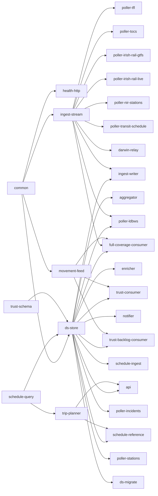
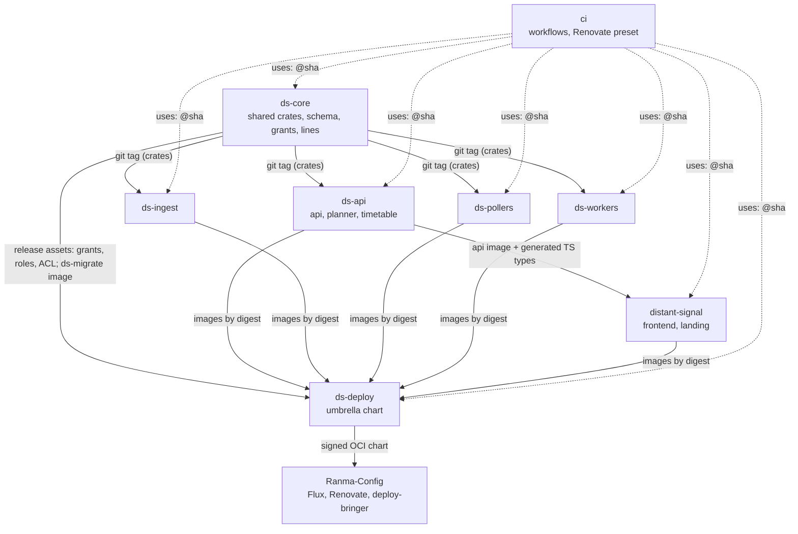

# Splitting the monorepo into the Distant-Signal organisation

Status: plan, spec only. No repositories have been created and no code has
moved. Task DS-261. Written 2026-11-02 against `main` at `01f5a7f2`. Revised
the same day after two decisions by the user:

- split thematically now, not on triggers;
- license every DS repository under AGPL-3.0-or-later.

Revised again the same day: the user accepted every recommendation in the
first list of open questions (§10.1), and asked for a git history rewrite
as part of the migration (§5.11). The history figures in §5.11 were measured
against `main` at `cc44d13c`.

This spec moves Distant Signal (DS) from the single
`FasterSpeeding/Distant-Signal` repository into the GitHub organisation
[Distant-Signal](https://github.com/Distant-Signal), and splits it into
thematic repositories. It also re-evaluates the shared CI and utility code
that DS uses or could share.

**The plan in one paragraph.** Transfer the repository to
`Distant-Signal/distant-signal`. It keeps its stars, issues, PRs and
old-URL redirects, and it stays the landing repository and the frontend's
home. License everything AGPL-3.0-or-later before the transfer. In the same
frozen window as the transfer, rewrite the history once (§5.11): one
author identity, no Claude attribution, every commit kept one for one,
and the original history frozen in a private archive. Then cut
seams inside the monorepo and extract the shared libraries first, as
`ds-core`. After that, extract one repository at a time, each with
`git filter-repo` history:

- `ds-deploy`: the umbrella chart;
- `ds-pollers`;
- `ds-ingest`;
- `ds-workers`;
- `ds-api`: the api, the trip planner and the timetable pipeline.

Shared tooling goes to `Distant-Signal/ci`.

How the pieces fit:

- Shared crates are git dependencies pinned to `ds-core` tags.
- Schema, migrations, the checksum lock, Postgres grants and the Redis ACL
  belong to `ds-core` and ship as release assets.
- The frontend gets generated API types from the api image it pins for e2e.
- Images go to the stable path `ghcr.io/distant-signal/images/<service>`
  whichever repository builds them. `ds-deploy` pins their digests through
  Renovate, so the OCI chart URL Ranma-Config watches never changes again
  after phase 1.
- Every repository stays public, which is what keeps CI free.

Nothing on Forgejo moves (§8.2).

**Risk.** The coupling data in §2 was the case *against* splitting. The plan
treats it as the list of seams to engineer:

- 38% of changes since 2026-10-01 crossed code areas;
- 39 to 43% of api and frontend changes were joint;
- 78% of schema changes also touched the api.

Each of these gets a mechanism in §5: a version pin, an ordering check, or a
vendored artifact. Without those mechanisms the split would be fragile.

## 1. Inventory

### 1.1 Crates

There are 31 workspace members (`Cargo.toml`) with 469,618 lines of Rust.
"Commits" counts non-merge commits since the repository began (2026-07-05)
that touched the crate. "Image" means `containers.yml` builds an image for it.

| Crate | Theme | LOC | Workspace deps | Image | Commits |
|---|---|---:|---|---|---:|
| `common` | shared lib | 35,619 | none | | 255 |
| `health-http` | shared lib | 282 | common | | 5 |
| `trust-schema` | shared lib | 2,030 | none | | 23 |
| `schedule-query` | shared lib | 11,268 | none | | 75 |
| `ingest-stream` | ingest contract | 5,683 | common | | 31 |
| `movement-feed` | ingest lib | 3,831 | common, health-http | | 30 |
| `ds-store` | schema + SQL | 48,220 | common, schedule-query, trust-schema | | 114 (+61 migrations) |
| `ds-migrate` | schema | 583 | common, ds-store | ships in the api image | 8 |
| `trip-planner` | planner lib | 15,560 | schedule-query | | 60 |
| `api` | api | 184,020 | common, ds-store, schedule-query, trip-planner, trust-schema | api | 1,071 |
| `aggregator` | worker | 19,180 | common, ds-store, health-http | aggregator | 285 |
| `enricher` | worker | 36,396 | common, ds-store, health-http | enricher | 116 |
| `notifier` | worker | 18,043 | common, ds-store, health-http | notifier | 100 |
| `ingest-writer` | ingest | 9,540 | common, ds-store, health-http, ingest-stream | ingest-writer | 63 |
| `movement-relay` | ingest (Kafka) | 3,744 | common, health-http, trust-schema | movement-relay | 33 |
| `darwin-relay` | ingest | 1,685 | common, health-http, ingest-stream | darwin-relay | 2 |
| `trust-consumer` | ingest | 8,565 | common, ds-store, health-http, movement-feed, trust-schema | trust-consumer | 97 |
| `trust-backlog-consumer` | ingest | 4,506 | same as trust-consumer | trust-backlog-consumer | 56 |
| `full-coverage-consumer` | ingest | 9,573 | common, ds-store, health-http, ingest-stream, movement-feed, schedule-query, trust-schema | full-coverage-consumer | 93 |
| `schedule-ingest` | schedule | 15,361 | common, ds-store, health-http | schedule-ingest | 48 |
| `schedule-reference` | schedule | 10,728 | common, ds-store, health-http, schedule-query, trip-planner | schedule-reference | 107 |
| `poller-transit-schedule` | schedule (transit) | 7,825 | common, health-http, ingest-stream | yes | 16 |
| `poller-incidents` | poller (Postgres) | 1,589 | common, ds-store, health-http | yes | 35 |
| `poller-stations` | poller (Postgres) | 1,069 | common, ds-store, health-http | yes | 31 |
| `poller-ldbws` | poller (stream) | 5,469 | common, ds-store, health-http, ingest-stream | yes | 45 |
| `poller-tfl` | poller (stream) | 2,823 | common, health-http, ingest-stream | yes | 49 |
| `poller-tocs` | poller (stream) | 449 | common, health-http, ingest-stream | yes | 25 |
| `poller-irish-rail-gtfs` | poller (stream) | 1,260 | common, health-http, ingest-stream | yes | 18 |
| `poller-irish-rail-live` | poller (stream) | 903 | common, health-http, ingest-stream | yes | 15 |
| `poller-nir-stations` | poller (stream) | 855 | common, health-http, ingest-stream | yes | 15 |
| `line-catalogue-validator` | tool | 2,959 | common | none (CI and manual) | 21 |

The fan-in is what matters:

- `common`: 27 dependents, every crate except `schedule-query`, `trip-planner`
  and `trust-schema`.
- `health-http`: 21 dependents.
- `ds-store`: 14 dependents, each with Postgres access.
- `ingest-stream`: 10 dependents, the stream producers plus `ingest-writer`.
- `schedule-query`: 5 dependents (`ds-store`, `api`, `trip-planner`,
  `schedule-reference`, `full-coverage-consumer`).
- `trip-planner`: 2 dependents, `api` and `schedule-reference`. The planner is
  not api-private: schedule-reference precomputes with it.



### 1.2 Everything else in the repository

| Area | What | Size |
|---|---|---|
| `frontend/` | Next.js app router and Mantine 9. It has a hand-written API client (`lib/api.ts`, 1,500 lines, no generated types), vitest, and the Playwright e2e and visual suites (172 baseline images). | 156k lines of TS/TSX |
| `charts/distant-signal` | One chart for the whole stack: 57 templates, `values.yaml` 7,044 lines, `_helpers.tpl` 3,576 lines. It holds `files/db-grants.yaml` (625 lines), the rendered `files/postgres-grants.sql` (1,371 lines), the Redis ACL template and the PrometheusRule. | 409 commits |
| `charts/ds-ingest-bucket` | A Crossplane chart (GCS bucket, IAM, audit). It is published as its own OCI artifact, and Ranma-Config's Renovate rule for it is disabled. | 6 commits |
| `lines/` | The curated line catalogue, 247 TOML files. The aggregator and api images copy it in, and `common::matcher` reads it. | 302 commits |
| `reference-data/` | CSVs and TSVs. `common`, `api` and `poller-transit-schedule` embed them with `include_str!`. The trust-consumer image copies the whole directory in. | |
| `docker/` | 21 Rust Dockerfiles generated by `scripts/gen-rust-dockerfiles.py`. Each one copies the whole workspace (`COPY . .`) with cargo-chef. | |
| `scripts/` | 31 typed Python scripts (below) and `scripts/tests`. | 186 commits |
| `.github/workflows` | `ci.yml` (4,057 lines, 17 jobs), `containers.yml` (895 lines, a 22-image matrix plus the chart push), `dependency-scan.yml`, `prune-buildcache.yml`, `validate-line-catalogue.yml`. | 247 commits |
| `docs/` | 306 Markdown files: runbooks, the API changelog, specs, and the dated `docs/superpowers` history. | |
| Root | `renovate.json5`, `deny.toml`, `pyproject.toml`/`uv.lock`, compose files, `authentik-blueprints/`. | |

The scripts fall into groups by what they touch:

- **Chart checks** (`check-*-chart.py`, 9 scripts, about 6,200 lines) and
  `chart-values-doc.py`. All of them know the DS chart's values paths.
- **Database:** `gen-db-grants.py`, `test-postgres-roles.py`,
  `observe-role-usage.py`, `check-migration-order.py`, `db-tests.py`, and
  `render-redis-acl.py` (for Redis).
- **Generic lint and CI:** `lint-scripts.py`, `lint-containers.py`,
  `paths-changed.py` and `check-bench-gates.py`. None of them names DS.
- **Code generation:** `gen-rust-dockerfiles.py` and
  `generate-pass-through.py`.
- **Frontend:** `check-copy.py`, `visual-tests.py` and the
  `tfl-arrivals-stub.py` e2e stub.
- **One-off analysis and backfills:** `fc-windowed-analysis.py`,
  `measure-transit-trip-planning.py`, `backfill-*.py`, and the `*.sql` and
  `test-*.sh` remediations.

### 1.3 Cross-cutting couplings

These are what any split has to cut.

1. **Schema and migrations.** There are 223 sqlx migrations in
   `crates/ds-store/migrations`, forward-only and immutable once merged. The
   checksum lock is `crates/api/tests/migration_checksums.lock`, 225 lines.
   It sits in the **api** crate, not `ds-store`, which is one reason 78% of
   store changes also touch the api. The lock and index-locking tests
   (`migration_checksums.rs`, `migration_index_locking.rs`) are api tests.
   `check-migration-order.py` compares migrations against `origin/main`.
2. **The schema gate.** `ds-store/src/schema.rs` makes every DB service wait
   for two things: the newest migration embedded in its build, and every
   privilege its role is given. `crates/ds-store/build.rs` reads
   `../../charts/distant-signal/files/db-grants.yaml` **at compile time**.
   The schema crate depends on a file inside the chart.
3. **DB roles and grants.** `db-grants.yaml` classifies every table, view,
   sequence and function. It gives 13 service roles (`api`, `aggregator`,
   `enricher`, `notifier`, `writer`, `schedule_reference`, `stations`,
   `incidents`, `schedule_ingest`, `trust_backlog`, `trust_consumer`,
   `full_coverage_ro`, `ldbws_ro`), 2 groups and 4 other roles their
   privileges. `gen-db-grants.py render` writes `postgres-grants.sql`, which
   the chart's roles Job runs. `gen-db-grants.py check` runs in CI against a
   freshly migrated database. Since July, 56% of grants changes came with a
   migration and 56% with an api change.
4. **Chart files read by crate tests.** Ten Rust files read chart files
   directly: the Redis ACL template (`common/tests/redis_acl.rs`), chart
   values (`ingest-stream/tests/chart_values.rs`), and the api's rate-limit
   and config defaults (`api/src/data/config.rs`, `api/src/rate_limit.rs`),
   among others.
5. **Shared DB test harness.** `ds-store`'s `test-support` feature is used by
   api, notifier, trust-consumer and trust-backlog-consumer. CI builds one
   cargo-nextest archive (`rust-db-build`). Three jobs then run every
   `#[ignore]` DB test from it: as the superuser, as the app role, and as
   each service's own role. `db-tests.py` lists the passes, which cover ten
   crates.
6. **Golden and differential data.** `ingest-stream/tests/golden.rs` and its
   fixtures pin the v1 envelope wire format "between producers and the
   writer, which ship separately". This boundary is already designed for
   independent releases. `trip-planner/tests/differential.rs` checks CSA
   against RAPTOR, inside one crate. Other fixtures live in
   `schedule-query`, `schedule-ingest`, `darwin-relay`,
   `poller-transit-schedule` and `common`, plus `enricher/eval/dataset.jsonl`.
   All of them are crate-local.
7. **The api and frontend contract.** The Rust types are serde with
   camelCase. The TypeScript side is hand-mirrored in `frontend/lib/api.ts`,
   with no generated schema. Changes are recorded in `docs/api-changelog.md`,
   which DS-MCP also reads; its client cites entries by date. CI's
   `frontend-e2e` job builds the api **from source** and runs it against
   `frontend/e2e/fixtures/seed.sql`, which depends on the current migrations.
8. **The chart and the images.** `containers.yml` builds all 22 images on
   every push to `main`. `push-helm-chart` then pins every digest into
   `values.yaml` through a hard-coded `SERVICE_TO_PATH` map. It packages the
   chart as `0.4.1+build.<run>.sha.<short>`, pushes it to
   `oci://ghcr.io/fasterspeeding/charts`, and signs it with cosign keyless,
   with three retries. The chart is the only versioned release unit: an image
   is never deployed except through a chart build. `global.imageRegistry`
   keeps the **last two path segments** of every image repository, so the
   path shape `<registry>/<namespace>/distant-signal/<svc>` is load-bearing.
9. **Data baked into images.** `lines/` goes into the api and aggregator
   images, and `reference-data/` into trust-consumer. `include_str!` CSVs
   are embedded in common, api and poller-transit-schedule.
10. **Owner-specific strings.** 225 occurrences of `FasterSpeeding` in 51
    files. The ones that matter at runtime:
    - `common::user_agent::PROJECT_URL`, sent to every upstream data provider;
    - the alert `runbook_url`s in the PrometheusRule and its tests;
    - `IMAGE_BASE` and the chart destination in `containers.yml`;
    - `prune-buildcache.yml`'s package name;
    - every `image.repository` default in `values.yaml`.

## 2. Evidence (risk context)

These numbers argued against splitting. With the split decided, they are
the list of seams the designs in §5 must handle.

### 2.1 What changes together

"Changes" are first-parent commits on `main`: merged PRs and direct commits,
with each merge diffed against its first parent. Paths are grouped into ten
areas:

- **api**: `api` plus `docs/api-changelog.md`;
- **frontend**;
- **chart**: both charts;
- **ci**: `.github`, `scripts`, `docker`;
- **store**: `ds-store`, `ds-migrate`, migrations;
- **common**: `common`, `health-http`, `line-catalogue-validator`, `lines/`;
- **ingest**: the relays, consumers, `ingest-*`, `movement-feed`,
  `trust-schema`;
- **schedule**: `schedule-*`, `trip-planner`;
- **pollers**;
- **workers**: aggregator, enricher, notifier.

| Window | Changes | Touch 2+ areas | Touch 2+ code areas (ci and chart excluded) |
|---|---:|---:|---:|
| All history (2026-07-05 on) | 1,388 | 589 (42%) | 450 (32%) |
| Since 2026-10-01 | 512 | 265 (52%) | 196 (38%) |

Coupling is rising, not falling, as the project matures.

The strongest pairs since 2026-10-01 are below. A percentage is the share of
the first area's changes that also touched the second, then the other way
round.

| Pair | Changes | Share |
|---|---:|---|
| chart + ci | 98 | 63% / 65% |
| api + frontend | 89 | 39% / 43% |
| api + chart | 78 | 34% / 50% |
| api + store | 76 | 33% / **78%** |
| chart + store | 54 | 35% / 56% |
| chart + ingest | 47 | 30% / 60% |
| api + ingest | 46 | 20% / 59% |
| api + common | 45 | 20% / 67% |
| common + ingest | 41 | 61% / 53% |
| api + schedule | 42 | 19% / 70% |

At commit level since 2026-01-01 (4,115 non-merge commits), the clearest
clusters are these:

- aggregator with `lines/`: 52% of aggregator commits;
- api changelog with api: 74%;
- migrations with api: 80%;
- `trust-backlog-consumer` with `trust-consumer`: 61%;
- `full-coverage-consumer` with the other two TRUST consumers: 32 to 35%;
- `scripts/` with the chart: 55%.

The island-of-Ireland and TfL pollers are the quietest code: 15 to 49
commits each, mostly alongside `common` or `ingest-stream`.

### 2.2 CI

These figures come from the last 20 successful `ci.yml` runs on `main`.

- **Wall time:** minimum 10.3 minutes, median 14.1, maximum 72 (queueing).
- **Job time per run:** 66 job-minutes in run 41408892594. The largest jobs
  are Playwright (13.6), cargo build and test (11.2), frontend (9.9),
  scripts-lint (6.1), and the three DB passes (5.6, 4.3 and 5.4) off a
  3.6-minute archive build.
- **Containers:** median 8 minutes, maximum 19 (`containers.yml`).
- **Volume:** in the week to 2026-11-02, each of CI, Containers and the
  dependency scan ran about 166 times. CI alone is about 11,000 job-minutes
  a week.

The repository is **public**, so these minutes cost nothing on
GitHub-hosted runners. The organisation is on the Free plan. A **private**
repository there gets 2,000 minutes a month, which DS's CI would use up in
about a day and a half. **Every repository in the organisation has to stay
public, or the CI bill changes the whole calculation.**

### 2.3 Repository facts

- 5,360 commits since 2026-07-05 and a 194 MiB pack.
- 142 PRs and 6 issues (4 open), 1 star, no forks.
- No branch protection or rulesets, no repository secrets or variables, and
  no environments. The workflows use only `GITHUB_TOKEN` and OIDC.
  `validate-line-catalogue.yml` names `RDM_API_KEY` and `RDM_TOCS_BASE_URL`,
  but neither is set at repository level, so check before the move.
- No `LICENSE` and no `SECURITY.md`. Homepage `https://ds.cursed.solutions/`.
  No description, no topics.
- Authors since 2026-10-01: FasterSpeeding (1,857 commits, under the
  address §5.11.1 replaces) and `mine-bringer-renovate[bot]` (25). The
  whole-history identity counts are in §5.11.1.

## 3. Target layout

### 3.1 Repositories

All repositories are public and licensed AGPL-3.0-or-later.

| Repository | Contents | Images it builds | Why this boundary |
|---|---|---|---|
| `distant-signal` (landing; the transferred repository) | `frontend/`, the landing README, `CONTRIBUTING.md`, the dev-stack compose file (pulls every image), `docs/superpowers` (historical record), `check-copy.py`, `visual-tests.py`, `tfl-arrivals-stub.py` | frontend | Highest change rate (1,263 commits). It is what users see. It keeps the history, stars and redirects. |
| `ds-core` | `common`, `ds-runtime` (the domain-free half of `common`, §5.8), `health-http`, `trust-schema`, `schedule-query`, `ingest-stream`, `ds-store` with migrations and the checksum lock, `ds-migrate`, `line-catalogue-validator`, a new `ds-lines` crate that embeds `lines/`, core `reference-data/`, `db-grants.yaml`, the Redis ACL source, and the DB scripts (`gen-db-grants.py`, `render-redis-acl.py`, `test-postgres-roles.py`, `observe-role-usage.py`, `check-migration-order.py`, `check-crate-deps.py`) | ds-migrate | Everything with fan-in: `common` has 27 dependents, `ds-store` 14 and `ingest-stream` 10. It is the one owner of the schema, grants, stream envelope and line catalogue. |
| `ds-api` | `api`, `trip-planner`, `schedule-ingest`, `schedule-reference`, `docs/api-changelog.md`, the api-only `reference-data` CSVs (station groups, TOC codes, operator names and groups, fixed-link operators) | api, schedule-ingest, schedule-reference | Since July, `trip-planner` changed with api in 38% of its commits, `schedule-reference` in 42% and `schedule-query` in 43%. `schedule-reference` links `trip-planner`. The two schedule crates share a pod and a PVC. Keeping planner and timetable with the api keeps those changes in one repository. |
| `ds-ingest` | `ingest-writer`, `movement-relay`, `darwin-relay`, `trust-consumer`, `trust-backlog-consumer`, `full-coverage-consumer`, `movement-feed` (only these consumers use it), `stanox-crs.csv` | 6 | The three TRUST consumers change together (32 to 61%). It holds the Kafka and stream runtime and the ingest runbooks. |
| `ds-pollers` | the 8 `poller-*` crates, `poller-transit-schedule`, the transit `reference-data` | 9 | The quietest code (15 to 49 commits each). Six of the nine talk to the rest only through the golden-pinned `ingest-stream` envelope. |
| `ds-workers` | `aggregator`, `enricher` (with `eval/`), `notifier` | 3 | Separate `ds-store` consumers at a moderate change rate. Aggregator's churn on `lines/` moves to `ds-core` bumps (§5.2). |
| `ds-deploy` | `charts/distant-signal`, `charts/ds-ingest-bucket`, `scripts/alert-rules-tests`, `check-*-chart.py`, `chart-values-doc.py`, `check-alert-payloads.py`, `docs/alerts.md` and the deploy runbooks | none (charts) | The deploy unit. It pins every image by digest and is the only thing Ranma-Config watches. Chart and CI changes went together 63% of the time, so the chart takes its CI with it. |
| `ci` | reusable workflows, composite actions, the Renovate preset, generic scripts (§8.3) | none | Shared by the 7 code repositories. |
| `.github` | `profile/README.md`, default `SECURITY.md`, `CONTRIBUTING.md`, issue forms | none | Organisation presentation and defaults. |

That makes 7 code repositories plus `ci` and `.github`, against 31 crates and
22 images. `ds-ingest-bucket` goes into `ds-deploy` rather than its own
repository. It is a chart, already versioned and pushed on its own, and one
deploy repository is simpler than two.

Under §2.1's grouping, the rejected per-service split (about 30
repositories) would have made nearly every pollers, workers and ingest change
a core bump plus a service change, with no gain in deploy independence. One
chart stays the deploy unit (§5.4).

### 3.2 Dependencies between repositories



The rules:

- No service repository depends on another service repository. The one
  exception is the frontend pinning the api image, for e2e tests and types.
- Only `ds-core` publishes Rust code.
- Only `ds-deploy` publishes something Ranma-Config consumes.

## 4. The landing repository

### 4.1 Which repository

The landing repository is **`Distant-Signal/distant-signal`, the transferred
`FasterSpeeding/Distant-Signal`**. It keeps the frontend, which is the user's
default. As services are extracted it ends up as the frontend plus the
project front page.

| Candidate | For | Against |
|---|---|---|
| **The transferred repository, keeping the frontend (chosen)** | The 5,360 commits (rewritten one for one, §5.11), the star, the 142 PRs and the issues stay. Every old link redirects: Ranma-Config, the deploy records, Renovate PR bodies, DS-MCP comments, old alert annotations. | Its history is the whole monorepo's, which is useful: `contract:` migration headers cite its commits, resolved through the commit map (§5.11.8). |
| A new frontend repository | A clean start. | Loses the stars, issues and PR history, and the old links would point at an archived repository. |
| A thin meta or docs repository | A front page independent of code churn. | Nothing to build, so the README drifts. It adds a hop. The `.github` profile already plays this role at the organisation level. |
| `ds-core` | The technical centre. | Not what visitors come for. Its README is for crate consumers. |

### 4.2 What it carries

- **README as the front page.** Today's 158-line README is a developer
  overview. Restructure it in this order:
  1. what DS is, in two sentences;
  2. a link to https://ds.cursed.solutions/;
  3. four screenshots: home and train page at 390 px and 1366 px, light and
     dark;
  4. a feature list;
  5. an architecture overview, a Mermaid diagram of producers to Postgres or
     Redis streams to ingest-writer, api and frontend, notifier;
  6. the repository index (§3.1);
  7. links to "Run it locally" and "Contributing".

  Generate the screenshots from the seeded e2e stack inside the pinned
  Playwright container (the `visual-tests.py` route) into
  `docs/screenshots/`, so they are reproducible and never show real user
  data. Don't reuse `frontend/e2e/visual-baselines/`: those are test
  baselines and must stay byte-exact.
- **Repository index.** Every organisation repository and its role. Add a
  row for DS-MCP saying that it is hosted elsewhere and consumes the public
  API, without linking a tailnet URL.
- **Contributing and dev setup across repositories.** `CONTRIBUTING.md`
  covers the following.
  - **Full stack locally.** The landing repository's `docker-compose.yml`
    pulls every image from `ghcr.io/distant-signal/images/*`, using the
    digests pinned in `ds-deploy`'s `values.yaml`. A small script,
    `scripts/dev-stack.py`, writes them into `.env`. Setting
    `DS_<SERVICE>_SRC=../ds-ingest` builds that service from a local
    checkout instead.
  - **Working across repositories.** For example, changing `ds-core` and
    a service together, through a local Cargo `[patch]` (§5.2).
  - The per-repository toolchain commands from today's `CLAUDE.md`. Each
    repository gets its own `CLAUDE.md`, with the shared conventions in
    `ci/docs/conventions.md`.
- **Issue tracker home.** The landing repository owns *all* issues,
  cross-cutting and per area, with area labels: `area:frontend`, `area:api`,
  `area:core`, `area:ingest`, `area:pollers`, `area:workers`, `area:deploy`.
  The other repositories disable Issues and point here through the
  `.github` issue-form config. The worklog/Vikunja cards stay the working
  tracker. GitHub Issues are for external reports and anything that needs a
  public link.
- **Security policy and licence.** `SECURITY.md` lives in `.github`, so it
  is the default for every repository. It uses GitHub private vulnerability
  reporting and covers the site, the API (including delegated access) and
  the images. The AGPL-3.0-or-later `LICENSE` is in §6.

### 4.3 Organisation-level presentation

- **`Distant-Signal/.github/profile/README.md`:** three lines on what DS is,
  the site link, one screenshot and the repository index. Keep it short and
  point to the landing README.
- **Pinned repositories:** `distant-signal` first, then `ds-api` and
  `ds-core`.
- **Description:** "A personal UK rail companion: line status, train and
  journey tracking, trip planning and Delay Repay support." Homepage: the
  site. Topics: `rail`, `uk`, `trains`, `transport`, `rust`, `nextjs`,
  `helm`, `postgres`, `agpl`. Each other repository gets a one-line
  description and the shared topics.
- **Organisation avatar:** the app icon (`frontend/public/icon-512.png`).

### 4.4 Transfer, not archive

Transfer the existing repository and extract the services out of it. Don't
archive it and start fresh.

A GitHub transfer keeps issues, PRs, stars, watchers, releases and wiki. It
redirects old web and git URLs until somebody creates a repository at the
old name, so never create one. A rename on transfer
(`Distant-Signal` to `distant-signal`) is also redirected.

Archiving would break existing links and duplicate the name in search, and
every extract would need a fresh history.

The transfer keeps the repository; it does not keep the SHAs. The history
rewrite (§5.11) runs in the same frozen window and force-pushes `main`
once. Old PR pages keep showing the original commits, because GitHub
manages `refs/pull/*` and they can't be rewritten. The original history
stays complete in the private archive (§5.11.7).

Treat redirects as a convenience only. Update explicitly in phase 1:

- the Flux verification regex;
- Renovate's `sourceUrl`;
- the task-bringer repository list;
- the User-Agent URL.

## 5. Designs

### 5.1 Schema, migrations, grants and the Redis ACL: owned by `ds-core`

**What `ds-core` owns:**

- `crates/ds-store/migrations/`, which stays forward-only and immutable;
- the checksum lock and its tests, moved from `crates/api/tests` to
  `crates/ds-store/tests`: `migration_checksums.lock`,
  `migration_checksums.rs` and `migration_index_locking.rs`;
- `check-migration-order.py`;
- `ds-migrate`, with **its own image** (`images/ds-migrate`). Today it ships
  inside the api image. The chart's migrate hook Job and the schema-owner
  backfills switch to it.

**Grants and ACL source.** `db-grants.yaml` moves to
`crates/ds-store/db-grants.yaml`, so `build.rs` reads a file inside its own
crate rather than the chart. The Redis ACL template (`redis-users.acl.tpl`)
moves to `ds-core/access/`, and `render-redis-acl.py` and `gen-db-grants.py`
move with it. `common/tests/redis_acl.rs` keeps checking that the Redis
commands the code issues are in the ACL, now against a file in the same
repository.

**Release assets.** Every `ds-core` tag `vX.Y.Z` publishes:

- the crates, at the git tag (§5.2);
- `images/ds-migrate:vX.Y.Z`;
- GitHub release assets: `db-grants.yaml`, `postgres-grants.sql`,
  `postgres-roles.sql` and `redis-users.acl.tpl`, each signed with
  `cosign sign-blob` under `ds-core`'s workflow identity.

**Vendoring into the chart.** `ds-deploy` keeps a file `core-version`.
Renovate bumps it through a `github-releases` custom manager. In the same PR,
`ds-deploy/scripts/sync-core.py` downloads the assets, verifies them and
writes them into `charts/distant-signal/files/`. The same PR also bumps
`migrate.image` to the matching `ds-migrate` digest. CI fails when the
vendored files differ from the release.

**Version labels.** Every service image carries
`org.distant-signal.core-version=<tag>`, read from its `Cargo.lock`. The
schema gate already makes a service wait (not ready) until the database has
its `REQUIRED_MIGRATION` and its role holds the grants baked in from
`db-grants.yaml`.

**Ordering checks in `ds-deploy` CI:**

1. **Expand.** For every image pinned in `values.yaml`, its `core-version`
   must be at most the pinned `ds-migrate` version. A service can't
   reach prod expecting a migration or grant that the chart wouldn't run.
   The check reads labels with `crane config` over the public registry.
2. **Contract.** A destructive migration's header gains a version:
   `-- contract: <what> (code stopped using it in <commit>; safe after core vA.B.C)`.
   `ds-core`'s release workflow reads `ds-deploy`'s `main` `values.yaml`.
   It refuses the tag while any pinned image has a `core-version` older than
   `vA.B.C`. That is today's "ships a release after the code stopped using
   it" rule, made mechanical.

**DB tests in other repositories.** A repository with `#[ignore]` DB tests
uses `ci`'s reusable `rust-db-tests.yml`. It starts Postgres and Valkey,
runs `images/ds-migrate` at the repository's pinned core version, applies
that version's `postgres-grants.sql`, and runs the repository's passes from
its own `db-tests.toml`. Those are today's `db-tests.py` passes, split by
crate.

**Requesting a grant.** A service that needs a new grant opens a `ds-core`
PR changing `db-grants.yaml`, alongside the migration if there is one, then
bumps core. The schema gate keeps it unready until the roles Job has run.

### 5.2 How shared crates are consumed: git tags

**Decision: git dependencies on the public `ds-core` repository, pinned by
tag.**

```toml
# each consumer's workspace Cargo.toml
[workspace.dependencies]
common    = { git = "https://github.com/Distant-Signal/ds-core", tag = "v0.4.0" }
ds-store  = { git = "https://github.com/Distant-Signal/ds-core", tag = "v0.4.0" }
# ... one line per core crate, all on the same tag
```

`Cargo.lock` records the exact commit. In `deny.toml`, `allow-git` gets
exactly `https://github.com/Distant-Signal/ds-core`. `unknown-git = "deny"`
stays.

**Why not a registry:**

- **crates.io** would publish 10+ workspace-internal crates as a public API
  with semver promises and permanent versions. Names like `common` aren't
  available.
- **The Forgejo Cargo registry** can't be reached from GitHub-hosted runners
  (§8.1).
- **A hosted private registry** adds cost, a token secret in every
  repository, and a single point of failure.

Git tags need no infrastructure. The repository is public, so cargo fetches
over HTTPS without auth.

**Version-bump workflow:**

1. **Change in `ds-core`.** PRs merge to `main` as today. Releases are
   deliberate: `workflow_dispatch` on `release.yml` with `bump: patch|minor`.
   It runs `scripts/release.py`, which:
   - bumps `workspace.package.version`;
   - prepends `CHANGELOG.md` from the merged PR titles since the last tag,
     flagging migrations, grants and ACL changes and contract migrations;
   - tags `vX.Y.Z`;
   - builds and signs `ds-migrate`;
   - attaches the access assets.
2. **Versioning.** While on `0.x`, a breaking Rust API change or a contract
   migration is a minor bump. Anything else is a patch. Every migration is
   at least a patch release, so the schema version is the core version.
3. **Consumers.** Renovate (the `ci` preset) groups all `ds-core` crates
   into one PR per repository, `renovate/ds-core`. That PR updates every
   `tag =` line and `Cargo.lock`. The git dependencies use Renovate's cargo
   manager. Confirm tag tracking with `renovate --platform=local
   --dry-run=extract`. If it doesn't work, a regex custom manager on
   `tag = "v..."` with the `git-tags` datasource does. The PR's CI is the
   compatibility test, and it automerges when green.
4. **Developing across repositories.** Use a local, uncommitted patch:
   `cargo --config 'patch."https://github.com/Distant-Signal/ds-core".common.path="../ds-core/crates/common"' test`.
   A helper, `ci/scripts/core-patch.py --core ../ds-core`, writes all the
   lines into `.cargo/config.toml`. That file is git-ignored in every
   consumer. Open the `ds-core` PR, release, then open the consumer PR on
   the new tag.

### 5.3 Generated API types and cross-repo api and frontend changes

**Types.** Derive TypeScript from the api's serde types with `ts-rs`. It
honours `#[serde(rename_all = "camelCase")]`, `Option` and enums.

- `ds-api` CI regenerates `api-types/api.ts` and fails if the committed copy
  is stale.
- The api image bakes the file in at `/usr/share/distant-signal/api-types.ts`.
- The image's tag (`build.<run>-<sha>`) is the types' version.

**Consumption by the frontend.** No npm registry is needed. GitHub's npm
registry requires a token even for public packages, and npmjs would need an
organisation and a secret.

- The frontend keeps one pin, `frontend/e2e/api-image.txt`, holding
  `ghcr.io/distant-signal/images/api:<tag>@sha256:...`. Renovate bumps it.
- `scripts/sync-api-types.py` extracts the types file from that exact image
  into `frontend/lib/api-types.ts`, and CI checks the two match.
- `lib/api.ts` keeps its fetch helpers but imports every request and
  response type. The hand-mirrored interfaces go.
- e2e runs the same pinned image, migrated with the `ds-migrate` version
  from the image's `core-version` label, and then `seed.sql`.
- DS-MCP can fetch the same file from the public image, or from the
  `ds-api` release asset.

**The process for a change across api and frontend.** This applies to the
39 to 43% of changes that touched both (§2.1).

1. **The `ds-api` PR** adds the field or route. It must be additive: a new
   optional field, or a new route. It includes regenerated types and a
   `docs/api-changelog.md` entry. Merge it, and the api image is published.
2. **Renovate** opens the frontend's api-pin PR with the new types. The
   developer pushes the frontend change onto that PR, or onto a branch built
   on it. e2e runs against the new api image. Merge it, and the frontend
   image is published with `org.distant-signal.api-build=<api tag>`.
3. **`ds-deploy`'s ordering check:** the frontend image's `api-build` must
   be at most the pinned api image's build. A chart can't ship a frontend
   that expects an api it doesn't deploy. Normally both bumps land in the
   same grouped image PR (§5.4), so they deploy together.
4. **Removing or renaming a field** is a later `ds-api` PR, made only after
   the deployed frontend no longer reads it. DS-MCP is checked through the
   changelog, as today.
5. **A change that must switch on at once** ships dark behind an
   off-by-default chart value. Both halves deploy, then one `ds-deploy`
   values change turns it on.

### 5.4 Chart and deploy: one umbrella chart, per-service images

**Decision: one umbrella chart in `ds-deploy`; images versioned per
service.** Per-service charts would mean:

- 22 HelmReleases and `version.yaml` files in Ranma-Config;
- 22 Renovate PRs per build;
- rebuilding today's ordering (migrate Job, roles Job, then workloads) out
  of Flux `dependsOn`;
- a flood of small deploy-bringer requests instead of one reviewable
  release.

**How image tags flow:**

1. **Every service repository** builds on each `main` push, through `ci`'s
   `image.yml`, and pushes `ghcr.io/distant-signal/images/<service>`.
   - Tags: `build.<run>-<short sha>` plus `sha-<short sha>`.
   - Labels: `org.opencontainers.image.source`, `.revision`, `.licenses`,
     `org.distant-signal.core-version`, and `api-build` on the frontend.
   - Each image is signed with cosign keyless and attested.

   The image path doesn't depend on the source repository. Each package is
   linked to the repository that builds it, through the package's "Manage
   Actions access" setting, so moving a service between repositories changes
   nothing in the chart. The `global.imageRegistry` rule (keep the last two
   segments) yields `images/<service>`.
2. **`ds-deploy` Renovate** tracks each `values.yaml` `image.repository` and
   `image.tag` plus `image.digest`. It uses the helm-values manager with
   regex versioning `^build\.(?<major>\d+)-[0-9a-f]+$`, so builds order by
   run number.
   - All DS images go into **one group PR**, `renovate/ds-images`, which
     automerges when green.
   - `ds-core`'s `core-version` and `ds-migrate` bumps get their own group,
     `renovate/ds-core`, which merges first, because the ordering checks
     (§5.1) block the images otherwise.
   - Security bumps are never grouped.
3. **Every `ds-deploy` `main` push** packages the chart as
   `<base>+build.<run>.sha.<short>`. It pushes to
   `oci://ghcr.io/distant-signal/charts/distant-signal`, the same URL as
   after phase 1, and signs it. The digest pinning moves from
   `containers.yml`'s `SERVICE_TO_PATH` step into the bump PRs: digests are
   committed in `values.yaml`, not injected at package time.
4. **Ranma-Config** keeps one OCIRepository and one Renovate PR per chart
   build (`renovate/distant-signal-chart`), filed deliberately to
   deploy-bringer with deploy notes, approved with the passkey.

   The notes come from the `ds-deploy` compare range. Each image bump's PR
   body lists the per-service commit ranges, which Renovate generates from
   the image's `org.opencontainers.image.source` label. Migrations, grants
   and contract flags come from the `ds-core` CHANGELOG entries in the
   range.

**Holding one service back** (today's frontend "hold" pattern) is a `ds-deploy`
PR reverting that one digest, or a Renovate `ignoreDeps` for a while.

**The chart version.** The base goes to 0.5.0 at phase 1, then to **0.6.0**
when `ds-deploy` takes over the push. That repository's run counter starts
at 1, and semver ignores build metadata, so a new base guarantees Renovate
orders the builds correctly.

**Changes in Ranma-Config:**

| Where | Phase 1 (transfer) | `ds-deploy` cutover |
|---|---|---|
| `clusters/base/apps/distant-signal/version.yaml` | `url` becomes `oci://ghcr.io/distant-signal/charts/distant-signal`, plus a new `tag`. Add the identity `Distant-Signal/distant-signal`. | `url` unchanged. Add the identity `Distant-Signal/ds-deploy`. |
| `renovate.json5` | `matchPackageNames`, `sourceUrl`, compare template | `sourceUrl` and compare template point to `ds-deploy` |
| `renovate-github.yaml` | `discoveryFilters`: the new name, and the App installed on the organisation | Add every organisation repository, or use a `Distant-Signal/*` filter |
| `task-bringer/release.yaml` | Add the new name | Add every new repository to the DS project |
| `scripts/bump-distant-signal.sh` | Chart path | Notes source |
| `ds-ingest-gcp/release.yaml` | Chart path | Identity (`ds-deploy`) |
| `deploy-prs.yaml`, deploy-bringer | None | None: both read Ranma-Config |

### 5.5 CI per repository

**Every repository is public.** That is a requirement, not a preference.
Public repositories get free GitHub-hosted minutes. On the Free plan a
private repository gets 2,000 minutes a month, and today's CI is about
11,000 job-minutes a week (§2.2).

**The Free plan's 20-concurrent-job limit is shared across the
organisation.** Today's 22-leg container matrix already hits it. A `ds-core`
release triggers four consumer PRs at once. Mitigations:

- `concurrency` with `cancel-in-progress` in every workflow;
- path filters (`paths-changed.py`) on the heavy jobs;
- Renovate's `ds-core` PRs staggered with `prConcurrentLimit: 2` in the
  preset;
- container matrices limited to the services whose inputs changed. A `main`
  build still builds all of them weekly, to pick up base-image fixes.

**Per repository:**

| Repository | Jobs, all from `ci`'s reusable workflows |
|---|---|
| `ds-core` | rust-ci (fmt, clippy in both feature sets, MSRV, deny, test), rust-db-tests (superuser, app role, per-service role), migration order and grants checks, release |
| `ds-api`, `ds-ingest`, `ds-workers`, `ds-pollers` | rust-ci, rust-db-tests where there are DB tests (not for most pollers), image |
| `distant-signal` | node-ci (lint, prettier, tsc, vitest, build), e2e and visual tests against the pinned api image, check-copy, image |
| `ds-deploy` | helm lint and render assertions, the chart check scripts, alert-rules tests, values docs, the §5.1 and §5.3 ordering checks, chart push |
| `ci` | actionlint, the scripts lint, a self-test that calls its own workflows |

**Caching:**

- `Swatinem/rust-cache` is per repository, so each Rust repository compiles
  sqlx, axum and reqwest once more. Only `ds-ingest` pays for rdkafka.
- Docker layer caches stay in the registry, at
  `ghcr.io/distant-signal/images/buildcache:<service>`. They can be read
  across the organisation.
- `cargo-chef` keeps the dependency layer cached across `ds-core` bumps
  that change only path crates.

The per-PR job time drops for most repositories, because a pollers PR no
longer runs Playwright or the api's DB passes.

`ci` is consumed as `uses: Distant-Signal/ci/.github/workflows/<x>.yml@<sha> # vN`,
and Renovate bumps it. It is public, so no cross-repository access settings
are needed.

### 5.6 History preservation: `git filter-repo` per repository

The landing repository keeps the full history, rewritten once at phase 1
(§5.11). Each extracted repository is built from a fresh mirror clone of
that **rewritten** history, so it inherits the clean identity and messages.
No extraction rewrites identity or messages again:

1. **List the paths, including historical names.** For each path in the
   target set, run `git log --follow --name-only --format= -- <path>`
   (and for directories, `git log --name-status --diff-filter=R`) to collect
   old names. Examples are pre-rename crate directories and
   `charts/nr-status`. Write `paths/<repo>.txt` in `ci`, so the extraction
   is reviewable and repeatable.
2. **Run** `git filter-repo --paths-from-file paths/ds-ingest.txt`, plus
   `--path-rename` for the layout of the new repository's root: crates under
   `crates/`, docs under `docs/`.
3. **Keep authorship as rewritten.** filter-repo keeps authors and dates,
   so commits stay `FasterSpeeding <lucy@cursed.solutions>` from the phase 1
   rewrite. Don't pass `--mailmap`, `--email-callback`, `--name-callback`
   or `--message-callback` here: the identity was settled once, and a
   second rewrite would only add a second map to chain. Run the identity
   and attribution checks of §5.11.6 (items 5 to 7) on every extract
   anyway, before its first push.
4. **Commit the commit map.** filter-repo's `commit-map` (landing SHA to
   extract SHA) goes in as `docs/history/commit-map.tsv`. Old SHAs resolve
   in two hops: the landing repository's `docs/history/commit-map.tsv`
   (original to landing, §5.11.8) and then the extract's map. The helper
   `scripts/resolve-sha.py <sha>` in the landing repository, later in
   `ci`, walks both and prints the commit in every repository it reaches.
5. **Add a top commit** that adds `LICENSE`, the repository's README and CI,
   and switches path dependencies to `ds-core` tags.
6. **Remove the extracted paths from the landing repository** in one commit
   that names the new repository and its first SHA. Do this only after the
   new repository's images have been deployed once (§9).

### 5.7 Issue and PR migration

- **The transfer** moves all 142 PRs and 6 issues to the landing
  repository, where they stay.
- **Open issues** that belong to an extracted area keep living in the
  landing repository with an `area:` label (§4.2). Nothing needs
  transferring, because the other repositories have Issues disabled. If a
  repository ever enables Issues, GitHub's "Transfer issue" works within the
  organisation.
- **Open PRs can't be moved.** Each extraction has a **freeze**: no open PR
  touches the paths being moved. Merge or close them first. A PR that
  can't wait is re-created in the new repository by cherry-picking it onto
  the extract, with a link back.
- **Renovate branches** in the landing repository that touch moved paths are
  closed. Renovate re-opens them in the new repository.
- **Worklog.** Commits carry `Task: DS-123` trailers in every repository.
  task-bringer's DS project lists all repositories (§5.4 table).

### 5.8 `common`: domain and runtime

Before `ds-core` is extracted, split `common` into two crates.

- **`ds-runtime`**, domain-free: `backoff`, `log_once`, `logging`,
  `metrics`, `secret`, `redis_conn`, `redis_auth`, `redis_group`, `pg`,
  `startup`, `heap`, `outbound_endpoint_guard`, `service_args`, `progress`,
  `advisory_locks`, `user_agent`, with `health-http` folded in or alongside.
- **`common`**, the domain: matcher, segments, severity, stations, TfL,
  TRUST timestamps, transit, island of Ireland, and so on.

`ds-runtime` stays in `ds-core`; nothing is published elsewhere (§10.1, decision 9).
`user_agent::PROJECT_URL` becomes the organisation URL.

**The line catalogue.** `lines/` and its validator go into `ds-core` as a
`ds-lines` crate. It embeds the TOML (`include_dir`), so a consumer's
catalogue is exactly its pinned core version. Services keep `--lines-dir`
as an override for local edits. The api and aggregator images stop copying
`lines/`.

Since July, 52% of aggregator commits touched `lines/`. Most of those were
catalogue edits followed by matcher checks. They now become a `ds-core`
release plus an automerged bump. That is the largest new friction in the
plan, and the user accepted it (§10.1, decision 8).

### 5.9 GHCR paths, signing and repository settings

**Paths:**

- **Images:** `ghcr.io/distant-signal/images/<service>`, from phase 1 on,
  for every repository.
- **Charts:** `ghcr.io/distant-signal/charts/distant-signal` and
  `.../charts/ds-ingest-bucket`.
- **Build cache:** `ghcr.io/distant-signal/images/buildcache:<service>`.
  For the first week, `cache-from` also lists the old fasterspeeding cache.

The old `ghcr.io/fasterspeeding/...` packages stay for 90 days as the
rollback target. After that, prune all but the last deployed chart and its
images. The cluster pulls anonymously, so check that each new package is
**public** on its first push.

**Signing.** The cosign subject is
`https://github.com/Distant-Signal/<repo>/.github/workflows/<file>@refs/heads/main`.
Flux verifies only the chart, and `matchOIDCIdentity` is a list. Add the
next identity **before** each cutover:

1. the landing repository in phase 0;
2. `ds-deploy` before phase 5.

Drop each old identity 90 days later. If the cluster ever verifies images,
use one organisation regex:
`^https://github\.com/Distant-Signal/[^/]+/\.github/workflows/[^/]+@refs/heads/main$`.
`ds-core`'s access assets are verified in `sync-core.py` against
`Distant-Signal/ds-core`'s `release.yml`.

**Repository settings,** applied identically by a script
(`ci/scripts/repo-settings.py`, through the GitHub API):

- Issues on only in the landing repository;
- squash and merge commits allowed, as today;
- delete branch on merge;
- private vulnerability reporting on.

**Organisation settings:**

- an Actions allow-list: GitHub-owned actions, the already-pinned
  third-party ones, `FasterSpeeding/Piped` and `Distant-Signal/ci`;
- a read-only default `GITHUB_TOKEN`;
- a ruleset on every repository that blocks force-pushes and deletion on
  `main`, with no required reviews. It is created at the **end of phase 1**,
  right after the history rewrite's single force-push has been verified
  (§5.11.5), not in phase 0: an organisation-wide ruleset would cover the
  repository the moment it is transferred and block that push. Nothing
  later needs a force-push, because extractions push to new, empty
  repositories and remove paths with ordinary commits. Don't add a bypass
  list; if a second rewrite is ever needed, disable the ruleset for that
  window and re-enable it.

**Secrets:** none today. The RDM secrets named in
`validate-line-catalogue.yml` aren't set at repository level, so confirm
them. That workflow moves to `ds-core`.

### 5.10 Commit identity

From the phase 1 rewrite on, every commit is authored
`FasterSpeeding <lucy@cursed.solutions>`, and nothing carries Claude
attribution. GitHub links a commit to an account through a verified address
on that account, not through the repository owner.

- **Before the rewrite,** the user adds `lucy@cursed.solutions` to the
  FasterSpeeding account and verifies it. If "Keep my email addresses
  private" and "Block command line pushes that expose my email" are on,
  the rewrite's force-push is refused, so allow this address to be public:
  it will be in every commit. Keep the two old addresses verified on the
  account, so the original commits shown on old PR pages stay linked.
- **Local config,** on every machine and agent workspace:
  `git config --global user.name FasterSpeeding` and
  `git config --global user.email lucy@cursed.solutions`.
- **Agent sessions** check that `git config user.email` is
  `lucy@cursed.solutions` before committing, and wait rather than override
  it. They add no `Co-Authored-By: Claude` trailer and no
  "Generated with Claude Code" footer to commits or PR bodies. Each
  repository's `CLAUDE.md` says so.
- **`ci`'s reusable `identity.yml`** runs on every PR. It fails when a
  commit's author is anyone other than `lucy@cursed.solutions` or the
  Renovate bot's noreply, or its committer is anyone other than those two
  and `GitHub <noreply@github.com>` (web merges). It also fails on any
  message line matching the attribution rules of §5.11.3. Until `ci`
  exists (phase 3), the same check is a step in `ci.yml`, added in phase 1.
- Extracts keep the rewritten authors (§5.6).

### 5.11 History rewrite

The history is rewritten once, in phase 1, before any extraction. It does
three things:

- normalises every identity to `FasterSpeeding <lucy@cursed.solutions>`;
- strips Claude attribution from commit messages;
- keeps every commit, tree, parent and date, one for one.

It does **not** regroup commits (§5.11.4). The original history is frozen
in a private archive repository (§5.11.7).

All figures are from `main` at `cc44d13c` (5,365 commits) unless stated.
Across all branches there are 5,380 commits.

#### 5.11.1 Identities

| Identity today | Author | Committer | Becomes |
|---|---:|---:|---|
| `FasterSpeeding <lucina@lmbyrne.dev>` | 5,334 | 5,197 | `FasterSpeeding <lucy@cursed.solutions>` |
| `FasterSpeeding <lukecmb@gmail.com>` (5 commits on 2026-09-03, the client-local timezone work) | 5 | 5 | `FasterSpeeding <lucy@cursed.solutions>` |
| `Claude <noreply@anthropic.com>` (one commit, `aa3ab695`, a docs fix) | 1 | 1 | `FasterSpeeding <lucy@cursed.solutions>` |
| `GitHub <noreply@github.com>` (134 PR merges, 3 other merges and 25 Renovate squash commits, all made on GitHub) | 0 | 162 | committer `FasterSpeeding <lucy@cursed.solutions>` |
| `mine-bringer-renovate[bot] <…@users.noreply.github.com>` | 25 | 0 | unchanged |

**The Claude-authored commit is reattributed.** The user asked for no
Claude attribution, and this is the only commit where Claude is the author
rather than a trailer. Its `Co-Authored-By` trailer goes under §5.11.3 like
every other.

**GitHub-made commits are normalised to the owner as committer.** There
are 159 commits with a GitHub signature today. Any rewrite drops every
signature, so after it "committed by GitHub" would be an unsigned claim
that GitHub made a commit it never made. The rewritten commit is in fact
committed by the owner running the rewrite. The author (FasterSpeeding or
the Renovate bot) and both dates are kept. Merges made on GitHub **after**
the rewrite keep GitHub as committer, because GitHub really signs those.

**The Renovate bot keeps its authorship.** It isn't one of the user's
identities, and its noreply address already links to the bot.

#### 5.11.2 What mentions Claude in commit messages today

Scanning `git log origin/main --format=%B`: 3,609 messages contain
"claude" in any case.

| Category | Messages | Rule |
|---|---:|---|
| `Co-Authored-By: Claude … <noreply@anthropic.com>` trailers: Opus 5.5 (2,110), Sonnet 5 (1,415), Opus 5 1M (41), Opus 5 (30), Haiku 4.5 (5) | 3,600 | strip mechanically |
| `Claude-Session: https://claude.ai/code/session_…` trailers | 11 | strip mechanically |
| "🤖 Generated with [Claude Code](…)" footers | 0 in commits (109 PR bodies) | strip mechanically wherever found |
| Messages where nothing mentions Claude once the above are gone | 3,538 | none needed |
| **Messages that still mention Claude: the review list** | **71** | reviewed, not stripped |

The 71 messages on the review list, by what the mention is:

| Mention | Messages | Default |
|---|---:|---|
| The product's `/connect-claude` route, the Claude connector and the user's Claude API key (`ClaudeKeySettings`) | 44 | keep: product history |
| The enricher's Anthropic/Claude LLM provider, Message Batches, `claude-default` eval profiles | 14 | keep: product history |
| Claude.ai and Claude Desktop as MCP clients of the API | 3 | keep: product history |
| Other product prose ("Claude with your own API key", Claude Message Batch alerts, the user's own Claude client) | 6 | keep: product history |
| `Merge pull request #3/#4 from FasterSpeeding/claude/…` (branch names) | 2 | keep: a branch name is a fact about the merge |
| `CLAUDE.md` and a `.claude/` path named in prose | 2 | keep: they name tracked files |

So none of the 71 is attribution. File names and file contents that
mention Claude (`CLAUDE.md`, `crates/enricher/prompts/claude-haiku-5.*`,
`ClaudeKeySettings.tsx`, `docs/enricher-anthropic.md`) are product content
and are never touched.

#### 5.11.3 Rewrite rules

**Identity.** One mailmap, passed with `--mailmap`. filter-repo applies it
to authors and committers; the match is on the address and is
case-insensitive:

```text
FasterSpeeding <lucy@cursed.solutions> <lucina@lmbyrne.dev>
FasterSpeeding <lucy@cursed.solutions> <lukecmb@gmail.com>
FasterSpeeding <lucy@cursed.solutions> <noreply@anthropic.com>
FasterSpeeding <lucy@cursed.solutions> <noreply@github.com>
```

No author uses `noreply@github.com`, so the last line changes only
committers. A mailmap is declarative, which makes it easier to review than
an `--email-callback` doing the same thing.

**Messages.** One `--message-callback`. filter-repo passes it the raw
message as `bytes` and uses the return value:

```python
import re
drop = re.compile(
    rb"^(?:co-authored-by:[^\n]*<noreply@anthropic\.com>"
    rb"|claude-session:[ \t]*https://claude\.ai/\S*"
    rb"|(?:\xf0\x9f\xa4\x96[ \t]*)?generated with \[?claude code\]?(?:\([^)\n]*\))?[^\n]*)[ \t]*\r?$\n?",
    re.IGNORECASE | re.MULTILINE,
)
new = drop.sub(b"", message)
if new != message:
    new = re.sub(rb"[ \t]+$", b"", new, flags=re.MULTILINE)
    new = re.sub(rb"\n{3,}", b"\n\n", new).rstrip(b"\n") + b"\n"
return new
```

In words:

1. Delete a whole line that is a `Co-authored-by:` trailer with an
   `@anthropic.com` noreply address, whatever the model name.
2. Delete a whole line that is a `Claude-Session:` trailer pointing at
   `claude.ai`.
3. Delete a whole line that is a "Generated with Claude Code" footer, with
   or without the 🤖 and the link.
4. Only in a message where something was deleted, remove trailing spaces,
   collapse runs of blank lines to one, and end with exactly one newline.
   Every other message is returned byte for byte.
5. Nothing else is touched. Any "claude" left after rules 1 to 3 goes on
   the review list. The `Task: DS-…` trailers (624) stay.

filter-repo also rewrites abbreviated commit IDs inside messages by
default, so "fixed in `9cb89d89`" points at the new commit. Messages hold
569 distinct hex tokens. In the rehearsal, filter-repo left 7 as-is, and
none of them was a commit: they were migration timestamps and agent
worktree IDs.

**The review list.** `scan-messages.py` writes `review.tsv` with the
columns old SHA, category, line, decision. Every row needs a decision
before the real run. `keep` is the default for all 71 rows. An `edit`
decision becomes an exact old-to-new line replacement in
`message-overrides.tsv`, keyed by old SHA, which the callback applies
after rule 3. With every row on `keep`, there are no overrides.

**File contents.** No file on `main`, on any branch, or in any tag names
either old address, except this spec on `docs/repo-split-spec`, which has
to name them. The rewrite passes `--replace-text` with:

```text
lucina@lmbyrne.dev==><old address>
lukecmb@gmail.com==><old address>
```

That changes this spec's blob in every commit that contains it, and
nothing else. The mailmap that names the addresses lives in the private
archive (§5.11.7), not in any public repository.

**Tags and releases.** There are none today: no tags and no GitHub
releases. If any exist at the rewrite, filter-repo rewrites annotated tags'
tagger through the same mailmap. Run the message rules over each tag
message with `--refs` including `refs/tags/*`, and re-create each release
on its rewritten tag.

**PR titles, bodies and comments.** These aren't in git, so they are
edited through the API.

- No PR title mentions Claude.
- 109 of 143 PR bodies end with the "🤖 Generated with [Claude Code]"
  footer. None has a `Co-Authored-By` line or an old address.
- 2 PR comments (#29 and #33) carry the footer. Issue bodies carry none.

Recommended: **do it.** It is one script, `strip-pr-footers.py`. It reads
each body through `gh api`, applies rules 1 to 4, and `PATCH`es only when
something changed, at under 2 minutes for 111 calls. Those pages are the
most visible place the attribution sits, and they stay after the
transfer.

One caveat: GitHub keeps a body's edit history, which anyone who can see
the PR can open. Deleting a revision is a per-revision click in the web
UI, with no API. Treat the edit as presentation, not erasure (question
§10.2.5).

#### 5.11.4 Regrouping history: evaluated, not recommended

**What the history looks like** (`main` at `cc44d13c`):

| Measure | Value |
|---|---:|
| Commits | 5,365 |
| Merge commits | 1,246 (23%) |
| First-parent chain | 1,679 commits (31% of history): 790 direct commits and 889 merges |
| Merged PRs | 134, all into `main`, the first on 2026-10-04 |
| PR merges on the first-parent chain | 120 |
| Commits per PR | mean 3.3, median 2, max 22 (399 commits under the 120 merges) |
| Commits that arrived through a PR | 545 (10%) |
| Local (non-PR) merges on the first-parent chain | 769, carrying 3,287 commits: mean 4.3, median 2, max 103 |
| Of those, merges of `main` *into* a branch that `main` later fast-forwarded to | 111 |
| Since the first PR (2026-10-04), first-parent steps | 526: 123 PR merges, 261 direct commits, 69 local merges, 73 reverse merges |

Ninety per cent of the history never went through a PR, and even since
PRs started they are under a quarter of the first-parent steps.

**The options:**

| Option | Result | Bisect | Provenance | In-repo SHA references (124 distinct, 63 not on the first-parent chain) | Effort and risk |
|---|---|---|---|---|---|
| **A. One for one (recommended)** | 5,365 commits, same trees, parents and dates | Unchanged. `git bisect --first-parent` already gives the mainline view | Every message, `Task:` trailer and date kept | All 124 map one to one. filter-repo also rewrites commit IDs cited in messages | About half a day plus verification. filter-repo native; each commit is checked by tree equality |
| B. Collapse each PR into one commit | Only the 120 PR merges collapse, about 400 fewer commits. The other 90% is untouched | Coarser for PR-era changes only | PR merges lose their branch commits and messages | The commits inside PRs map many to one | Custom script. It still needs A's rules, so it is more work than A for a small cosmetic gain |
| C. Mainline squash: each first-parent step becomes one commit, with `PR: #n` trailers where there is a PR | About 1,650 to 1,680 commits (69% fewer) | Every commit was a real `main` state, but a step can hold up to 103 commits' work | Messages concatenated; per-commit authorship and dates are lost (one author anyway) | 63 references land in a squashed commit, many to one. The `.git-blame-ignore-revs` Prettier commit (`1d552032`) merges with other work, so blame can't skip it any more | Custom `git commit-tree` script, about 1.5 to 2 days. The 111 reverse merges make the first-parent chain wander into branch history, so each one needs repairing by hand (follow the second parent). Extracts inherit steps whose messages describe other areas' work |
| D. Thematic regrouping (features, fixes, migrations) | Some tens of commits | Broken: the regrouped trees never existed and would not build | Lost | Mostly unresolvable | Days of hand work, can't be checked by tree equality, and it fights `contract:` ordering. Rejected |

**Fixed points every option shares:**

- **Migration headers can't change.** Migrations are immutable and
  checksum-locked. The 3 real `-- contract:` headers cite `9cb89d89`,
  `b944ddb0` and `e44f98f3`, and those texts stay old SHAs forever. They
  resolve through `docs/history/commit-map.tsv`. Under A the map gives one
  exact commit. Under C two of the three land inside a squashed step.
- **Chart OCI tags** `0.4.1+build.<run>.sha.<short>` already published keep
  their old short SHAs, and so do images' `build.<run>-<sha>` tags and
  `org.opencontainers.image.revision` labels. Semver ignores build
  metadata, and the base goes to 0.5.0 at phase 1 anyway, so Renovate
  ordering is safe under every option.
- **The image-label ordering checks** (§5.1, §5.3) compare `core-version`
  tags and api build run numbers, never SHAs, and they arrive in phase 3,
  after the rewrite. No option affects them.
- **Old PR and issue links to SHAs** break the same way under every option,
  because every SHA changes. The transferred repository's old PR pages keep
  their original commits through GitHub-managed `refs/pull/*`. Everything
  else resolves through the map and the archive.
- **Per-repository extraction** (§5.6) works on any of them. Under A each
  extract gets per-crate commits with accurate messages. Under C an extract
  gets mainline steps whose messages also describe work that stayed behind.

**Recommendation: A, applied once to the monorepo before any extraction.**
The tidy view that regrouping would buy already exists without rewriting:

- `git log --first-parent` and `git bisect --first-parent` show the
  mainline;
- GitHub's PR list shows the PR-era changes.

Regrouping costs exact SHA resolution, blame-ignore, and a large part of
the provenance the user's `Task:` trailers carry. It also only reaches the
10% of history that went through PRs, unless it is C, which is the riskiest
mechanical option. Doing the rewrite once, before extraction, gives every
repository the same clean identity, and needs one map rather than one per
extract. If the user still wants C, it slots into the same phase 1 window
in place of A's commit graph. That is question §10.2.1.

#### 5.11.5 When: phase 1, behind a freeze

The rewrite changes every SHA. Doing it at the transfer means the one URL
break and the one SHA break happen together. Ranma-Config is edited in that
window anyway, and the first organisation-built chart (0.5.0) is already
built from rewritten history. Doing it per extraction instead would leave
the landing repository, which holds most of the history, unrewritten, and
would need a fresh map per extract.

Order inside phase 1 (§9 has the full phase):

1. **Freeze.** Merge or close every open PR, PR #149 included. Pause
   Renovate on the repository. Push every branch worth keeping to
   `origin`, and abandon the rest: filter-repo rewrites every branch it is
   given, so a pushed branch comes through rewritten. Stop agent sessions
   and remove their worktrees. Make sure deploy-bringer has no DS chart PR
   in flight.
2. **Archive** the original (§5.11.7).
3. **Transfer and rename.** Disable Actions on the repository for the
   window.
4. **Rewrite** in a fresh clone of heads and tags only (§5.11.6), and
   verify it.
5. **Force-push** each branch with
   `git push --force-with-lease=<branch>:<original sha>`, then delete the
   remote branches that weren't kept.
6. **Re-enable Actions.** The first commit after the rewrite is a normal
   PR that adds:
   - `docs/history/commit-map.tsv`;
   - `.git-blame-ignore-revs` with the mapped SHA of `1d552032`. filter-repo
     doesn't edit file contents, so this one file is fixed by hand;
   - the identity check step (§5.10);
   - the chart base bump to 0.5.0.

   Its build is the first organisation build.
7. **Create the organisation ruleset** (§5.9).
8. **Re-clone everywhere.** Don't fetch into an old clone. An old clone
   can't silently merge the new history in: `git pull` refuses unrelated
   histories, and the ruleset blocks a force-push. Keep the old clone
   renamed (`Distant-Signal.pre-rewrite`) until phase 2 ends, then delete
   it.

#### 5.11.6 Tooling and verification

**Install.** `git-filter-repo` isn't installed and doesn't need to be. Run
it through uv at a pinned version:

```sh
uv tool run --from 'git-filter-repo==2.47.0' git-filter-repo --version
```

The scripts live on a `tooling` branch of the private archive
(§5.11.7), because the mailmap names the old addresses:

- `rewrite.py`;
- `message_callback.py`;
- `scan-messages.py`;
- `verify-rewrite.py`;
- `strip-pr-footers.py`.

They are typed stdlib Python, checked with ruff and `mypy --strict`, with
uv for anything else.

**The run:**

```sh
git clone --bare https://github.com/Distant-Signal/distant-signal.git rewrite.git
cd rewrite.git
git remote remove origin   # nothing pushes by accident
uv tool run --from 'git-filter-repo==2.47.0' git-filter-repo \
  --mailmap ../tooling/mailmap \
  --replace-text ../tooling/replace-text.txt \
  --message-callback "$(cat ../tooling/message_callback.py)"
```

A bare clone fetches `refs/heads/*` and `refs/tags/*`, and not
`refs/pull/*`, which GitHub would refuse anyway. filter-repo writes
`filter-repo/commit-map` and `filter-repo/ref-map`.

**Rehearsal, already done once.** On 2026-11-02 the exact rules above ran
on a throwaway local copy of every branch. It was never pushed, and it was
deleted after the run. The results:

- 5,371 commits in 20 seconds;
- 5,371 mapped and 0 pruned;
- trees identical in every commit except the 2 that contain this spec;
- exactly two identities left: FasterSpeeding with the new address, and
  the Renovate bot;
- zero old addresses in messages or blobs;
- zero attribution trailers or footers;
- 71 messages still mentioning Claude, which is the review list;
- no empty messages;
- `Task:` trailers intact.

**Verification checklist** (`verify-rewrite.py`, run before the push; every
item must pass). Fetch the archive's original refs into the rewrite clone
as `refs/verify/original/*`, so both histories sit in one object store.

1. **Refs.** Every kept branch is rewritten. `git rev-list --count` on
   each one equals the original's.
2. **Map.** `commit-map` has one row per original commit and no
   all-zero (pruned) rows.
3. **Trees.** For each mapped pair, `git diff --name-only <old> <new>` is
   empty. Where it isn't, it lists only `docs/specs/repo-split.md`, and
   only the two addresses differ.
4. **Graph and dates.** Each new commit's parents are the mapped parents of
   its original. Author and committer timestamps and time zones are
   unchanged.
5. **Identities.** `git log --all --format='%an <%ae>%n%cn <%ce>' | sort -u`
   prints exactly `FasterSpeeding <lucy@cursed.solutions>` and the Renovate
   bot.
6. **Old addresses: zero** in messages
   (`git log --all --format=%B | grep -ciE 'lmbyrne|lukecmb'`), in any blob
   (`git log --all -G'lmbyrne\.dev|lukecmb@gmail\.com'`), and in tag
   messages.
7. **Attribution: zero.** Zero lines match the drop pattern in any commit
   or tag message, and `git interpret-trailers --parse` finds no
   `@anthropic.com` co-author.
8. **Messages otherwise untouched.** For each pair, the old message with
   rules 1 to 4 applied and the SHA substitutions from the map equals the
   new message.
9. **Review list handled.** A fresh scan's remaining "claude" messages
   equal `review.tsv` row for row, every row has a decision, and every
   `edit` was applied.
10. **Build.** The rewritten tip's tree equals the original tip's, so CI
    on the first post-rewrite PR is the build check.

#### 5.11.7 The archive: `Distant-Signal/distant-signal-archive`

**Recommendation: a separate archive repository, private and archived.
Not a `refs/archive/*` namespace in the landing repository.**

**What it holds:**

- every original branch;
- the original `refs/pull/<n>/head` commits pushed as branches
  `pull/<n>`, since GitHub refuses pushes to `refs/pull/*`;
- the `tooling` branch (§5.11.6);
- a `git bundle create --all` of the original mirror, attached as a
  release asset;
- a README that names the rewrite date, the final original `main` SHA, and
  the map.

Archive it (read-only) as soon as the rewrite is verified.

**Why not `refs/archive/*` in the landing repository:** GitHub serves a
commit page for any SHA reachable from any ref. The landing repository
would go on publishing the old identities and trailers that the rewrite
exists to remove, and `git log --all` and mirror clones would show two
histories.

**Why private:** the public doesn't need the original. The public commit
map resolves every original SHA (contract headers, deploy notes, old
links) to a public rewritten commit, and old PR pages already show the
original PR commits. A private repository costs nothing here, because the
archive runs no CI. If the user prefers public, nothing else in the plan
changes (question §10.2.2).

#### 5.11.8 What still names an original SHA, and how it resolves

| Where | What happens |
|---|---|
| Commit messages | Rewritten by filter-repo |
| The 3 `contract:` headers and other migration comments | Immutable. Resolve through `docs/history/commit-map.tsv` |
| `.git-blame-ignore-revs` | Updated in the first post-rewrite commit (§5.11.5) |
| The other in-repo SHA mentions: 124 distinct, most of them in `docs/superpowers` | Left as historical text. `scripts/resolve-sha.py` resolves them |
| Old PR pages | Show the original commits through `refs/pull/*`. Direct-to-`main` commits that were never in a PR become unreachable in the landing repository; use the archive |
| Published chart tags, image tags and `revision` labels | Keep the original short SHAs. Resolve through the map |
| Ranma-Config deploy records and Renovate compare links, worklog card commit links | Old compare URLs may 404 after GitHub's GC. Use the archive or the map. No action needed |

The map is `docs/history/commit-map.tsv`, with two columns, original and
rewritten, for every rewritten commit. It is about 440 KB and holds SHAs
only, so it is public. Extracts chain their own maps on top (§5.6).

## 6. Licensing: AGPL-3.0-or-later

This is decided. It applies to every DS repository: the 7 code repositories,
`ci` and `.github`. It is done in phase 0, before the transfer.

**Files and fields:**

- **`LICENSE`:** the verbatim GNU AGPL v3 text at the root of every
  repository, with the README stating "AGPL-3.0-or-later".
- **Cargo:** `license = "AGPL-3.0-or-later"` in `[workspace.package]`, and
  `license.workspace = true` in every crate's `[package]`. `publish = false`
  stays everywhere except where Cargo needs nothing more: git dependencies
  don't publish.
- **npm:** `"license": "AGPL-3.0-or-later"` in `frontend/package.json`.
  `"private": true` stays.
- **Python:** `license = "AGPL-3.0-or-later"` in `pyproject.toml`
  (PEP 639), in every repository that has one.
- **Helm.** `Chart.yaml` has no licence field. Add the annotation
  `artifacthub.io/license: AGPL-3.0-or-later` and a `LICENSE` file inside
  each chart directory, so `helm package` ships it.
- **Images:** the `org.opencontainers.image.licenses=AGPL-3.0-or-later`
  label in the `containers.yml` and `image.yml` label block.
- **SPDX headers: not per file.** Over 470k lines of Rust and 156k lines of
  TypeScript, the headers would be noise. The licence is unambiguous from
  `LICENSE` and the manifests. The exception is files designed to be copied
  out: `ci`'s workflows, composite actions and scripts get
  `# SPDX-License-Identifier: AGPL-3.0-or-later`.

**Dependency compatibility, checked:**

- **Rust.** I ran `cargo deny --locked check licenses`, with cargo-deny
  0.20.2 as in CI, on this branch: `licenses ok`. Every licence in
  `deny.toml`'s allow-list is compatible with AGPL-3.0: Apache-2.0 (with
  and without the LLVM exception), BSD-2/3-Clause, BSL-1.0,
  CDLA-Permissive-2.0, ISC, MIT, MPL-2.0 (through its secondary-licence
  clause), Unicode-3.0 and Zlib.

  I also ran a simulation on a scratch copy: workspace crates set to
  `AGPL-3.0-or-later` and `[licenses.private] ignore = false`. It fails
  only on the 31 workspace crates' own licence, `rejected: not explicitly
  allowed`. With `AGPL-3.0-or-later` added to `allow`, it passes. So add
  `"AGPL-3.0-or-later"` to `allow` and keep `private.ignore = true`. That
  makes the own-licence policy explicit and harmless.
- **npm production dependencies,** from `frontend/package-lock.json`:
  - MIT 195, Apache-2.0 21, ISC 21;
  - LGPL-3.0-or-later 14 (sharp's libvips binaries);
  - BSD-2/3-Clause, BlueOak-1.0.0, MIT-0, 0BSD, CC0-1.0, Unlicense;
  - MPL-2.0 OR Apache-2.0;
  - CC-BY-4.0 (browser-support data).

  All of these are compatible. There is no npm licence gate today, so add
  `check-npm-licences.py` to `ci`, with this allow-list, and run it in node-ci.
- **Python** tools are lint-only and never distributed.
- **Base images** (Debian, Node, Postgres, Valkey) are aggregation, not
  derivative works.

**AGPL §13 (network use).** Users interact with DS over the network, so the
site must offer them the corresponding source of what is deployed.

- Add a "Source code" link to the frontend footer and the about page. It
  points to the landing repository's index.
- Add a `/public/version` api route listing each running image's
  `org.opencontainers.image.source` and `revision`. The chart passes the
  pinned digests' labels in as env.

Then every user can reach the exact commits.

**Data is separate from code.** `lines/` (DS-authored) is covered by the
AGPL. `reference-data/` includes upstream-derived data: add a
`reference-data/README.md` stating each file's source and terms. The user
treats the current RDM use as permitted.

## 7. What else depends on the DS repository

- **DS-MCP** (Forgejo, `lucy/Distant-Signal-MCP`) depends only on the
  deployed API and on `docs/api-changelog.md` by name. Its comments cite the
  file path. After the move, the old GitHub links redirect. Generated API
  types (§5.3) would let it pin a package instead of reading Rust structs.
- **Ranma-Config** depends on the chart, the images and the identity (§5.4).
- **The bedrock-openai-proxy test fixture** in Ranma-Config names the
  repository as a string. Update it when convenient.

## 8. Shared CI and utilities

### 8.1 What DS actually uses today

These were grepped across workflows, `Cargo.toml`, `deny.toml`, Dockerfiles,
`renovate.json5`, `pyproject.toml`/`uv.lock`, `package.json`, the chart and
the scripts.

- **GitHub, neutral:** `FasterSpeeding/Piped`. DS uses its reusable
  `lint-actions.yml` (pinned by SHA) and its Renovate base preset
  (`github>FasterSpeeding/Piped//config/renovate.json5`). Piped is also used
  by Aurora-Fauxy and by the Forgejo repositories' Renovate configs.
- **Marketplace actions,** all SHA-pinned.
- **Forgejo (`git-bringer`): nothing at build or CI time.**
  - `deny.toml` allows crates.io only (`allow-git = []`, and "the guide's
    Forgejo registry entry is dropped").
  - There is no `local>lucy/renovate-config` preset. DS-MCP, ci-workflows,
    helm-common and postgres-pgbackrest use it; DS doesn't.
  - There is no helm-common dependency. helm-common was *extracted from*
    the DS chart, but the DS chart doesn't consume it.
  - DS doesn't use `lucy/ci-workflows`, which was also extracted from DS's
    workflows.
- **Runtime only:** `lucy/postgres-pgbackrest`. The chart's
  `postgresql.pgbackrest.image.repository` has no default; the deployer
  (Ranma-Config) sets it. The chart and `renovate.json5` mention it only in
  comments.

GitHub-hosted runners **cannot reach** `git-bringer.fox-prometheus.ts.net`,
which is on the tailnet. helm-common's README says so under "GitHub-built
consumers". Forgejo's composite actions also need the in-cluster URL
(`http://forgejo-http.forgejo.svc.cluster.local:3000/...`). So nothing on
Forgejo can be a `uses:`, a Renovate `local>` preset, or a git dependency of
an organisation repository on GitHub.

### 8.2 (b) Forgejo repositories: move, keep or copy

| Repository | Used by DS? | Also used by | Verdict | Why |
|---|---|---|---|---|
| `lucy/ci-workflows` | No | lucy/* repos on Forgejo (DS-MCP, deploy-bringer, ...) | **Keep** | Written for Forgejo 15. It relies on server-side expansion quirks, `secrets: inherit` without declarations, the Forgejo registry login, buildx mirrors through the in-cluster pull-through cache, and runner-local grype DB and cargo cache. Moving it would break its real consumers, and GitHub doesn't need it. It is neutral already ("lucy/*"), not DS-branded. |
| `lucy/ci-workflows-selftest` | No | ci-workflows | **Keep** | Tests ci-workflows on Forgejo. |
| `lucy/helm-common` | No | DS-MCP, deploy-bringer charts | **Keep** | Only Forgejo repositories consume it. If the DS chart ever adopts it, vendor the `.tgz` (`helm dependency build --skip-refresh`) or push a neutral mirror to `ghcr.io/fasterspeeding/charts/helm-common`. Not the DS organisation: it isn't DS's. |
| `lucy/postgres-pgbackrest` | Runtime, through deployer values | Every pgBackRest Postgres in the cluster | **Keep** | Cluster infrastructure, pulled by the cluster from the in-cluster registry. It doesn't touch DS CI. Moving it to GHCR would add an internet dependency to the database's restart path for no gain. |
| `lucy/k8s-backup-component` | No (Ranma-Config's DS backup) | forgejo, coder, authentik, vaultwarden | **Keep** | Ranma-Config-level and multi-service. |
| `lucy/renovate-config` | No | Forgejo repositories | **Keep** | GitHub Renovate can't read it. DS uses Piped's preset. |
| `lucy-ts-libs` | No (not in `frontend/package.json`) | DS-MCP and other TypeScript services | **Keep** | Not used by DS. |
| `FasterSpeeding/Piped` (GitHub) | Yes | Aurora-Fauxy, the Forgejo repositories' presets | **Keep where it is** | Already on GitHub, public and neutral. Moving it into a DS-branded organisation would be wrong for its other users. |
| `lucy/Distant-Signal-MCP` | Consumer of DS | DS users | **Keep** (§10.1, decision 5) | Its pipeline is Forgejo end to end: Actions, the registry, `deploy-releases.yaml` and Forgejo Renovate. Moving it is a separate project. Revisit if it becomes public. |


### 8.3 (a) What to pull out of DS: `Distant-Signal/ci`

With 7 code repositories, the shared CI gets a home now. It goes in a
DS-organisation repository, not on Forgejo (§8.1), and not in Piped for the
DS-specific parts. Piped is neutral and serves other projects.

| Piece | Today | Goes to | Notes |
|---|---|---|---|
| clippy, rustfmt, MSRV, cargo-deny, test | `ci.yml` jobs | `ci/.github/workflows/rust-ci.yml` | Inputs: features, MSRV, system packages (the rdkafka set only for `ds-ingest`). This is a GitHub port of the design in `lucy/ci-workflows`, whose Forgejo copy stays. |
| nextest archive and the three DB passes | `ci.yml`, `db-tests.py`, `test-postgres-roles.py` | `rust-db-tests.yml`, with the runner script in `ci/scripts/` | Passes come from each repository's `db-tests.toml`. Migrations and grants come from the pinned core version (§5.1). `test-postgres-roles.py` stays in `ds-core`; the workflow fetches it at the pinned tag. |
| Image build, sign with retry, attest, digest output | `containers.yml` (three copies of the retry loop) | `image.yml` and the composite `actions/cosign-sign` | Labels as in §5.4. |
| Chart lint, package, push and sign | `containers.yml` `push-helm-chart` | `helm-chart.yml`, used by `ds-deploy` | The chart-specific asserts stay in `ds-deploy`. |
| Script lint (shellcheck, shfmt, ruff, mypy, actionlint, hadolint) | `lint-scripts.py`, `lint-containers.py` | `scripts-lint.yml` and `ci/scripts/` | Each repository keeps its own `pyproject.toml` lint group. |
| `paths-changed.py`, `check-bench-gates.py`, `gen-rust-dockerfiles.py` | `scripts/` | `ci/scripts/` | The Dockerfile generator takes a crate list per repository. Renovate's custom managers for `RUST_TAG` and cargo-chef move with it. |
| OSV dependency scan | `dependency-scan.yml` | `dependency-scan.yml` | Same pinned binary. |
| Commit identity check | none | `identity.yml` | §5.10 |
| npm licence gate | none | `ci/scripts/check-npm-licences.py` | §6 |
| Renovate rules (MSRV toolchain, sqlx `<0.9`, Valkey and Postgres majors, cargo 0.x minors, TypeScript `<7`, grouping) | `renovate.json5` | `ci/renovate/default.json5` (`github>Distant-Signal/ci//renovate/default.json5`), which extends Piped's preset | It adds the `ds-core` and `ds-images` groups and `prConcurrentLimit`. Each repository keeps only local rules. |
| `core-patch.py`, `repo-settings.py`, `paths/<repo>.txt` | none | `ci/scripts/` | §5.2, §5.9 and §5.6 |
| Chart checks (`check-*-chart.py`, alert-rules tests, `chart-values-doc.py`) | `scripts/` | `ds-deploy` | DS-chart specific: they name DS values paths, up to 34 times in one script. |
| `common` runtime modules | `crates/common` | `ds-core/crates/ds-runtime` | §5.8. A neutral crate outside DS only on demand (§10.1, decision 9). |

Everything in `ci` is DS-branded and AGPL-3.0-or-later. Two pieces are
generic and could later be offered to Piped as neutral versions: the cosign
retry action and the script lint. The user chose not to for now (§10.1,
decision 7).

## 9. Phased migration plan

Each phase leaves production deployable. Each one is a set of normal PRs,
deployed through the usual deploy-bringer flow before the next phase starts.
Efforts are focused working days.

### Phase 0: preparation, licence and rewrite preparation (about 3 days)

**Licence (§6), before anything moves:**

- add the `LICENSE` file;
- set the Cargo, npm and Python licence fields;
- add the chart annotation and the `LICENSE` files in both chart
  directories;
- add the image `licenses` label;
- add `"AGPL-3.0-or-later"` to `deny.toml` `allow`;
- add the source link and `/public/version` (§6).

**Owner-agnostic paths:** `IMAGE_BASE` and the chart destination from
`${{ github.repository_owner }}`, the `values.yaml` repositories,
`PROJECT_URL`, and the alert runbook URLs through
`alerts.runbookBaseUrl`.

**Ranma-Config:** add the second `matchOIDCIdentity` (`Distant-Signal/distant-signal`).

**GitHub organisation:**

- create `.github`: profile, `SECURITY.md`, `CONTRIBUTING.md`, issue forms;
- set the Actions allow-list and the read-only token default;
- install the Renovate App;
- confirm the RDM secrets.

The ruleset waits until the end of phase 1 (§5.9).

**History rewrite preparation (§5.11), about half a day:**

- the user adds and verifies `lucy@cursed.solutions` on the FasterSpeeding
  account, and checks the email-privacy push setting (§5.10);
- switch `git config user.email` to `lucy@cursed.solutions` everywhere;
  each agent session waits for it rather than overriding it;
- update `CLAUDE.md`: no `Co-Authored-By: Claude` trailers and no
  "Generated with Claude Code" footers from now on;
- create the private `Distant-Signal/distant-signal-archive` and push its
  `tooling` branch;
- rehearse the rewrite on a fresh throwaway clone, run the verification
  checklist, and settle every `review.tsv` row;
- run `strip-pr-footers.py` on the PR bodies and comments. It is
  independent of the git rewrite, so it can run any time.

**Rollback:** revert the PRs. The extra Flux identity is harmless. The
archive and the tooling change nothing until phase 1.

### Phase 1: freeze, transfer, rewrite and cutover (about 2 days plus a watched deploy)

The freeze lasts from step 1 until step 6's PR has merged, which is about
half a day.

1. **Freeze** (§5.11.5): no open PRs, Renovate paused, branches worth
   keeping pushed, agent worktrees removed, no DS chart PR in flight.
2. **Archive the original:**
   - mirror the repository into `Distant-Signal/distant-signal-archive`,
     with the `pull/<n>` branches;
   - attach the bundle;
   - record the original `main` SHA.
3. **Transfer** the repository, rename it `distant-signal`, and disable
   Actions for the window.
4. **Rewrite** in a fresh bare clone, and pass the whole verification
   checklist (§5.11.6). If any item fails, stop: nothing has been pushed,
   so lift the freeze and retry another day.
5. **Force-push** the rewritten branches with `--force-with-lease`, and
   delete the remote branches that weren't kept.
6. **Re-enable Actions.** Merge the first post-rewrite PR: the commit map,
   `.git-blame-ignore-revs`, the identity check step, and the chart base
   bump to **0.5.0**.
7. That PR's `main` build pushes to `ghcr.io/distant-signal/images/*` and
   `charts/distant-signal`. Check that the packages are public, that the
   signature verifies, and that the attestation is there.
8. **Create the organisation ruleset** (§5.9), then archive
   `distant-signal-archive`.
9. **Re-clone** in every workspace, with no `set-url` on old clones
   (§5.11.5). Resume Renovate and lift the freeze.
10. Make the hand-filed Ranma-Config PR (§5.4 table, phase 1 column)
    through deploy-bringer.
11. Confirm that Renovate's next chart PR comes from the new path.

**Rollback:**

- **Rewrite, before step 5:** abandon the clone. Nothing has changed.
- **Rewrite, after step 5 and before any new commit merges:** force-push
  the original branches back from the archive. The ruleset doesn't exist
  yet, which is why it comes at step 8.
- **Rewrite, after new commits:** fix forward. A second rewrite would need
  another freeze and a second map, so rerun only if the verification missed
  something material.
- **Cutover:** revert the Ranma-Config PR. The old chart, images and
  identity stay valid for 90 days.
- **Transfer:** fix the repository forward rather than transferring it
  back.

The archive keeps the original history whatever happens.

**Monorepo after this phase:** everything.

### Phase 2: landing presentation (about 1 day)

README front page, screenshots, repository index (with the future
repositories marked "planned"), `CONTRIBUTING.md`, area labels,
descriptions, topics and pins.

**Rollback:** revert; docs only.

### Phase 3: seams inside the monorepo (about 8 to 10 days, independent PRs)

These are the prerequisites. Each one is deployable alone.

1. Move the migration checksum lock and its tests into `ds-store` (§5.1).
2. Move `db-grants.yaml` into `ds-store` and the Redis ACL source into
   `access/`. The chart's copies become generated files with a drift check.
3. Give `ds-migrate` its own image, and switch the migrate hook Job and the
   backfills to it. Deploy, and watch the migrate Job.
4. Split `common` into `ds-runtime` and `common` (§5.8).
5. Add the `ds-lines` crate embedding the catalogue, with `--lines-dir` as
   an override. Stop copying `lines/` into images.
6. Split `reference-data/` by owner (§3.1). Each file moves next to its
   consumer, or into `ds-core`.
7. Turn the 10 crate tests that read chart files into **contract checks run
   from the chart side**:
   - each service gets a `--print-config-defaults` flag (in `ds-runtime`'s
     `service_args`) that prints its defaults as JSON;
   - a chart CI step compares `values.yaml` against the output of the
     pinned images.

   The Redis ACL test stays with the ACL in `ds-core`.
8. Add the image labels `core-version`, `api-build` and `licenses`, plus the
   ordering checks (§5.1, §5.3), running in the monorepo's chart CI.
9. Add `ts-rs` generated API types. Make the frontend import them, and
   delete the hand-written interfaces.
10. Create `Distant-Signal/ci` with the reusable workflows, the preset and
    the scripts (§8.3), and switch the monorepo's CI to them. The monorepo
    proves them before any extraction.
11. Add the identity check workflow.

**Rollback:** per PR.

**Monorepo after this phase:** everything. CI comes from `ci`.

### Phase 4: extract `ds-core`, the shared libraries first (about 3 to 4 days)

1. Freeze PRs that touch core paths.
2. Run `filter-repo` (§5.6) to create `Distant-Signal/ds-core`. Add CI and
   tag **v0.1.0** with its release assets and the `ds-migrate` image.
3. In the monorepo, switch every core crate to `git = ..., tag = "v0.1.0"`
   and the chart's access files to `sync-core.py` vendoring. Deploy a chart
   built this way.
4. After a clean deploy, delete the core paths from the monorepo.

**Rollback:**

- before the delete, revert the dependency switch (back to path
  dependencies);
- after it, revert the delete commit.

`images/ds-migrate` already exists from phase 3.

**Monorepo after this phase:** the services, the frontend and the chart.

### Phase 5: extract `ds-deploy` (about 3 days)

1. Freeze chart paths.
2. Add the `Distant-Signal/ds-deploy` identity in Ranma-Config.
3. Run `filter-repo` to create `ds-deploy`, with both charts, the alert
   tests and the chart scripts. Commit the current image digests into
   `values.yaml`, and set up Renovate's `ds-images` and `ds-core` groups.
4. Bump the chart base to **0.6.0**. Grant `ds-deploy` write access to the
   `charts/distant-signal` and `charts/ds-ingest-bucket` packages.
5. The monorepo stops pushing the chart. Its image builds continue.
6. The first `ds-deploy` chart goes through Ranma-Config's normal Renovate
   PR. Only `sourceUrl` and the compare template change there.

**Rollback:** re-enable the monorepo's chart push. Its identity is still
accepted, and the URL is the same, so no Ranma-Config URL change is needed.

**Monorepo after this phase:** the services and the frontend. Image digests
reach prod only through `ds-deploy` bumps.

### Phases 6 to 9: extract the services, one repository at a time

Every extraction follows the same recipe:

1. Freeze the paths.
2. Run `filter-repo` on the rewritten history (§5.6). Run the identity and
   attribution checks, and commit the extract's `commit-map.tsv`.
3. Set up the new repository's CI and give it write access to its image
   packages.
4. The first `main` build pushes to the **same** `images/<service>` paths.
5. `ds-deploy`'s Renovate picks up the new digests. Only the source
   repository behind them changed.
6. Deploy once.
7. Delete the paths from the monorepo.

**Rollback:** revert the `ds-deploy` digest bump. The last monorepo-built
image is in the same package. If the paths were already deleted, also revert
the delete commit.

| Phase | Repository | Effort | Why this order |
|---|---|---|---|
| 6 | `ds-pollers` | about 2 days | Lowest coupling. Most talk only through `ingest-stream`. It proves the service recipe. |
| 7 | `ds-ingest` | about 2 to 3 days | rdkafka build deps, the TRUST consumers and the stream runtime docs. |
| 8 | `ds-workers` | about 2 days | Aggregator's `lines/` work now goes through `ds-core` (§10.1, decision 8). |
| 9 | `ds-api` | about 4 days | Last, because it is most coupled to the frontend. It needs §5.3's types and pin flow running. After it, the landing repository holds just the frontend, the docs and the dev stack. |

### Phase 10: cleanup (about 1 day, 90 days after phase 9)

- Drop the old Flux identities, keeping `ds-deploy`'s.
- Prune the `fasterspeeding` packages.
- Remove the `cache-from` fallbacks.
- Archive the Ranma-Config notes.

### Total

About 31.5 working days: 30 for the split, plus about 1.5 for the history
rewrite (half a day in phase 0, one day in phase 1). What lives where
during the transition:

| After phase | Landing repository | Elsewhere |
|---|---|---|
| 1 to 3 | everything, with rewritten history | `distant-signal-archive` (original history, private, archived); `ci` (from phase 3) |
| 4 | services, frontend, chart | `ds-core` |
| 5 | services, frontend | `ds-core`, `ds-deploy` |
| 6 to 8 | shrinking services, frontend | plus `ds-pollers`, `ds-ingest`, `ds-workers` |
| 9 | frontend, docs, dev stack | all 7 code repositories |

## 10. Decisions and open questions

### 10.1 Decisions

The split and the licence were decided first (§3, §6). On 2026-11-02 the
user accepted every recommendation from the first round of questions:

1. **Repository name:** `distant-signal`, lowercase to match the GHCR paths.
2. **Landing repository:** the transferred repository, keeping the
   frontend. There is no separate docs repository (§4.1).
3. **Image paths:** `ghcr.io/distant-signal/images/<service>` for every
   repository. They stay stable across extractions and keep the
   `global.imageRegistry` two-segment rule.
4. **Chart versions:** 0.5.0 at the transfer, and 0.6.0 when `ds-deploy`
   takes over the push.
5. **DS-MCP:** stays on Forgejo. It can read the generated API types from
   the public api image.
6. **Issue tracker:** GitHub Issues only in the landing repository, with
   `area:` labels. Worklog cards stay the working tracker.
7. **Piped:** no neutral copies for now. Everything stays in
   `Distant-Signal/ci`.
8. **Line catalogue:** goes in `ds-core`. A catalogue edit becomes a core
   release plus an automerged bump.
9. **`ds-runtime`:** stays inside `ds-core`. Nothing is published
   elsewhere.
10. **Old GHCR packages:** the `fasterspeeding` chart and images are kept
    90 days as the rollback target, then pruned to the last deployed build.
11. **Organisation ruleset:** blocks force-push and deletion on `main`,
    with no required reviews or checks. It is created after the history
    rewrite's force-push, at the end of phase 1, not lifted for it (§5.9).
12. **`ds-ingest-bucket`:** goes in `ds-deploy`, not its own repository.
13. **Automerge:** green `ds-core` bump PRs in consumers, and the grouped
    image PRs in `ds-deploy`. The human gate stays at the Ranma-Config
    chart PR, filed to deploy-bringer and approved with the passkey.

### 10.2 Open questions: the history rewrite

Each comes with a recommendation.

1. **Regrouping.** Recommended: **none**; rewrite one for one (option A in
   §5.11.4). Only 10% of commits came through PRs, and a mainline squash
   (C) would lose exact SHA resolution for 63 of the 124 in-repo
   references and the blame-ignore commit, for a view that
   `git log --first-parent` already gives. Alternative: C, at about 1,650
   to 1,680 commits, for about 1.5 extra days in the same window.
2. **Archive visibility.** Recommended: `Distant-Signal/distant-signal-archive`
   **private** and archived, with the public commit map resolving every
   original SHA. Alternative: public archived, if old links should resolve
   for anyone.
3. **GitHub-made commits.** Recommended: normalise the committer of the
   162 GitHub-committed commits to `FasterSpeeding <lucy@cursed.solutions>`,
   since their signatures are lost either way, and keep their authors.
   Alternative: keep `GitHub <noreply@github.com>` as committer, unsigned.
4. **The Claude-authored commit** `aa3ab695`. Recommended: reattribute it
   to `FasterSpeeding <lucy@cursed.solutions>` and strip its trailer.
   Alternative: keep Claude as its author, the one exception to the rule.
5. **PR bodies and comments.** Recommended: strip the footer from the 109
   PR bodies and 2 comments through the API, accepting that GitHub's edit
   history still holds the old text. Alternative: leave the PR text alone.
6. **The review list.** Recommended: keep all 71 remaining Claude mentions.
   All are product content (the connector, the LLM provider, MCP clients)
   or names of tracked files and branches.
7. **Old PR pages.** Recommended: accept that they keep showing the
   original commits and old identities through `refs/pull/*`. Purging them
   would mean asking GitHub Support to delete PRs or refs, which also
   loses the review record.
8. **Old addresses on the GitHub account.** Recommended: keep them verified,
   so the original commits on old PR pages stay linked to the account.
9. **Timing.** Recommended: in the phase 1 freeze, once, before any
   extraction. Alternative: per extraction, which leaves the landing
   repository's history unrewritten and needs a map per extract.
