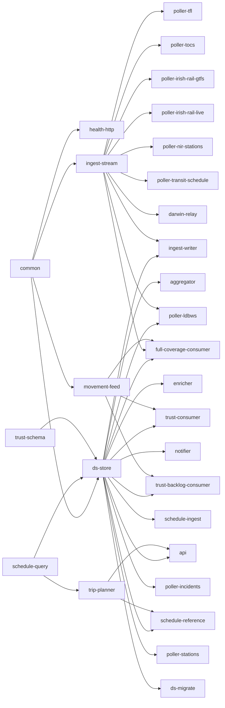

# Splitting the monorepo into the Distant-Signal organisation

Status: proposal, spec only. No repositories have been created and no code
has moved. Task DS-261. Written 2026-11-02 against `main` at `01f5a7f2`.

This spec asks whether Distant Signal (DS) should leave the single
`FasterSpeeding/Distant-Signal` repository for a set of thematic repositories
under the GitHub organisation [Distant-Signal](https://github.com/Distant-Signal).
It also re-evaluates the shared CI and utility code that DS uses or could
share.

**Short answer.** Move the repository into the organisation, but do not split
it per service.

- The code is tightly coupled. 14 of 31 crates link `ds-store`, which owns
  one Postgres schema. One chart deploys all 22 images under a single tag.
  `ds-store` reads the chart's `db-grants.yaml` when it builds.
- Changes routinely cross area boundaries. Since 2026-10-01, 512 changes
  landed on `main` (merged PRs plus direct commits). 52% of them touched more
  than one area, and 38% touched more than one code area even with CI and the
  chart left out. 39% of api changes also touched the frontend, and 78% of
  schema changes also touched the api.
- CI is cheap enough to keep together. The median `main` run takes 14 minutes
  of wall time.

A per-service split would turn about four in ten changes into multi-repo
releases that need ordering. It would buy little CI time and no deploy
independence, because everything still ships as one chart, against one
schema, through one deploy-bringer request.

The recommendation is:

1. Transfer the repository into the organisation as `Distant-Signal/distant-signal`.
   This keeps its history, stars, issues and PRs, plus redirects from the old
   URLs. It becomes the **landing repository** and keeps the frontend.
2. Add a `Distant-Signal/.github` repository for the organisation profile and
   default community files.
3. Cut internal seams inside the workspace, so that a later split is cheap if
   the numbers ever justify it.
4. Extract only satellites with low coupling. The first is `ds-ingest-bucket`.

None of the shared repositories on Forgejo should move. DS uses none of them
at build or CI time. They also serve non-DS projects, and GitHub-hosted runners
can't reach them anyway (§7).

## 1. Inventory

### 1.1 Crates

There are 31 workspace members (`Cargo.toml`) with 469,618 lines of Rust.
"Commits" counts non-merge commits since the repository began (2026-07-05)
that touched the crate. "Image" means `containers.yml` builds an image for it.

| Crate | Theme | LOC | Workspace deps | Image | Commits |
|---|---|---:|---|---|---:|
| `common` | shared lib | 35,619 | none | | 255 |
| `health-http` | shared lib | 282 | common | | 5 |
| `trust-schema` | shared lib | 2,030 | none | | 23 |
| `schedule-query` | shared lib | 11,268 | none | | 75 |
| `ingest-stream` | ingest contract | 5,683 | common | | 31 |
| `movement-feed` | ingest lib | 3,831 | common, health-http | | 30 |
| `ds-store` | schema + SQL | 48,220 | common, schedule-query, trust-schema | | 114 (+61 migrations) |
| `ds-migrate` | schema | 583 | common, ds-store | ships in the api image | 8 |
| `trip-planner` | planner lib | 15,560 | schedule-query | | 60 |
| `api` | api | 184,020 | common, ds-store, schedule-query, trip-planner, trust-schema | api | 1,071 |
| `aggregator` | worker | 19,180 | common, ds-store, health-http | aggregator | 285 |
| `enricher` | worker | 36,396 | common, ds-store, health-http | enricher | 116 |
| `notifier` | worker | 18,043 | common, ds-store, health-http | notifier | 100 |
| `ingest-writer` | ingest | 9,540 | common, ds-store, health-http, ingest-stream | ingest-writer | 63 |
| `movement-relay` | ingest (Kafka) | 3,744 | common, health-http, trust-schema | movement-relay | 33 |
| `darwin-relay` | ingest | 1,685 | common, health-http, ingest-stream | darwin-relay | 2 |
| `trust-consumer` | ingest | 8,565 | common, ds-store, health-http, movement-feed, trust-schema | trust-consumer | 97 |
| `trust-backlog-consumer` | ingest | 4,506 | same as trust-consumer | trust-backlog-consumer | 56 |
| `full-coverage-consumer` | ingest | 9,573 | common, ds-store, health-http, ingest-stream, movement-feed, schedule-query, trust-schema | full-coverage-consumer | 93 |
| `schedule-ingest` | schedule | 15,361 | common, ds-store, health-http | schedule-ingest | 48 |
| `schedule-reference` | schedule | 10,728 | common, ds-store, health-http, schedule-query, trip-planner | schedule-reference | 107 |
| `poller-transit-schedule` | schedule (transit) | 7,825 | common, health-http, ingest-stream | yes | 16 |
| `poller-incidents` | poller (Postgres) | 1,589 | common, ds-store, health-http | yes | 35 |
| `poller-stations` | poller (Postgres) | 1,069 | common, ds-store, health-http | yes | 31 |
| `poller-ldbws` | poller (stream) | 5,469 | common, ds-store, health-http, ingest-stream | yes | 45 |
| `poller-tfl` | poller (stream) | 2,823 | common, health-http, ingest-stream | yes | 49 |
| `poller-tocs` | poller (stream) | 449 | common, health-http, ingest-stream | yes | 25 |
| `poller-irish-rail-gtfs` | poller (stream) | 1,260 | common, health-http, ingest-stream | yes | 18 |
| `poller-irish-rail-live` | poller (stream) | 903 | common, health-http, ingest-stream | yes | 15 |
| `poller-nir-stations` | poller (stream) | 855 | common, health-http, ingest-stream | yes | 15 |
| `line-catalogue-validator` | tool | 2,959 | common | none (CI and manual) | 21 |

The fan-in is what matters:

- `common`: 27 dependents, every crate except `schedule-query`, `trip-planner`
  and `trust-schema`.
- `health-http`: 21 dependents.
- `ds-store`: 14 dependents, each with Postgres access.
- `ingest-stream`: 10 dependents, the stream producers plus `ingest-writer`.
- `schedule-query`: 5 dependents (`ds-store`, `api`, `trip-planner`,
  `schedule-reference`, `full-coverage-consumer`).
- `trip-planner`: 2 dependents, `api` and `schedule-reference`. The planner is
  not api-private: schedule-reference precomputes with it.

### 1.2 Everything else in the repository

| Area | What | Size |
|---|---|---|
| `frontend/` | Next.js app router and Mantine 9. It has a hand-written API client (`lib/api.ts`, 1,500 lines, no generated types), vitest, and the Playwright e2e and visual suites (172 baseline images). | 156k lines of TS/TSX |
| `charts/distant-signal` | One chart for the whole stack: 57 templates, `values.yaml` 7,044 lines, `_helpers.tpl` 3,576 lines. It holds `files/db-grants.yaml` (625 lines), the rendered `files/postgres-grants.sql` (1,371 lines), the Redis ACL template and the PrometheusRule. | 409 commits |
| `charts/ds-ingest-bucket` | A Crossplane chart (GCS bucket, IAM, audit). It is published as its own OCI artifact, and Ranma-Config's Renovate rule for it is disabled. | 6 commits |
| `lines/` | The curated line catalogue, 247 TOML files. The aggregator and api images copy it in, and `common::matcher` reads it. | 302 commits |
| `reference-data/` | CSVs and TSVs. `common`, `api` and `poller-transit-schedule` embed them with `include_str!`. The trust-consumer image copies the whole directory in. | |
| `docker/` | 21 Rust Dockerfiles generated by `scripts/gen-rust-dockerfiles.py`. Each one copies the whole workspace (`COPY . .`) with cargo-chef. | |
| `scripts/` | 31 typed Python scripts (below) and `scripts/tests`. | 186 commits |
| `.github/workflows` | `ci.yml` (4,057 lines, 17 jobs), `containers.yml` (895 lines, a 22-image matrix plus the chart push), `dependency-scan.yml`, `prune-buildcache.yml`, `validate-line-catalogue.yml`. | 247 commits |
| `docs/` | 306 Markdown files: runbooks, the API changelog, specs, and the dated `docs/superpowers` history. | |
| Root | `renovate.json5`, `deny.toml`, `pyproject.toml`/`uv.lock`, compose files, `authentik-blueprints/`. | |

The scripts fall into groups by what they touch:

- **Chart checks** (`check-*-chart.py`, 9 scripts, about 6,200 lines) and
  `chart-values-doc.py`. All of them know the DS chart's values paths.
- **Database:** `gen-db-grants.py`, `test-postgres-roles.py`,
  `observe-role-usage.py`, `check-migration-order.py`, `db-tests.py`, and
  `render-redis-acl.py` (for Redis).
- **Generic lint and CI:** `lint-scripts.py`, `lint-containers.py`,
  `paths-changed.py` and `check-bench-gates.py`. None of them names DS.
- **Code generation:** `gen-rust-dockerfiles.py` and
  `generate-pass-through.py`.
- **Frontend:** `check-copy.py`, `visual-tests.py` and the
  `tfl-arrivals-stub.py` e2e stub.
- **One-off analysis and backfills:** `fc-windowed-analysis.py`,
  `measure-transit-trip-planning.py`, `backfill-*.py`, and the `*.sql` and
  `test-*.sh` remediations.

### 1.3 Cross-cutting couplings

These are what any split has to cut.

1. **Schema and migrations.** There are 223 sqlx migrations in
   `crates/ds-store/migrations`, forward-only and immutable once merged. The
   checksum lock is `crates/api/tests/migration_checksums.lock`, 225 lines.
   It sits in the **api** crate, not `ds-store`, which is one reason 78% of
   store changes also touch the api. The lock and index-locking tests
   (`migration_checksums.rs`, `migration_index_locking.rs`) are api tests.
   `check-migration-order.py` compares migrations against `origin/main`.
2. **The schema gate.** `ds-store/src/schema.rs` makes every DB service wait
   for two things: the newest migration embedded in its build, and every
   privilege its role is given. `crates/ds-store/build.rs` reads
   `../../charts/distant-signal/files/db-grants.yaml` **at compile time**.
   The schema crate depends on a file inside the chart.
3. **DB roles and grants.** `db-grants.yaml` classifies every table, view,
   sequence and function. It gives 13 service roles (`api`, `aggregator`,
   `enricher`, `notifier`, `writer`, `schedule_reference`, `stations`,
   `incidents`, `schedule_ingest`, `trust_backlog`, `trust_consumer`,
   `full_coverage_ro`, `ldbws_ro`), 2 groups and 4 other roles their
   privileges. `gen-db-grants.py render` writes `postgres-grants.sql`, which
   the chart's roles Job runs. `gen-db-grants.py check` runs in CI against a
   freshly migrated database. Since July, 56% of grants changes came with a
   migration and 56% with an api change.
4. **Chart files read by crate tests.** Ten Rust files read chart files
   directly: the Redis ACL template (`common/tests/redis_acl.rs`), chart
   values (`ingest-stream/tests/chart_values.rs`), and the api's rate-limit
   and config defaults (`api/src/data/config.rs`, `api/src/rate_limit.rs`),
   among others.
5. **Shared DB test harness.** `ds-store`'s `test-support` feature is used by
   api, notifier, trust-consumer and trust-backlog-consumer. CI builds one
   cargo-nextest archive (`rust-db-build`). Three jobs then run every
   `#[ignore]` DB test from it: as the superuser, as the app role, and as
   each service's own role. `db-tests.py` lists the passes, which cover ten
   crates.
6. **Golden and differential data.** `ingest-stream/tests/golden.rs` and its
   fixtures pin the v1 envelope wire format "between producers and the
   writer, which ship separately". This boundary is already designed for
   independent releases. `trip-planner/tests/differential.rs` checks CSA
   against RAPTOR, inside one crate. Other fixtures live in
   `schedule-query`, `schedule-ingest`, `darwin-relay`,
   `poller-transit-schedule` and `common`, plus `enricher/eval/dataset.jsonl`.
   All of them are crate-local.
7. **The api and frontend contract.** The Rust types are serde with
   camelCase. The TypeScript side is hand-mirrored in `frontend/lib/api.ts`,
   with no generated schema. Changes are recorded in `docs/api-changelog.md`,
   which DS-MCP also reads; its client cites entries by date. CI's
   `frontend-e2e` job builds the api **from source** and runs it against
   `frontend/e2e/fixtures/seed.sql`, which depends on the current migrations.
8. **The chart and the images.** `containers.yml` builds all 22 images on
   every push to `main`. `push-helm-chart` then pins every digest into
   `values.yaml` through a hard-coded `SERVICE_TO_PATH` map. It packages the
   chart as `0.4.1+build.<run>.sha.<short>`, pushes it to
   `oci://ghcr.io/fasterspeeding/charts`, and signs it with cosign keyless,
   with three retries. The chart is the only versioned release unit: an image
   is never deployed except through a chart build. `global.imageRegistry`
   keeps the **last two path segments** of every image repository, so the
   path shape `<registry>/<namespace>/distant-signal/<svc>` is load-bearing.
9. **Data baked into images.** `lines/` goes into the api and aggregator
   images, and `reference-data/` into trust-consumer. `include_str!` CSVs
   are embedded in common, api and poller-transit-schedule.
10. **Owner-specific strings.** 225 occurrences of `FasterSpeeding` in 51
    files. The ones that matter at runtime:
    - `common::user_agent::PROJECT_URL`, sent to every upstream data provider;
    - the alert `runbook_url`s in the PrometheusRule and its tests;
    - `IMAGE_BASE` and the chart destination in `containers.yml`;
    - `prune-buildcache.yml`'s package name;
    - every `image.repository` default in `values.yaml`.

## 2. Evidence

### 2.1 What changes together

"Changes" are first-parent commits on `main`: merged PRs and direct commits,
with each merge diffed against its first parent. Paths are grouped into ten
areas:

- **api**: `api` plus `docs/api-changelog.md`;
- **frontend**;
- **chart**: both charts;
- **ci**: `.github`, `scripts`, `docker`;
- **store**: `ds-store`, `ds-migrate`, migrations;
- **common**: `common`, `health-http`, `line-catalogue-validator`, `lines/`;
- **ingest**: the relays, consumers, `ingest-*`, `movement-feed`,
  `trust-schema`;
- **schedule**: `schedule-*`, `trip-planner`;
- **pollers**;
- **workers**: aggregator, enricher, notifier.

| Window | Changes | Touch 2+ areas | Touch 2+ code areas (ci and chart excluded) |
|---|---:|---:|---:|
| All history (2026-07-05 on) | 1,388 | 589 (42%) | 450 (32%) |
| Since 2026-10-01 | 512 | 265 (52%) | 196 (38%) |

Coupling is rising, not falling, as the project matures.

The strongest pairs since 2026-10-01 are below. A percentage is the share of
the first area's changes that also touched the second, then the other way
round.

| Pair | Changes | Share |
|---|---:|---|
| chart + ci | 98 | 63% / 65% |
| api + frontend | 89 | 39% / 43% |
| api + chart | 78 | 34% / 50% |
| api + store | 76 | 33% / **78%** |
| chart + store | 54 | 35% / 56% |
| chart + ingest | 47 | 30% / 60% |
| api + ingest | 46 | 20% / 59% |
| api + common | 45 | 20% / 67% |
| common + ingest | 41 | 61% / 53% |
| api + schedule | 42 | 19% / 70% |

At commit level since 2026-01-01 (4,115 non-merge commits), the clearest
clusters are these:

- aggregator with `lines/`: 52% of aggregator commits;
- api changelog with api: 74%;
- migrations with api: 80%;
- `trust-backlog-consumer` with `trust-consumer`: 61%;
- `full-coverage-consumer` with the other two TRUST consumers: 32 to 35%;
- `scripts/` with the chart: 55%.

The island-of-Ireland and TfL pollers are the quietest code: 15 to 49
commits each, mostly alongside `common` or `ingest-stream`.

### 2.2 CI

These figures come from the last 20 successful `ci.yml` runs on `main`.

- **Wall time:** minimum 10.3 minutes, median 14.1, maximum 72 (queueing).
- **Job time per run:** 66 job-minutes in run 41408892594. The largest jobs
  are Playwright (13.6), cargo build and test (11.2), frontend (9.9),
  scripts-lint (6.1), and the three DB passes (5.6, 4.3 and 5.4) off a
  3.6-minute archive build.
- **Containers:** median 8 minutes, maximum 19 (`containers.yml`).
- **Volume:** in the week to 2026-11-02, each of CI, Containers and the
  dependency scan ran about 166 times. CI alone is about 11,000 job-minutes
  a week.

The repository is **public**, so these minutes cost nothing on
GitHub-hosted runners. The organisation is on the Free plan. A **private**
repository there gets 2,000 minutes a month, which DS's CI would use up in
about a day and a half. **Every repository in the organisation has to stay
public, or the CI bill changes the whole calculation.**

### 2.3 Repository facts

- 5,360 commits since 2026-07-05 and a 194 MiB pack.
- 142 PRs and 6 issues (4 open), 1 star, no forks.
- No branch protection or rulesets, no repository secrets or variables, and
  no environments. The workflows use only `GITHUB_TOKEN` and OIDC.
  `validate-line-catalogue.yml` names `RDM_API_KEY` and `RDM_TOCS_BASE_URL`,
  but neither is set at repository level, so check before the move.
- No `LICENSE` and no `SECURITY.md`. Homepage `https://ds.cursed.solutions/`.
  No description, no topics.
- Authors since 2026-10-01: `FasterSpeeding <lucina@lmbyrne.dev>` (1,857
  commits) and `mine-bringer-renovate[bot]` (25).

## 3. Options and the proposed layout

### 3.1 Option C: one repository per service (rejected)

That would be about 30 repositories: 22 deployables plus libraries. It is
rejected because:

- `common` and `ds-store` would need publishing and version bumps in 27 and
  14 consumers;
- every migration would become a release train across up to 14 repositories;
- `api` and `schedule-reference` share `trip-planner`;
- the chart would need 22 image-bump inputs.

The pollers average 25 commits each in four months, so separate CI would
save almost nothing.

### 3.2 Option B: thematic repositories (the shape if DS ever splits)

This is the best full split, kept as the target shape for §8 phase 5. It is
not recommended now.

| Repository | Contents | Why this boundary | Main cost |
|---|---|---|---|
| `distant-signal` (landing, existing) | frontend, docs index, community files | Highest change rate (1,263 commits). Users see it first. | 39 to 43% of api and frontend changes become two-repo |
| `ds-core` | `common`, `health-http`, `trust-schema`, `schedule-query`, `ingest-stream`, `movement-feed`, `ds-store` + migrations + grants, `ds-migrate`, `line-catalogue-validator`, `lines/`, `reference-data/` | Everything with fan-in. One owner for schema, grants and the stream envelope. | Every consumer pins a release, and a migration is a core release plus a consumer bump. |
| `ds-api` | `api`, `trip-planner` | `trip-planner` is shared with schedule-reference, so it would have to move to core or be duplicated. | Owns the API changelog, and frontend e2e needs its image. |
| `ds-ingest` | `ingest-writer`, `movement-relay`, `darwin-relay`, TRUST consumers | The three TRUST consumers change together (32 to 61%). Kafka and Redis Streams. | 60% of ingest changes also touch the chart. |
| `ds-pollers` | the 8 `poller-*` crates, `poller-transit-schedule` | Low churn, and most talk only through the versioned envelope. | `poller-ldbws`, `-incidents` and `-stations` still link `ds-store`. |
| `ds-schedule` | `schedule-ingest`, `schedule-reference` | One pod sharing a PVC, the SFTP and bucket feed. | Needs `trip-planner` from api or core. |
| `ds-workers` | `aggregator`, `enricher`, `notifier` | Moderate churn, each a `ds-store` consumer. | Aggregator changes go with `lines/` 52% of the time, and `lines/` would be in core. |
| `ds-deploy` | `charts/distant-signal`, `db-grants.yaml` rendering, the alert-rules tests, the chart check scripts | The deploy unit. | Every image repository feeds it, and the chart and ci areas change together 63% of the time. |

Releases and versions under Option B:

- **Shared crates** would be consumed as git dependencies pinned by tag from
  `Distant-Signal/ds-core`, for example
  `common = { git = "https://github.com/Distant-Signal/ds-core", tag = "core-v0.3.1" }`.
  The repository is public, so this needs no registry and no auth. Renovate's
  cargo manager bumps git tags. `deny.toml` would add
  `allow-git = ["https://github.com/Distant-Signal/ds-core"]`.
- **Not crates.io:** it implies a public API and semver promises for
  workspace-internal code.
- **Not a private registry:** a self-hosted one is only reachable on the
  tailnet (§7.2), and Cloudsmith-style services add cost and secrets.
- **Versioning:** each service repository tags `vX.Y.Z` on its own cadence
  and builds images tagged `sha-<short>` plus the semver tag.
  `ds-deploy` pins image digests in `values.yaml` through Renovate's
  helm-values manager. Its chart version keeps the
  `<base>+build.N.sha.S` scheme.

### 3.3 Option A: core monorepo plus satellites (recommended)

| Repository | Contents | Status |
|---|---|---|
| `Distant-Signal/distant-signal` | The current monorepo, transferred, with the frontend, landing README and community files. | Phase 1 |
| `Distant-Signal/.github` | Organisation profile (`profile/README.md`) and default `SECURITY.md`, `CONTRIBUTING.md` and issue forms. No code. | Phase 0 |
| `Distant-Signal/ds-ingest-bucket` | `charts/ds-ingest-bucket`, `check-ingest-bucket-chart.py`, its CI and its OCI push. | Phase 4 (optional) |

Why `ds-ingest-bucket` alone:

- 6 commits in four months;
- an independent version (0.2.1) and OCI artifact already;
- no crate reads it;
- Crossplane, not workload, concerns;
- its Renovate rule in Ranma-Config is disabled until it goes live.

Its only DS coupling is the bucket's name and the reader's service account,
both of which are values.

Releases and versions under Option A don't change. Crates stay path
dependencies. There is one chart version per build, and the images share the
commit tag. Independent service cadence is still possible today without a
split: the chart can pin one service to an older digest by values. That is
how the Ranma-Config "hold" pattern for the frontend already works.

## 4. The landing repository

### 4.1 Which repository

**Recommendation: the transferred `FasterSpeeding/Distant-Signal`, renamed
`Distant-Signal/distant-signal`.**

Under Option A it is the frontend's repository, so this is the user's default.
It also keeps the 5,360 commits, the star, the issues and PRs, and the
redirects from every existing link. Those links are in Ranma-Config, the
deploy records, Renovate PR bodies, DS-MCP comments and old alert annotations.

| Candidate | For | Against |
|---|---|---|
| **Transferred monorepo, which holds the frontend (recommended)** | No new repository. History and stars kept. Old URLs redirect. It is where the product visibly lives. | The README has to serve both visitors and developers. |
| Frontend extracted to a new repository, which becomes the landing page | Matches "frontend first" literally. | Loses the stars, issues and PR history unless the *backend* is extracted instead (§4.4). Turns 43% of frontend changes into two-repo changes (§2.1). |
| Thin meta or docs repository (`distant-signal-docs` or similar) | Clean front page, independent of code churn. | A repository with nothing to build. Its README drifts from the code. It adds a hop for every visitor. Only worth it once there are 4 or more code repositories. |
| `.github` profile only | Every organisation visitor sees it. | Not a repository people star, file issues on or clone. It complements the landing repository rather than replacing it. |

### 4.2 What it carries

- **README as the front page.** Today's 158-line README is a developer
  overview. Restructure it in this order:
  1. what DS is, in two sentences;
  2. a link to https://ds.cursed.solutions/;
  3. four screenshots: home and train page at 390 px and 1366 px, light and
     dark;
  4. a feature list;
  5. an architecture overview, a Mermaid diagram derived from `CLAUDE.md`'s
     Architecture section: producers to Postgres or Redis streams to
     ingest-writer, api and frontend, notifier;
  6. the repository index;
  7. links to "Run it locally" and "Contributing".

  Generate the screenshots from the seeded e2e stack inside the pinned
  Playwright container. Use the same `visual-tests.py` route, committed under
  `docs/screenshots/`, so they are reproducible and never show real user
  data. Don't reuse `frontend/e2e/visual-baselines/`: those are test
  baselines and must stay byte-exact. Regenerate the screenshots
  deliberately, not on every UI change.
- **Repository index.** A table of every organisation repository and its
  role (§3.3). Add a row for DS-MCP noting that it is hosted elsewhere and
  consumes the public API, without linking a tailnet URL.
- **Contributing and dev setup.** Write `CONTRIBUTING.md` from the
  `CLAUDE.md` command blocks: toolchain, `docker compose --env-file local.env
  up --build`, the DB test passes and the frontend checks. Under Option A
  there is no cross-repo setup; one clone is the full stack. If Option B ever
  happens, the landing repository's compose file pulls the other services'
  images from `ghcr.io/distant-signal/...` by default. A `DS_<SERVICE>_SRC`
  path override builds a locally checked-out repository instead.
- **Issue tracker home.** The landing repository owns *all* issues,
  cross-cutting and per area, with area labels (`area:api`,
  `area:frontend`, `area:ingest`, `area:chart`, ...). Satellites disable
  Issues and point there through `.github` issue-form config. The
  worklog/Vikunja cards stay the working tracker. GitHub Issues are for
  external reports and anything that needs a public link.
- **Security policy and licence.** Put `SECURITY.md` in the `.github`
  repository so it applies to every organisation repository by default. Use
  private vulnerability reporting (GitHub's built-in form). It should cover
  the hosted site, the API (including delegated access) and the images. The
  repository has **no licence**. As a public repository it is therefore "all
  rights reserved", and nobody can legally reuse it. Pick one before the
  move (question 6).

### 4.3 Organisation-level presentation

- `Distant-Signal/.github/profile/README.md`: three lines on what DS is, the
  site link, one screenshot and the repository index. Keep it short and
  point to the landing README.
- Pin `distant-signal` first. The `.github` repository needs no pin, since
  its profile README already shows on the organisation page. Pin
  `ds-ingest-bucket` only if it is useful to visitors.
- Description: "A personal UK rail companion: line status, train and journey
  tracking, trip planning and Delay Repay support." Homepage: the site.
  Topics: `rail`, `uk`, `trains`, `transport`, `rust`, `nextjs`, `helm`,
  `postgres`.
- Organisation avatar: the app icon (`frontend/public/icon-512.png`).

### 4.4 Should the existing repository become the landing repository?

**Yes: transfer it, don't archive it.** A GitHub transfer keeps issues, PRs,
stars, watchers, releases and wiki. It redirects old web and git URLs to the
new location until somebody creates a new repository at the old name. Don't
create one. Renaming on transfer (`Distant-Signal` to `distant-signal`) is
also redirected.

Archiving and starting fresh would break those links. It would also leave
two repositories with the same name in search results, and it would force
everything to be rebased onto a new history.

If the backend is ever extracted (Option B), extract *outward* from the
landing repository. The frontend and the landing page stay where the history
and redirects are, and `ds-core` and the others start as `git filter-repo`
extracts (§5.6).

Redirects are a convenience, not something to depend on:

- Ranma-Config's Flux verification uses an anchored regex on the **new**
  subject.
- Renovate's `sourceUrl` and compare links change.
- The `task-bringer` repository mapping changes.

Update all of these explicitly in phase 1 (§8).

## 5. Hard problems

### 5.1 Schema and migrations: one owner, many consumers

Under Option A, nothing changes. Within the repository:

- Move `migration_checksums.lock` and its two tests from `crates/api/tests`
  to `crates/ds-store/tests`, so a migration-only change no longer touches
  the api. This is phase 3.
- Keep the conventions: forward-only, `-- contract:` headers,
  `check-migration-order.py`.

Under Option B, `ds-core` owns `migrations/`, the lock, the order check and
`ds-migrate`. `ds-migrate` gets its own image, `ghcr.io/distant-signal/ds-core/ds-migrate`,
instead of riding in the api image. The chart's migrate hook Job uses it.

The **schema gate** already makes this safe. A service built against core
`vN` embeds `REQUIRED_MIGRATION`, and it waits (not ready) until the
database has reached that migration. Older services keep running, because
migrations are expand-only. The release rule is:

1. a core release containing migrations is deployed (chart bump) before any
   service that needs them;
2. destructive (`contract:`) migrations ship one core release after the last
   consumer stopped using the object.

Add a check to core's CI that refuses a `contract:` migration while any
service image pinned in the chart's current `values.yaml` was built against
an older core tag. That data is in the chart's digests and the images' OCI
labels.

### 5.2 Per-service roles and grants

Keep a single source, `db-grants.yaml`, next to the migrations that make it
necessary. 56% of grants changes co-change with migrations. Today the file
lives in the chart, and `ds-store/build.rs` reads it from there.

- **Option A:** move it to `crates/ds-store/db-grants.yaml`. The chart can't
  read files outside its directory, so the chart's copy becomes a generated
  file. `gen-db-grants.py render` writes both `charts/.../files/db-grants.yaml`
  and `postgres-grants.sql`, and `check` fails on drift. `build.rs` then
  reads a file inside its own crate. Alternatively, leave it where it is: it
  works, and the cost is only conceptual. Phase 3, optional.
- **Option B:** `ds-core` owns `db-grants.yaml` and the renderer. Each core
  release publishes `postgres-grants.sql`, `postgres-roles.sql` and the YAML
  as release assets. `ds-deploy` vendors them through a Renovate
  `github-releases` custom manager, with a CI check that the vendored copy
  matches the tag. A service that needs a new grant opens a PR on core. The
  schema gate's grant check, baked in at build time, makes the service wait
  until the roles Job has run the new grants.

### 5.3 Cross-repo atomic changes

The case: an API field plus its frontend use. That is 89 changes since
October (§2.1).

- **Option A:** stays atomic. One PR, and `frontend-e2e` runs against the
  api built from the same commit.
- **Option B:** use expand and contract, which the API changelog already
  supports:
  1. The api PR adds the field (optional, additive) and the changelog entry,
     and ships.
  2. The frontend PR uses it, with e2e run against the api image pinned by
     digest in the frontend repository's `e2e/api-image.txt`. Renovate bumps
     that file when the api publishes.
  3. A removal is a later api release after the frontend stopped reading the
     field.

  Generate the TypeScript types to replace the hand-mirrored `lib/api.ts`,
  using `ts-rs` or `specta` from the serde types. Publish them as a versioned
  npm package (`@distant-signal/api-types`) from the api repository, so type
  drift fails `tsc` rather than e2e. Do this in phase 3 even under Option A:
  it also helps DS-MCP. For a change that really must land together,
  off-by-default chart values remain the switch. Both halves deploy dark, and
  one values change turns them on.

### 5.4 The chart: umbrella or per-service

**Keep one umbrella chart** under either option. Today one chart means:

- one migrate hook before every workload;
- one roles Job;
- one `PrometheusRule`;
- one signature;
- one Renovate PR (`renovate/distant-signal-chart`) and one deploy-bringer
  request, with deploy notes for the whole release.

Per-service charts would mean 22 HelmReleases and `version.yaml` files in
Ranma-Config, and 22 Renovate PRs per build. The deploy order (migrations,
grants, then services) would have to be rebuilt with Flux `dependsOn`.
deploy-bringer would see a stream of small requests instead of one
reviewable release.

Image tags and builds:

- **Option A:** unchanged. `containers.yml` builds the matrix, pins digests
  and pushes `X.Y.Z+build.N.sha.S`.
- **Option B:** each service repository publishes signed images on `main`.
  Renovate in `ds-deploy` bumps `image.tag` and `image.digest` per service,
  grouped into one weekly PR plus immediate security bumps. Every merge to
  `ds-deploy`'s `main` produces the chart build. A chart build then means
  "these exact digests". Deploy notes come from the bump PR's
  aggregated release notes.

The OCI tag scheme doesn't change: `<base>_build.<run>.sha.<short>`, with
`+` written as `_` in the OCI tag. Ranma-Config's Renovate rule parses
`build.N` and `sha.S` from it.

Two things change with the move:

1. **The run number.** A transfer keeps the workflow's run counter (verify
   on the first build). A *new* repository restarts at 1, which Renovate
   would order below 0.4.1+build.700. Bump the chart base to **0.5.0** at the
   cutover either way. Semver precedence ignores build metadata, so 0.5.0
   beats every 0.4.1 build whatever N is.
2. **The repository path,** in §5.8 and §5.9.

### 5.5 CI cost and caching across repositories

Minutes are free while every repository is public (§2.2). The real cost of a
split is time and duplication:

- Each Rust repository compiles the heavy shared dependencies again in its
  own cache (sqlx, rdkafka with vendored librdkafka, axum, reqwest).
  `Swatinem/rust-cache` and the GitHub Actions cache are scoped to one
  repository.
- Docker layer caches live in GHCR (`buildcache:<service>`). Those *can* be
  read across organisation repositories, because `cache-from` takes any
  readable ref. Keep them registry-based.
- Each Postgres-backed repository needs its own copy of the services
  containers and the DB-pass harness.

Under Option A, the cheaper lever is path filtering within the one repository.
`paths-changed.py` exists and gates only `frontend-e2e` today. Gating the
Rust DB passes and Playwright on their inputs would cut the many docs-, chart-
and script-only runs, from 66 job-minutes to a few. This is phase 3.

### 5.6 Preserving git history

- **The landing repository:** a GitHub transfer keeps everything, with the
  same SHAs.
- **Satellites:** `git filter-repo` from a fresh clone, with explicit
  `--path` and `--path-rename`. For `ds-ingest-bucket` that is
  `--path charts/ds-ingest-bucket/ --path scripts/check-ingest-bucket-chart.py --path-rename charts/ds-ingest-bucket/:chart/`.
  Then delete those paths in one commit in the landing repository that names
  the new repository and its first SHA.

  filter-repo keeps authors and dates. It rewrites SHAs, so links to old
  commit SHAs only resolve in the landing repository. It drops signatures:
  3 of the last 10 `main` commits are GitHub-signed merges, and those lose
  their "Verified" badge in the extract.
- **Not a fresh start.** Blame on migrations and the chart is regularly how
  incidents are explained (`-- contract: ... in <commit>` headers cite SHAs).
  Those SHAs stay valid in the landing repository either way.

### 5.7 Issue and PR migration

The transfer moves all 142 PRs and 6 issues. Satellites start empty with
Issues disabled (§4.2). Transfer any open issue that is really about a
satellite with GitHub's "Transfer issue", which works within one owner.
Closed PRs stay in the landing repository as history.

Update the worklog `Task:` trailers: task-bringer's DS project maps to
`repos: [FasterSpeeding/Distant-Signal]` in Ranma-Config
(`clusters/mine-bringer/apps/task-bringer/release.yaml`). Add the new name,
and keep the old one for old commits.

### 5.8 GHCR paths

Packages owned by the `FasterSpeeding` user don't move with a repository
transfer. New pushes go wherever `IMAGE_BASE` points.

New paths:

- **Images:** `ghcr.io/distant-signal/distant-signal/<service>`. This keeps
  the three-segment shape, so `global.imageRegistry`'s "keep the last two
  segments" rule (`_helpers.tpl`) still yields `distant-signal/<service>`.
  Under Option B the middle segment becomes the source repository
  (`ghcr.io/distant-signal/ds-ingest/ingest-writer`), and the helper keeps
  working.
- **Charts:** `oci://ghcr.io/distant-signal/charts/distant-signal` and
  `.../charts/ds-ingest-bucket`.
- **Build cache:** `ghcr.io/distant-signal/distant-signal/buildcache:<service>`.
  For the first week, `cache-from` lists the old path as well, so the first
  builds aren't cold.

What to update:

- In DS: `IMAGE_BASE`, the chart `DEST`, every `image.repository` default in
  `values.yaml` and its README table, `prune-buildcache.yml`'s
  `package-name`, `user_agent::PROJECT_URL` and the alert `runbook_url`s.
  Phase 0 makes all of these one variable each.
- **Package visibility:** check the first organisation push. The packages
  must be **public**, because the cluster pulls anonymously today. Link each
  package to the repository so `GITHUB_TOKEN` keeps write access.
- **Old packages:** keep them for 90 days, as the rollback target. After
  that, prune all but the last deployed chart and its images.

### 5.9 Signing identities, secrets and Actions settings

The cosign keyless subject is
`https://github.com/<owner>/<repo>/.github/workflows/containers.yml@refs/heads/main`.
The transfer changes it immediately. Flux verifies only the **chart**
(Ranma-Config `clusters/base/apps/distant-signal/version.yaml`, an anchored
`matchOIDCIdentity` regex), and `matchOIDCIdentity` is a list.

Steps:

1. **Before the transfer:** add a second identity for
   `^https://github\.com/Distant-Signal/distant-signal/\.github/workflows/containers\.yml@refs/heads/main$`.
   Both identities verify, so the switch is safe in either direction.
2. **Cutover:** in one hand-filed Ranma-Config PR, change the
   OCIRepository's `url` to the new chart path and its `tag` to the first
   organisation build.
3. **After 90 days:** drop the old identity.

`containers.yml`'s own `cosign verify` self-check and the provenance
attestation derive from `github.workflow_ref`, so they follow automatically.
`gh attestation verify --repo` callers in docs change to the new name.

Under Option B, if images are ever verified in the cluster, use one regex
over the organisation:
`^https://github\.com/Distant-Signal/[^/]+/\.github/workflows/containers\.yml@refs/heads/main$`.

Secrets and settings:

- **Secrets:** none at repository level today. Confirm where
  `validate-line-catalogue.yml`'s RDM secrets come from, and re-create them
  as repository secrets if they are needed.
- **Organisation Actions settings:**
  - allow GitHub-owned actions, plus the pinned third-party ones already in
    use (`dtolnay`, `Swatinem`, `taiki-e`, `astral-sh`, `azure`, `docker`,
    `sigstore`) and `FasterSpeeding/Piped`;
  - default `GITHUB_TOKEN` to read-only. The workflows already request
    `packages: write`, `id-token: write` and `attestations: write` per job.
- **Renovate:** the mine-bringer Renovate GitHub App must be installed on
  the organisation (or the repository). Ranma-Config's
  `renovate-github.yaml` `discoveryFilters` must list the new name.
- **Rulesets:** an organisation ruleset that blocks force-pushes and
  deletion on `main`. No required reviews, which matches today's flow, where
  green PRs are merged directly.

### 5.10 Commit identity

Commits must stay authored as `FasterSpeeding <lucina@lmbyrne.dev>`.
Attribution on GitHub depends on that email being verified on the
FasterSpeeding account, not on which owner holds the repository, so nothing
changes there.

The risks are new clones and agent worktrees picking up a different global
identity. Mitigations:

- keep the existing pre-commit check in agent sessions: `git config
  user.email` must be `lucina@lmbyrne.dev`;
- optionally add a CI job on PRs that fails when a commit's author email is
  outside an allowlist (`lucina@lmbyrne.dev` and the Renovate bot's noreply).

filter-repo extracts keep the original authors. Never pass `--mailmap` or
`--email-callback`.

### 5.11 Ranma-Config, Renovate and deploy-bringer

| Where | Change |
|---|---|
| `clusters/base/apps/distant-signal/version.yaml` | `url`, `tag` and a second identity under `verify` (§5.9) |
| `renovate.json5` | `matchPackageNames` to the new chart path; `sourceUrl`; the `compare/` link template in `prBodyNotes` |
| `clusters/mine-bringer/apps/renovate-github.yaml` | `discoveryFilters`, and the App installation |
| `clusters/mine-bringer/apps/task-bringer/release.yaml` | Add the new repository to the DS project |
| `scripts/bump-distant-signal.sh` and its header | Chart path |
| `clusters/mine-bringer/apps/ds-ingest-gcp/release.yaml` | Chart path, if it moves in phase 4 |
| `deploy-prs.yaml` | No change: `exclude: ["renovate/distant-signal-chart"]` is a branch name in Ranma-Config |
| deploy-bringer | No change: it reads Ranma-Config, which stays at `FasterSpeeding/Ranma-Config` |

## 6. What else depends on the DS repository

- **DS-MCP** (Forgejo, `lucy/Distant-Signal-MCP`) depends only on the
  deployed API and on `docs/api-changelog.md` by name. Its comments cite the
  file path. After the move, the old GitHub links redirect. Generated API
  types (§5.3) would let it pin a package instead of reading Rust structs.
- **Ranma-Config** depends on the chart, the images and the identity (§5.11).
- **The bedrock-openai-proxy test fixture** in Ranma-Config names the
  repository as a string. Update it when convenient.

## 7. Shared CI and utilities

### 7.1 What DS actually uses today

These were grepped across workflows, `Cargo.toml`, `deny.toml`, Dockerfiles,
`renovate.json5`, `pyproject.toml`/`uv.lock`, `package.json`, the chart and
the scripts.

- **GitHub, neutral:** `FasterSpeeding/Piped`. DS uses its reusable
  `lint-actions.yml` (pinned by SHA) and its Renovate base preset
  (`github>FasterSpeeding/Piped//config/renovate.json5`). Piped is also used
  by Aurora-Fauxy and by the Forgejo repositories' Renovate configs.
- **Marketplace actions,** all SHA-pinned.
- **Forgejo (`git-bringer`): nothing at build or CI time.**
  - `deny.toml` allows crates.io only (`allow-git = []`, and "the guide's
    Forgejo registry entry is dropped").
  - There is no `local>lucy/renovate-config` preset. DS-MCP, ci-workflows,
    helm-common and postgres-pgbackrest use it; DS doesn't.
  - There is no helm-common dependency. helm-common was *extracted from*
    the DS chart, but the DS chart doesn't consume it.
  - DS doesn't use `lucy/ci-workflows`, which was also extracted from DS's
    workflows.
- **Runtime only:** `lucy/postgres-pgbackrest`. The chart's
  `postgresql.pgbackrest.image.repository` has no default; the deployer
  (Ranma-Config) sets it. The chart and `renovate.json5` mention it only in
  comments.

GitHub-hosted runners **cannot reach** `git-bringer.fox-prometheus.ts.net`,
which is on the tailnet. helm-common's README says so under "GitHub-built
consumers". Forgejo's composite actions also need the in-cluster URL
(`http://forgejo-http.forgejo.svc.cluster.local:3000/...`). So nothing on
Forgejo can be a `uses:`, a Renovate `local>` preset, or a git dependency of
an organisation repository on GitHub.

### 7.2 (b) Forgejo repositories: move, keep or copy

| Repository | Used by DS? | Also used by | Verdict | Why |
|---|---|---|---|---|
| `lucy/ci-workflows` | No | lucy/* repos on Forgejo (DS-MCP, deploy-bringer, ...) | **Keep** | Written for Forgejo 15. It relies on server-side expansion quirks, `secrets: inherit` without declarations, the Forgejo registry login, buildx mirrors through the in-cluster pull-through cache, and runner-local grype DB and cargo cache. Moving it would break its real consumers, and GitHub doesn't need it. It is neutral already ("lucy/*"), not DS-branded. |
| `lucy/ci-workflows-selftest` | No | ci-workflows | **Keep** | Tests ci-workflows on Forgejo. |
| `lucy/helm-common` | No | DS-MCP, deploy-bringer charts | **Keep** | Only Forgejo repositories consume it. If the DS chart ever adopts it, vendor the `.tgz` (`helm dependency build --skip-refresh`) or push a neutral mirror to `ghcr.io/fasterspeeding/charts/helm-common`. Not the DS organisation: it isn't DS's. |
| `lucy/postgres-pgbackrest` | Runtime, through deployer values | Every pgBackRest Postgres in the cluster | **Keep** | Cluster infrastructure, pulled by the cluster from the in-cluster registry. It doesn't touch DS CI. Moving it to GHCR would add an internet dependency to the database's restart path for no gain. |
| `lucy/k8s-backup-component` | No (Ranma-Config's DS backup) | forgejo, coder, authentik, vaultwarden | **Keep** | Ranma-Config-level and multi-service. |
| `lucy/renovate-config` | No | Forgejo repositories | **Keep** | GitHub Renovate can't read it. DS uses Piped's preset. |
| `lucy-ts-libs` | No (not in `frontend/package.json`) | DS-MCP and other TypeScript services | **Keep** | Not used by DS. |
| `FasterSpeeding/Piped` (GitHub) | Yes | Aurora-Fauxy, the Forgejo repositories' presets | **Keep where it is** | Already on GitHub, public and neutral. Moving it into a DS-branded organisation would be wrong for its other users. |
| `lucy/Distant-Signal-MCP` | Consumer of DS | DS users | **Keep for now** (question 7) | Its pipeline is Forgejo end to end: Actions, the registry, `deploy-releases.yaml` and Forgejo Renovate. Moving it is a separate project. Revisit if it becomes public. |

### 7.3 (a) What to pull out of DS

The rule: extract only when there is a **second consumer on the same
platform**. Under Option A there is one Rust repository on GitHub, so most of
this stays.

| Piece | Generic? | Verdict | Where, if extracted |
|---|---|---|---|
| clippy, rustfmt, MSRV and cargo-deny jobs | Yes | **Keep** in `ci.yml` until a second organisation Rust repository exists | `Distant-Signal/.github` as a reusable `rust-ci.yml`, a GitHub port of `lucy/ci-workflows`'s design |
| nextest archive and the three DB passes, plus `db-tests.py` | The mechanism is; the passes are DS roles | **Keep** | Option B: a reusable `rust-db-tests.yml` in `Distant-Signal/.github`, with the passes file as input |
| Chart checks (`check-*-chart.py`, render asserts in `helm-lint`) | No: they name DS values paths (up to 34 references in one script) | **Keep** with the chart | Option B: `ds-deploy` |
| cosign sign with retry (three copies in `containers.yml`) | Yes | **Copy now** into a local composite action `.github/actions/cosign-sign` in DS, removing the duplication | Later `Distant-Signal/.github` (for DS) or Piped (if neutral is wanted) |
| `lint-scripts.py`, `lint-containers.py`, `paths-changed.py`, `check-bench-gates.py` | Yes, no DS names | **Keep**. Forgejo has the equivalent (`ci-workflows/scripts-lint.yml`). | If a second GitHub repository needs them: Piped (neutral) |
| Renovate rules (MSRV toolchain, sqlx `<0.9`, Valkey and Postgres majors, cargo 0.x minors, TypeScript `<7`) | DS-specific | **Keep** in `renovate.json5` | Option B: `Distant-Signal/renovate-config` (`github>Distant-Signal/renovate-config`), extending Piped |
| `common` generic modules: `backoff`, `log_once`, `logging`, `metrics`, `secret`, `redis_conn`/`redis_auth`/`redis_group`, `pg`, `startup`, `heap`, `outbound_endpoint_guard`, `service_args`, `progress`, `advisory_locks`, `user_agent` (minus `PROJECT_URL`), and `health-http` | Yes | **Keep**, but split internally (phase 3) into a domain-free `ds-runtime` crate and a domain `common` | If deploy-bringer or worklog-mcp (Rust, Forgejo) want it: a neutral name (`svc-runtime`), published to crates.io, since both platforms can reach it and `deny.toml` already allows it. Not DS-branded. |

## 8. Phased migration plan

Each phase leaves `main` deployable and has its own rollback.

### Phase 0: preparation (about 1.5 days)

**In DS:**

- Make the owner one variable each:
  - `IMAGE_BASE` and the chart `DEST`, from `${{ github.repository_owner }}`;
  - `values.yaml` repositories;
  - `PROJECT_URL`, as a constant plus a test that it is an https URL;
  - the alert `runbook_url`s, through a chart value
    `alerts.runbookBaseUrl`.
- Add the `cosign-sign` composite action.
- Check where the RDM secrets come from.

**In Ranma-Config:** add the second `matchOIDCIdentity` (§5.9).

**In GitHub:**

- create `Distant-Signal/.github` with `profile/README.md`, `SECURITY.md`,
  `CONTRIBUTING.md` and the issue-form config;
- set the organisation Actions policy and ruleset;
- install the Renovate App on the organisation.

**Decide** the licence (question 6).

**Rollback:** revert the PRs. The extra Flux identity is harmless.

### Phase 1: transfer and cutover (about 1 day plus a watched deploy)

1. Transfer `FasterSpeeding/Distant-Signal` to `Distant-Signal` and rename
   it `distant-signal`.
2. Bump the chart base to 0.5.0.
3. The first `main` build pushes to `ghcr.io/distant-signal/...`. Check that
   the packages are public, the signature verifies and the attestation is
   there.
4. Update local remotes (`git remote set-url`) in the main clone and the
   worktrees.
5. File one hand-made Ranma-Config PR, through a normal deploy-bringer
   request with deploy notes:
   - the OCIRepository `url` and `tag`;
   - Renovate `matchPackageNames`, `sourceUrl` and the compare template;
   - `discoveryFilters`;
   - the task-bringer repository list;
   - `bump-distant-signal.sh`.
6. Confirm that Renovate's next chart PR comes from the new path.

**Rollback:** revert the Ranma-Config PR. The old chart, the old images and
the old identity are all still valid for 90 days, and the cluster goes back
to the last `fasterspeeding` build. Transferring the repository back is
possible but muddles redirects; fix forward instead.

**What stays in the monorepo:** everything.

### Phase 2: landing-repository presentation (about 1 day)

- Restructure the README (§4.2) and add the screenshots under
  `docs/screenshots/`.
- Add the repository index, `CONTRIBUTING.md` (from `CLAUDE.md`), and the
  repository description, topics and pin.
- Add the area labels.

**Rollback:** revert. Docs only.

### Phase 3: internal seams (about 3 to 5 days, independent PRs)

- Move `migration_checksums.lock` and its tests into `ds-store`.
- Make `ds-store` own `db-grants.yaml`, with the chart copy generated
  (optional, §5.2).
- Split `common` into `ds-runtime` and domain `common`.
- Add generated API types (ts-rs or specta) replacing the hand-written
  `lib/api.ts` types, behind a `tsc` drift check.
- Path-filter the heavy CI jobs: Rust DB passes on `crates/**` and
  migrations; Playwright on `frontend/**`, `crates/api/**` and migrations.
- Extend `check-crate-deps.py` to enforce the §1.1 layering, for example
  pollers may not link `trip-planner`.

**Rollback:** per PR.

**What stays in the monorepo:** everything. This phase only makes a later
split cheap.

### Phase 4: satellite `ds-ingest-bucket` (about 1 day, optional)

Do this when the bucket goes live, or never.

1. `filter-repo` extract (§5.6) to `Distant-Signal/ds-ingest-bucket`, with
   its own `ci.yml` (helm lint and the check script) and an OCI push to
   `oci://ghcr.io/distant-signal/charts/ds-ingest-bucket`, signed by the new
   repository's identity.
2. Remove the files from the landing repository in one commit.
3. Ranma-Config: `ds-ingest-gcp/release.yaml` path and identity, and the
   Renovate rule.

**Rollback:** the landing repository's commit before the deletion still
builds and pushes the chart. Revert the deletion and point Ranma-Config back.

### Phase 5: conditional thematic split (1 to 2 weeks per extract)

Only start this when the triggers in §9.2 are met. Extract in this order,
because each step depends on the one before:

1. `ds-core` (shared crates and schema). Tag `core-v*`. The landing
   repository consumes it by git tag for one release while keeping the code,
   to prove the pin. Then delete the code.
2. `ds-deploy` (chart), with Renovate digest bumps from the landing
   repository's images.
3. `ds-pollers`, the stream-only pollers first. They depend only on
   `common`, `health-http` and the golden-pinned `ingest-stream`.
4. Then `ds-ingest`, `ds-schedule`, `ds-workers` and `ds-api` if they still
   earn it.

The frontend stays in the landing repository (§4.4).

**Rollback per extract:** the landing repository keeps the code for one
release after each extract (dual-sourced). Reverting is "point the chart back
at the landing repository's images".

## 9. Recommendation

### 9.1 What to do

Do phases 0 to 3 now. Phase 4 is optional. Don't start phase 5. The numbers
behind that:

- **Coupling is high and rising.** 38% of changes since 2026-10-01 cross
  code areas, against 32% over the whole history. api and frontend changes
  share 39 to 43%. Store changes touch the api 78% of the time. The chart
  and CI change together 63% of the time. Under a split, every one of those
  becomes an ordered multi-repo release.
- **The fan-in is concentrated.** `common` has 27 dependents and `ds-store`
  14. One schema and one grants file serve 13 roles, and `ds-store` reads
  the chart at build time.
- **The deploy unit is one chart,** and it stays one (§5.4). A split adds no
  deploy independence that pinning one service's digest by values doesn't
  already give.
- **CI is fast and free:** a 14-minute median, public minutes. A split saves
  little and duplicates the heavy Rust and Postgres setup per repository.
  Path filtering inside the repository gets most of the saving.
- **It is four months old,** with one author. Repository boundaries pay off
  for team ownership, which DS doesn't have.

The organisation move itself is worthwhile without a split. It gives:

- project branding and a front page;
- `ghcr.io/distant-signal/...` image paths;
- a home for community files;
- a clean place for future repositories, including DS-MCP if it goes public.

### 9.2 When to revisit a split

Revisit phase 5 when, over a rolling 8 weeks, **all** of these hold:

- fewer than 15% of changes cross code areas, measured with this spec's
  script;
- generated API types are in place;
- a second regular contributor works mainly on one theme.

## 10. Open questions for the user

1. **Split beyond the organisation move?** Recommended: no. Transfer the
   repository, add seams and keep Option A, with phase 5 only on the §9.2
   triggers.
2. **Repository name in the organisation.** Recommended: `distant-signal`
   (lowercase, matching GHCR paths). Alternative: keep `Distant-Signal`.
3. **Landing repository.** Recommended: the transferred monorepo, which
   keeps the frontend, rather than a thin meta or docs repository or an
   extracted frontend repository (§4.1).
4. **Image path shape.** Recommended: `ghcr.io/distant-signal/distant-signal/<service>`,
   which keeps the `global.imageRegistry` two-segment rule. Alternative:
   `ghcr.io/distant-signal/<service>`, which needs a helper change and
   breaks overrides for anyone using them.
5. **Chart version at the cutover.** Recommended: bump the base to 0.5.0, so
   Renovate ordering is safe whatever the run number does.
6. **Licence.** The repository is public with no licence today, so nobody
   may reuse it. Recommended: choose before phase 1. AGPL-3.0-or-later fits
   a hosted service whose improvements you want shared back. MIT or
   Apache-2.0 if you'd rather allow anything. Or keep it all rights
   reserved, and say so in the README.
7. **DS-MCP.** Recommended: keep it on Forgejo for now. Move it into the
   organisation only if it becomes public, as a separate project with its
   own CI, registry and deploy changes.
8. **Issue tracker.** Recommended: GitHub Issues in the landing repository
   for external and public-facing reports, with area labels. Satellites
   disable Issues. Worklog cards stay the working tracker.
9. **Home for shared GitHub CI, if it is ever needed.** Recommended:
   DS-specific reusable workflows in `Distant-Signal/.github`, and neutral
   ones (script lint, cosign retry) in `FasterSpeeding/Piped`. Nothing from
   Forgejo moves (§7.2).
10. **Old GHCR packages.** Recommended: keep the `fasterspeeding` chart and
    images for 90 days as the rollback target, then prune all but the last
    deployed build.
11. **Organisation ruleset.** Recommended: block force-push and deletion on
    `main`, with no required reviews or checks, which matches today's
    direct merges of green PRs.
12. **`ds-ingest-bucket`.** Recommended: extract it to its own repository
    when the bucket goes live (phase 4), not before.
13. **`common` runtime extraction.** Recommended: do the internal
    `ds-runtime` split now (phase 3). Publish a neutral crate only if a
    Forgejo Rust service (deploy-bringer, worklog-mcp) wants the same code.
